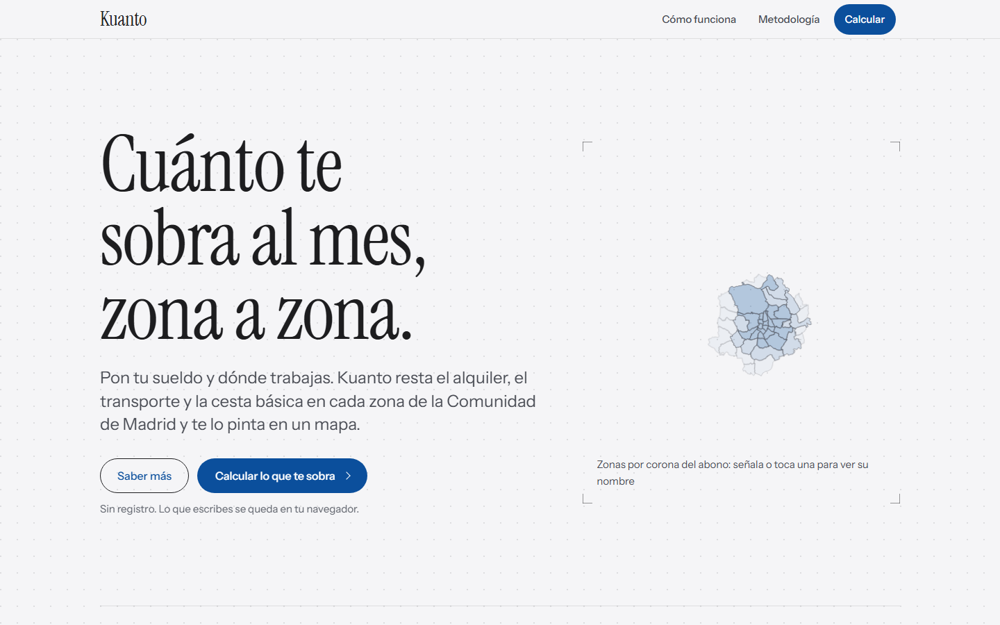
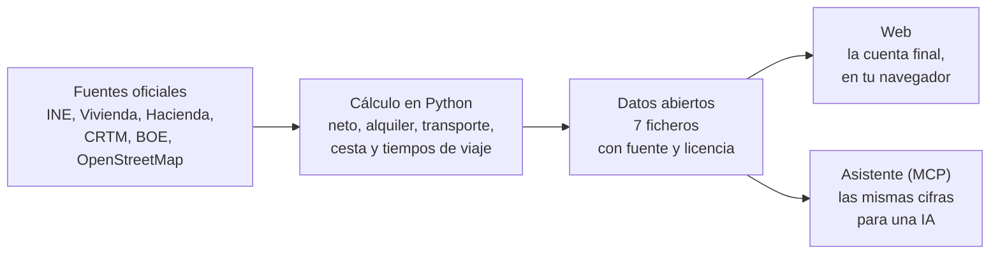

# Kuanto

**Cuánto dinero te sobra al mes según dónde vivas en la Comunidad de Madrid.**

[](https://github.com/yeraybc/DataMad-hackaton-2026/actions/workflows/pages.yml)
[](LICENSE)
[](app/datos/LEEME.md#licencia-por-fichero)

[**Abrir Kuanto**](https://yeraybc.github.io/DataMad-hackaton-2026/) · [Cómo funciona](https://yeraybc.github.io/DataMad-hackaton-2026/saber-mas.html) · [Nota metodológica](https://yeraybc.github.io/DataMad-hackaton-2026/metodologia.html) · [Informe de análisis](https://yeraybc.github.io/DataMad-hackaton-2026/informe.html)

[](https://yeraybc.github.io/DataMad-hackaton-2026/)

## El problema

Al elegir dónde vivir se compara el alquiler, pero el alquiler es solo una parte. Un piso más barato lejos del trabajo puede salir caro en abono y en horas de viaje, y lo que de verdad importa es lo que queda a fin de mes. Ese dato no lo publica nadie zona a zona: está repartido entre el INE, el Ministerio de Vivienda, la Agencia Tributaria, el Consorcio de Transportes y el BOE.

## Qué hace Kuanto

Escribes tu sueldo, cómo es tu hogar y dónde trabajas. Para cada una de las 199 zonas de la Comunidad (los 178 municipios distintos de la capital y los 21 distritos de Madrid; fuente: [`zonas.geojson`](app/datos/LEEME.md#zonasgeojson)) Kuanto hace esta cuenta y la pinta en un mapa:

```
  sueldo neto (después de IRPF y cotizaciones)
− alquiler de la zona
− abono o título de transporte más barato hasta tu trabajo
− cesta básica del hogar (comida, luz, gas, agua, teléfono)
= lo que te sobra al mes
```

Al lado pone las horas al mes que pasarías en el viaje, para que se vea lo que cuesta vivir lejos. La cuenta se hace en tu navegador: lo que escribes no sale de tu dispositivo.

## Cómo funciona



Cada fuente se descarga tal cual y se guarda con su huella digital. Un paquete de Python las cruza y publica los resultados como ficheros abiertos, que la web y el asistente leen sin servidor. Un ejemplo con cifras y lo que Kuanto no sabe están en [Cómo funciona Kuanto](docs/como-funciona.md); qué aporta cada fuente, en [Datos y fuentes](docs/datos-y-fuentes.md).

## Por qué puedes fiarte

- Cada cifra de la web dice de qué fuente oficial sale, y una comprobación automática rechaza la que no lo diga.
- Lo que sale de un modelo o de un supuesto lleva la marca «estimado», y lo que falta sale en gris en vez de inventado.
- El IRPF, las cotizaciones y las tarifas son los de 2026, con cada parámetro citado a su BOE o BOCM.
- Las afirmaciones sobre fuentes y normas se contrastaron con el publicador original ([verificaciones](docs/verificaciones/README.md)) y cada decisión del equipo está registrada con su motivo ([registro de decisiones](docs/decisiones.md)).
- Cualquier cifra se puede seguir hasta su descarga original ([trazabilidad](docs/trazabilidad.md)), y los datos de la web se regeneran desde esas descargas con un comando.
- Los supuestos y los límites están escritos en la [nota metodológica](https://yeraybc.github.io/DataMad-hackaton-2026/metodologia.html#titulo-supuestos).

## Inicio rápido

Ver la web en local, sin instalar nada más que Python:

```bash
git clone https://github.com/yeraybc/DataMad-hackaton-2026.git
cd DataMad-hackaton-2026
python -m http.server -d app      # y abre http://localhost:8000/
```

Regenerar todos los datos desde las fuentes oficiales (necesita [uv](https://docs.astral.sh/uv/getting-started/installation/) y las descargas de [`data/README.md`](data/README.md)):

```bash
uv venv && uv pip install -r requirements.txt
source .venv/bin/activate         # Windows (Git Bash): source .venv/Scripts/activate
python -m mesobra
```

Los pasos previos, los tests y el asistente MCP están en [Reproducir Kuanto](docs/reproducir.md).

## Documentación

| Si quieres… | Empieza por |
|---|---|
| Entender qué hace Kuanto, con un ejemplo | [Cómo funciona Kuanto](docs/como-funciona.md) y [preguntas frecuentes](docs/preguntas-frecuentes.md) |
| Ver en qué se diferencia de preguntar a una IA | [Kuanto frente a preguntar a una IA](docs/kuanto-frente-a-ia.md) |
| Saber qué significa un término | [Glosario](docs/glosario.md) |
| Saber de qué fuente sale cada pieza | [Datos y fuentes](docs/datos-y-fuentes.md) |
| Saber por qué Kuanto es como es | [Decisiones clave](docs/decisiones-clave.md) |
| Revisar el método, los supuestos y los límites | [Nota metodológica](https://yeraybc.github.io/DataMad-hackaton-2026/metodologia.html) e [informe de análisis](https://yeraybc.github.io/DataMad-hackaton-2026/informe.html) |
| Reutilizar los datos | [Datos abiertos de Kuanto](app/datos/LEEME.md) |
| Saber de dónde sale cada descarga | [Fuentes descargadas](data/README.md) |
| Entender cómo está construido | [Arquitectura](docs/arquitectura.md) |
| Comprobar una cifra hasta su origen | [Trazabilidad](docs/trazabilidad.md) |
| Ejecutar el código o los tests | [Reproducir Kuanto](docs/reproducir.md) |
| Colaborar en el repositorio | [CONTRIBUTING.md](CONTRIBUTING.md) |
| Ver todo lo que hay | [Mapa de la documentación](docs/README.md) |

## Datos y licencias

- **Código:** MIT ([`LICENSE`](LICENSE)).
- **Datos que publica Kuanto:** CC BY 4.0, salvo los ficheros que derivan de OpenStreetMap, que llevan ODbL 1.0. La licencia, la cita exigida por cada fuente y el diccionario de cada fichero están en [Datos abiertos de Kuanto](app/datos/LEEME.md).
- **Interoperabilidad:** los indicadores de alquiler y esfuerzo se publican también como entidades NGSI-LD del modelo `KeyPerformanceIndicator` de [Smart Data Models](https://smartdatamodels.org/), validadas contra su esquema oficial ([`app/datos/sdm/`](app/datos/sdm/LEEME.md)), para que otras plataformas puedan reutilizarlos.
- Las fuentes de terceros conservan sus condiciones. Elaboración propia con datos del INE (www.ine.es), la Comunidad de Madrid, el Ministerio de Vivienda y Agenda Urbana, la Agencia Tributaria, el Consorcio Regional de Transportes de Madrid (Powered by CRTM), el BOE y © OpenStreetMap contributors. Ninguno de ellos participa en el proyecto ni lo avala.

## Sobre el proyecto

Kuanto es el proyecto del equipo para [DataMad 2026](https://eventos.urjc.es/155632/detail/datamad-2026.html), el datathon de datos abiertos de la Comunidad de Madrid. Lo han hecho [@yeraybc](https://github.com/yeraybc), [@izan-diaz](https://github.com/izan-diaz) y [@alexjimenez-git](https://github.com/alexjimenez-git), con agentes de IA que escriben el código y revisores automáticos que lo comprueban ([cómo trabajamos](CONTRIBUTING.md)).

Dudas o errores: [abre una issue](https://github.com/yeraybc/DataMad-hackaton-2026/issues).
