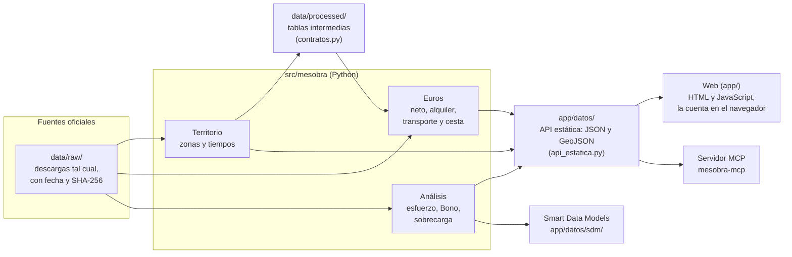

# Arquitectura

Cómo está construido Kuanto por dentro: qué piezas tiene, cómo pasan los datos de una a otra y qué reglas no se rompen nunca. Es para quien vaya a leer o cambiar el código. Para ejecutarlo, ver [Reproducir Kuanto](reproducir.md).

## Visión general

Kuanto tiene tres capas, y cada una solo lee de la anterior:

1. **Descargas** (`data/raw/`). Cada fuente se guarda tal cual, con la fecha en el nombre y su huella SHA-256 anotada en [`data/README.md`](../data/README.md). No se editan nunca.
2. **Cálculo** (`src/mesobra/`). Un paquete de Python lee las descargas, cruza las fuentes y escribe tablas intermedias en `data/processed/` y los ficheros finales en `app/datos/`.
3. **Publicación** (`app/`). Una web estática, sin servidor ni base de datos, que lee `app/datos/` y hace la última cuenta en el navegador con lo que escribe cada persona. El servidor MCP lee los mismos ficheros.

## El código, por grupos

El paquete se llama `mesobra` (el nombre de trabajo de Kuanto). Cada módulo hace una cosa y se puede ejecutar solo con `python -m mesobra.<módulo>`.

| Grupo | Módulo | Qué hace |
|---|---|---|
| Orquestación | `__main__` | `python -m mesobra`: comprueba las descargas, ejecuta los pipelines en orden y valida `app/datos/` |
| Territorio | `zonas` | Las 199 zonas: disuelve secciones censales, calcula el centro de población y su corona tarifaria |
| | `paso_secciones` | Pasa las secciones censales de 2021 (las del SERPAVI) a las de 2025 (las del ADRH) |
| | `tiempos` | Tiempos en transporte público entre zonas y hacia los polos de empleo, con r5py |
| | `coche` | Tiempos en coche entre los mismos puntos, sin tráfico |
| | `polos` | Polos de empleo con nombre, como destinos de trabajo |
| | `lineas_estimadas` | Reconstruye las líneas que el GTFS del CRTM publica sin viajes; lo que sale es estimado |
| | `fondo` | El mapa base propio de la web, que funciona sin red |
| | `pipeline_territorio` | Escribe `zonas.geojson` y `tiempos.json` |
| Euros | `neto` y `parametros_2026` | Del bruto al neto con las cotizaciones y el IRPF de 2026, con cada parámetro citado a su norma |
| | `alquiler` | Alquiler por zona desde el SERPAVI, actualizado con el IPC y ajustado a contrato nuevo |
| | `imputacion` | Estima el €/m² de las zonas sin dato del SERPAVI |
| | `transporte` | El título de transporte más barato al mes por la ruta real, con los precios de 2026 |
| | `hogares` | La cesta básica por perfil de hogar |
| | `pipeline_euros` | Escribe `netos.json`, `alquiler.json`, `tarifas.json` y `hogares.json` |
| Análisis | `renta` | Renta, desigualdad y hogares del ADRH por zona y sección |
| | `esfuerzo` | Esfuerzo de alquiler: alquiler mediano sobre la renta del hogar |
| | `bono` y `bono_inferencia` | El Bono Alquiler Joven frente a la necesidad, con regresión espacial |
| | `sobrecarga` y `sobrecarga_ecv` | Hogares inquilinos en sobrecarga, por modelo y con la ECV |
| | `censo2021`, `matriz_trabajo` | Tenencia por edad y dónde trabajan los residentes de cada municipio |
| | `simulacion`, `titulares` | Simulación del Bono y sueldos de referencia |
| | `figuras`, `pipeline_analisis` | Las figuras y `analisis.json` del informe |
| Contratos y acceso | `contratos` | Esquema de cada tabla de `data/processed/`, comprobado al escribirla |
| | `api_estatica` | Esquema de cada fichero de `app/datos/`, comprobado al final de `python -m mesobra` |
| | `calculo` | La cuenta final en Python, igual que `app/calculo.js` |
| | `mcp_servidor` | El servidor MCP: `calcular_sobrante`, `ranking_zonas` e `indicadores_zona` |
| | `sdm` | Los indicadores en el esquema Smart Data Models |

## La web

`app/` se publica tal cual en GitHub Pages, sin compilar. Sus piezas principales:

| Fichero | Qué es |
|---|---|
| `index.html`, `portada.js` | La portada, con el plano animado de las zonas, y la herramienta |
| `app.js` | Conecta la página: carga los datos, crea el mapa y lo repinta al cambiar el formulario |
| `vista.js` | Validación del formulario, escalas de color, leyenda y textos, en funciones puras sin DOM |
| `calculo.js` | La cuenta final, la misma que `src/mesobra/calculo.py` |
| `saber-mas.html`, `metodologia.html`, `informe.html`, `indice.js` | Las explicaciones públicas y el índice que resalta la sección que se lee |
| `informe.js`, `informe.pdf`, `img/g01.svg` a `g14.svg` | Los gráficos interactivos del informe técnico (de `mesobra.informe_figuras`) y su versión en PDF |
| `datos/` | La API estática, descrita en [`app/datos/LEEME.md`](../app/datos/LEEME.md) |
| `mapa/`, `fuentes/`, `vendor/` | El mapa base, las tipografías y MapLibre, servidos desde la propia web |

## Reglas que no se rompen

- **La web y el servidor MCP solo leen `app/datos/`.** No llaman a ninguna API externa ni a ningún servidor propio.
- **El sueldo no sale del navegador.** La cuenta personal se hace en el dispositivo de quien la usa.
- **`data/raw/` no se edita.** Una fuente nueva o actualizada es un fichero nuevo, con su fecha y su SHA-256.
- **Cada fichero publicado dice de dónde sale.** El bloque `meta` de cada JSON lleva `fuentes` (nombre, URL y licencia) y `nota` (método y supuestos).
- **Lo modelado se marca.** Lo que sale de un modelo o de un supuesto lleva «estimado», y lo que falta es `null`, no cero.
- **La cuenta está escrita dos veces y se comprueba que coincide.** `tests/test_paridad.py` exige las mismas cifras en Python y en JavaScript para las 199 zonas.

## Tests

| Dónde | Qué prueban | Cómo se ejecutan |
|---|---|---|
| `tests/` | El código de `src/` (un fichero por módulo), los contratos de datos y los hooks del repositorio | `pytest -q` |
| `app/*.test.js` | La lógica de la web: la cuenta, la vista y el índice | `npm test` |
| `tests/fixtures/` | Casos de referencia compartidos por los dos lenguajes | — |

La CI ejecuta los dos en cada PR, junto con las comprobaciones de documentación y de cifras con fuente. Cómo se sigue una cifra desde la web hasta su descarga original está en [Trazabilidad](trazabilidad.md).
