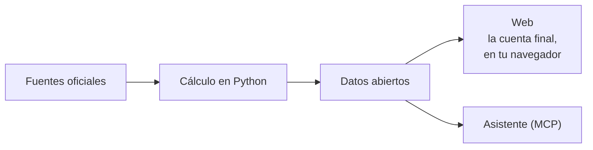

# Hoja de ruta de Kuanto

Qué hace Kuanto hoy y a dónde queremos llevarlo. Son intenciones, sin fechas ni compromisos: el orden puede cambiar según los datos que aparezcan y lo que pida quien lo usa. Lo ya decidido está en el [registro de decisiones](decisiones.md).

Las mismas ideas, en tarjetas, en el [tablero de la hoja de ruta](https://github.com/users/izan-diaz/projects/1). Si algo no coincide, manda este documento.

## De un vistazo

```mermaid
flowchart LR
  subgraph H["Hoy"]
    H1["Lo que te sobra al mes,<br>zona a zona"]
  end
  subgraph S["Siguiente"]
    S1["Frontera eficiente"]
    S2["Evolución del esfuerzo"]
    S3["Comparador de ofertas"]
    S4["Exportar y compartir"]
    S5["Simulador de presupuesto"]
  end
  subgraph D["Después"]
    D1["Dónde poner la oficina"]
    D2["Calidad de vida"]
    D3["¿Compensa vivir lejos?"]
    D4["API pública"]
  end
  subgraph M["Más adelante"]
    M1["Auditor de contratos"]
    M2["Grandes ciudades<br>y toda España"]
    M3["Más colaboradores"]
  end
  H --> S --> D --> M
```

| Horizonte | Qué significa |
|---|---|
| **Siguiente** | Sale casi todo de los datos y cálculos que ya hay |
| **Después** | Pide datos nuevos o una capa nueva |
| **Más adelante** | Pide más territorio, más manos o resolver antes un límite serio |

## Kuanto hoy

Kuanto calcula, para cada una de las 199 zonas de la Comunidad de Madrid (fuente: [`zonas.geojson`](../app/datos/LEEME.md#zonasgeojson)), el sueldo neto menos el alquiler, el transporte y la cesta básica, y lo pinta en un mapa junto a las horas de viaje.

Sobre esto se construye lo que viene:

| Ya existe | Dónde |
|---|---|
| La cuenta final en el navegador, sin que tus datos lleguen a ningún servidor | [Arquitectura](arquitectura.md) |
| Los resultados como ficheros abiertos, que la web lee sin servidor | [`app/datos/`](../app/datos/LEEME.md) |
| Un asistente MCP para consultarlos desde una IA | [Reproducir Kuanto](reproducir.md) |
| Un enlace que guarda lo que has escrito en el formulario | [`app/vista.js`](../app/vista.js) |
| Un informe técnico en web y PDF, con el cambio del esfuerzo del alquiler entre 2015 y 2024 | [Informe de análisis](https://yeraybc.github.io/DataMad-hackaton-2026/informe.html) |

## Siguiente

### Frontera eficiente

- **Para quién:** personas y administración.
- **Qué hace:** enfrenta lo que sobra con las horas de viaje en las 199 zonas (fuente: [`zonas.geojson`](../app/datos/LEEME.md#zonasgeojson)). Una persona ve dónde, con el mismo tiempo de viaje, le queda más dinero. La administración ve qué zonas dominan a otras.
- **Qué reutiliza:** el sobrante y los tiempos que ya calcula la web.
- **Qué hace falta:** el gráfico y una regla escrita para decidir cuándo una zona domina a otra, teniendo en cuenta la incertidumbre del alquiler.
- **Condición:** las zonas sin dato siguen sin cifra.

### Evolución del esfuerzo del alquiler, 2015-2024

- **Para quién:** personas y administración.
- **Qué hace:** muestra si una zona se está encareciendo y dónde crece la presión.
- **Qué reutiliza:** el análisis del informe. De 142 zonas con dato en los dos años, el esfuerzo sube en 68, pero solo en 31 sube más que su error (estimado; fuente: SERPAVI y ADRH, 2015-2024, [informe técnico](https://yeraybc.github.io/DataMad-hackaton-2026/informe-tecnico.html)).
- **Qué hace falta:** llevarlo del informe a la herramienta, con el error de cada zona a la vista.
- **Condición:** los datos recogen todos los contratos declarados, también los antiguos, así que no dicen cuánto cuesta alquilar hoy.

### Comparador de dos ofertas de trabajo

- **Para quién:** personas; también administración y empresas.
- **Qué hace:** con dos ofertas, aunque paguen lo mismo, muestra en cuál te sobra más. A una empresa o una administración le sirve para argumentar la viabilidad de una ubicación.
- **Qué reutiliza:** la cuenta actual, ejecutada una vez por cada lugar de trabajo.
- **Qué hace falta:** una pantalla que compare las dos.
- **Condición:** los mismos supuestos en las dos ofertas.

### Exportar y compartir

- **Para quién:** personas y administración.
- **Qué hace:** permite llevarse el resultado en CSV, JSON o informe imprimible, y compartirlo, con sus fuentes y supuestos. La administración puede descargar los datos agregados.
- **Qué reutiliza:** el enlace del formulario y los ficheros de [`app/datos/`](../app/datos/LEEME.md).
- **Qué hace falta:** la exportación y un enlace pensado para compartir.
- **Condición:** un enlace para compartir no lleva el sueldo. Hoy la dirección de la página guarda todo el formulario, sueldo incluido, así que esto hay que cambiarlo.

### Simulador de presupuesto

- **Para quién:** personas.
- **Qué hace:** metes lo que gastas en total y ves qué parte puedes ahorrar entera y dónde se puede recortar, para cuidar tu salud financiera.
- **Qué reutiliza:** el sueldo neto y la cesta básica.
- **Qué hace falta:** categorías de gasto con una fuente de referencia (la Encuesta de Presupuestos Familiares del INE es la candidata).
- **Condición:** todo en el navegador, y no es asesoramiento financiero.

## Después

### Dónde poner la oficina

- **Para quién:** empresas.
- **Qué hace:** una pestaña que señala las mejores zonas para las oficinas según el alquiler de la zona, el rendimiento de la empresa y las necesidades logísticas, con el mismo rigor que la herramienta actual.
- **Qué reutiliza:** las zonas, los mapas y el sistema de fuentes. No entra el transporte desde tu trabajo.
- **Qué hace falta:** una fuente de alquiler de oficinas y locales (la actual es de vivienda), datos logísticos y un método de puntuación explicado.
- **Condición:** lo que escriba la empresa no sale de su navegador.

### Calidad de vida

- **Para quién:** personas y administración.
- **Qué hace:** cruza cada zona con criminalidad, abundancia o escasez de servicios, ruido, contaminación y otros indicadores.
- **Qué reutiliza:** las zonas y la forma de unir fuentes por código oficial.
- **Qué hace falta:** localizar cada fuente, comprobar su licencia y a qué escala llega, y repartirla a las zonas cuando venga en otra unidad.
- **Condición:** si un indicador solo existe por municipio o por estación de medida, se dice; no se inventa el detalle.

### ¿Compensa vivir lejos?

- **Para quién:** personas y administración.
- **Qué hace:** mapas y gráficos de las zonas donde sí compensa vivir más lejos, y un informe de dónde el transporte o la vivienda cerca del empleo marcan la diferencia.
- **Qué reutiliza:** la cuenta, los tiempos de viaje y la frontera eficiente.
- **Qué hace falta:** definir con qué perfiles se calcula y cuánto vale una hora de viaje.
- **Condición:** el informe dice para qué perfiles vale y no extiende la conclusión a los demás.

### API pública

- **Para quién:** otros servicios, desarrolladores y administración.
- **Qué hace:** permite usar los datos de Kuanto con facilidad desde fuera.
- **Qué reutiliza:** los ficheros estáticos de [`app/datos/`](../app/datos/LEEME.md) y el asistente MCP.
- **Qué hace falta:** documentación, versiones y un contrato estable, para que un cambio no rompa a quien la usa.
- **Condición:** cada fichero conserva su licencia y su cita.

## Más adelante

### Auditor de contratos de alquiler

- **Para quién:** personas que alquilan.
- **Qué hace:** ayuda a leer la letra pequeña: señala cláusulas que chocan con la ley o con los datos oficiales, si el contrato te beneficia como inquilino y si cumple lo que necesitas.
- **Qué reutiliza:** el funcionamiento en el navegador y los datos de alquiler por zona.
- **Qué hace falta:** las normas citadas una a una, casos de prueba y revisión jurídica.
- **Condición:** el contrato no sale de tu dispositivo, y el resultado no sustituye a un abogado.

### Grandes ciudades y toda España

- **Para quién:** personas, administración y empresas.
- **Qué hace:** amplía las bases de datos para ganar precisión y alcance, primero en las grandes ciudades y después a nivel nacional.
- **Qué reutiliza:** la arquitectura por capas y el proceso de alta de fuentes.
- **Qué hace falta:** horarios de transporte, tarifas e IRPF de cada territorio, que cambian de una comunidad a otra.
- **Condición:** un territorio se publica cuando sus cifras pasan los mismos controles que las de Madrid.

### Más colaboradores

- **Para quién:** quien quiera contribuir.
- **Qué hace:** suma personas que se centren en un área (datos, cálculo, territorio, web), para ganar fiabilidad y calidad en cada capa.
- **Qué reutiliza:** la guía de [contribución](../CONTRIBUTING.md) y los revisores obligatorios por área.
- **Qué hace falta:** repartir responsables por área y preparar tareas de entrada.
- **Condición:** las mismas reglas para todos.

## Lo que no cambia

- Cada cifra pública lleva su fuente, y lo que sale de un modelo o un supuesto dice «estimado».
- Sin dato antes que inventado.
- Lo que escribes se queda en tu navegador.
- Datos abiertos, con licencia y cita.
- Cada cambio pasa por la CI y por los revisores de su área.

El porqué de cada una está en [decisiones clave](decisiones-clave.md).

## Proponer una idea

[Abre una issue](https://github.com/yeraybc/DataMad-hackaton-2026/issues) y cuenta qué problema resuelve, para quién y con qué datos.
