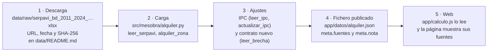

# Trazabilidad

Cómo se sigue cualquier cifra de Kuanto hasta el dato original que la produce, y qué impide que llegue a la web una cifra sin fuente. Es para quien quiera comprobar un resultado o auditar el proyecto.

## La cadena de una cifra

Ejemplo: el alquiler de una zona que aparece en la ficha de la web.

1. **Descarga.** El fichero del SERPAVI se guarda tal cual en `data/raw/`, con la fecha en el nombre. Su fila en [`data/README.md`](../data/README.md) da la URL de origen, la fecha de modificación, la licencia y la huella SHA-256. `python -m mesobra` no arranca si la huella no coincide.
2. **Carga.** `alquiler.py` lee el Excel y comprueba su estructura antes de usarlo. Cada constante con un límite (como el mínimo de alquileres declarados para fiarse de una mediana) lleva al lado el motivo y la issue que lo decidió.
3. **Ajustes.** Llevar el precio a hoy con el IPC y ajustarlo a contrato nuevo son pasos aparte, con su propia fuente y marcados como estimación.
4. **Fichero publicado.** `alquiler.json` lleva en su bloque `meta` cada fuente con su URL y su licencia, el año del dato y una nota con el método y los supuestos. `api_estatica.py` comprueba su forma antes de darlo por bueno.
5. **Web.** La web lee ese fichero y hace la cuenta. Junto al mapa, el desplegable «Fuentes, método y licencias» enseña las fuentes, las licencias y las notas de cada fichero, con sus fechas de actualización y la marca de lo estimado.

Todas las cifras siguen el mismo camino. Para cualquier otra, el punto de entrada es el bloque `meta` de su fichero en `app/datos/`, descrito en [Datos abiertos de Kuanto](../app/datos/LEEME.md).

## Qué lo respalda

| Pieza | Qué garantiza | Dónde |
|---|---|---|
| Huellas SHA-256 | Que todo el mundo trabaja con los mismos ficheros originales | [`data/README.md`](../data/README.md) |
| Contratos de datos | Que cada tabla intermedia y cada fichero publicado tienen las columnas, tipos y claves esperados | `src/mesobra/contratos.py`, `src/mesobra/api_estatica.py` |
| Verificaciones | Que las afirmaciones sobre fuentes, normas y licencias coinciden con el publicador original | [`docs/verificaciones/`](verificaciones/) |
| Registro de decisiones | Por qué se eligió cada fuente, método o supuesto, con fecha y PR | [`docs/decisiones.md`](decisiones.md) |
| Normas citadas | Que cada parámetro del IRPF, de las cotizaciones y de las tarifas cita su BOE o BOCM | `src/mesobra/parametros_2026.py`, `src/mesobra/transporte.py` |
| Tests | Que el neto coincide con los ejemplos de la Agencia Tributaria, los precios con los del BOCM y la cuenta de Python con la de JavaScript | `tests/`, [Validación](https://kuantoapp.github.io/metodologia.html#titulo-validacion) |

## Qué impide que se cuele una cifra sin fuente

Estas comprobaciones las hacen máquinas, en cada cambio:

- **Cifras con fuente.** En la web, cada línea con una cifra necesita una nota de fuente. Un hook lo comprueba al editar y la CI en cada PR. Si la cifra es estimada, debe decirlo ([AGENTS.md](../AGENTS.md#cifras-con-fuente)).
- **Revisores por área.** Un cambio que toca cálculos normativos, trabajo espacial, cifras públicas o fuentes de datos necesita el veredicto de un agente revisor especializado, y la CI no deja mergear sin él ([AGENTS.md](../AGENTS.md#revisores-obligatorios)).
- **Descargas intocables.** Un hook impide editar, mover o borrar nada de `data/raw/`.
- **Documentación al día.** La CI comprueba que la documentación no nombra rutas que ya no existen y que cada cambio de fuentes o reglas arrastra la suya.

## Cómo compruebo yo una cifra

1. En la web, abre «Fuentes, método y licencias» junto al mapa, o la nota de la cifra en las páginas de explicación, y mira si dice «estimado».
2. Abre el fichero de `app/datos/` que la produce (por ejemplo, `alquiler.json` para el alquiler) y lee su bloque `meta`: fuentes, año del dato y método.
3. Busca la fuente en [`data/README.md`](../data/README.md), descárgala de la URL original y compara su SHA-256 con el anotado.
4. Si quieres rehacer el cálculo, sigue [Reproducir Kuanto](reproducir.md). `git status` te dirá si tus ficheros de `app/datos/` salen distintos de los publicados.
5. Si algo no cuadra, [abre una issue](https://github.com/Kuantoapp/kuantoapp.github.io/issues).
