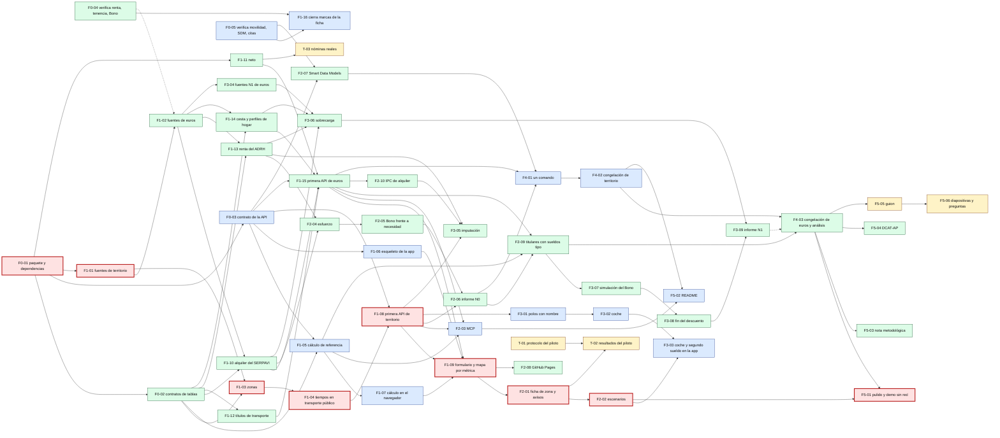

# Plan de desarrollo de «¿Me sobra?»

Plan de ejecución de la ficha [propuesta-A-unificada.md](propuesta-A-unificada.md) · escrito el 14 de noviembre de 2026 · manda `AGENTS.md`; la ficha manda en el qué y este plan en el cómo, el orden y el reparto.
Los identificadores `F1-04` son estables. Las duraciones, los tamaños y los umbrales marcados «(supuesto)» son estimaciones.

## Resumen

**Qué se enseña el 26 de noviembre.** Una web estática publicada en la que una persona escribe su sueldo, su hogar, dónde trabaja y cuántos días va, y ve en un mapa de 199 zonas a cuánto le pagan cada hora extra de viaje, cuánto le sobra al mes y cuántas horas pasa en el transporte; cambia los días de teletrabajo o quita el descuento del abono y el mapa se mueve. Un informe para la Administración con el esfuerzo de alquiler sobre renta, el Bono Alquiler Joven frente a la necesidad y los titulares con sueldos tipo. Una pregunta en directo a un asistente conectado al servidor MCP, que responde con las mismas cifras. Los datos derivados, abiertos y en esquema de Smart Data Models, y un repositorio que lo regenera todo con un comando.

**Camino crítico.** F0-01 (paquete) → F1-01 (fuentes de territorio) → F1-03 (zonas) → F1-04 (tiempos con r5py) → F1-08 (primera API de territorio) → F1-09 (formulario y mapa: esqueleto del 18) → F2-01 → F2-02 → F5-01, con la congelación del 22 (F4-02 y F4-03) como paso obligado antes de F5-01. La pieza con más riesgo es F1-04: tiene una puerta de decisión el 16 por la noche y tres planes B. La cadena de euros (F1-02 → F1-10 → F1-15) llega al mismo punto, F1-09, el 17 por la noche, sin holgura. Si H1 se va al 19, F2-01 y F2-02 se retrasan un día y F3-03 queda fuera.

**Reparto en una frase.** Izan lleva el territorio, el tiempo y la herramienta (zonas, tiempos de viaje, cálculo de referencia, web y MCP); Yeray lleva los euros y el análisis (alquiler, renta, neto, tarifas, cesta, esfuerzo, Bono, sobrecarga, informe y Smart Data Models); el piloto con usuarios y el relato van en un tercer carril sin asignar.

**Decisiones humanas pendientes** (detalle en la sección 6):

| Fecha límite | Decisión |
|---|---|
| 15 nov, 10:00 | Yeray confirma u objeta el stack, la excepción de `app/datos/` y el reparto (D1–D3), ya elegidos por Izan |
| 16 nov | Confirmar el 22 como fecha de congelación (D4); quién lleva el tercer carril (D7); escribir a la organización por las bases (D8) y por las licencias (D12) |
| 16 nov, 20:00 | Puerta de r5py: seguir, o plan B de tiempos (D6) |
| 18 nov, 20:00 | Hacer público el repositorio y activar Pages (D5); si arrancan la imputación y la sobrecarga (D9) |
| 20 nov, 20:00 | Corte de N1: qué entra en la congelación (D9) |
| 22 nov, 20:00 | Firma de la congelación (D10) |
| 23 nov, 12:00 | Titular y apertura del pitch (D11) |

## 1. Alcance priorizado contra las fechas

**Hitos.**

| Fecha | Hito | Se comprueba con |
|---|---|---|
| 15 nov (dom) | H0 · Paquete y contratos mergeados | F0-01, F0-02 y F0-03 en `main` |
| 18 nov (mié), colchón el 19 | H1 · Esqueleto de punta a punta: datos reales → cálculo → web que pinta el mapa | F1-09 mergeada con `app/datos/` real de los dos carriles |
| 20 nov (vie) | H2 · Todo N0 de la herramienta y del análisis en `main`; corte de N1 | F2-01, F2-02, F2-06 y F2-09 mergeadas; decisión D9 |
| 22 nov (dom) | H3 · Datos y cálculos congelados | F4-02 y F4-03 mergeadas y etiqueta `datos-congelados-2026-11-22` |
| 23–25 nov | H4 · Web pulida, informe, nota metodológica, pitch y dos ensayos | Lista de comprobación de la sección 8 |
| 26 nov (jue) | H5 · Presentación ante el jurado | — |

**Niveles.** N0 es lo que define la idea (los siete puntos de la ficha; la sección 15 nombra sobrante, esfuerzo y Bono). N1 la refuerza. N2 son extras. El MCP y Smart Data Models van en N0 porque el punto 7 de la ficha los nombra, pero fuera del camino crítico y con su plan B.

| Pieza (ficha) | Nivel | Issues | Si es N1 o N2: señal que la deja fuera, y qué queda |
|---|---|---|---|
| Fuentes de N0, verificaciones, zonas y renta (4, 12, 16) | N0 | F0-04, F0-05, F1-01, F1-02, F1-03, F1-13, F1-16 | — |
| Sobrante, horas, precio de la hora, esfuerzo, banda (6) | N0 | F1-05, F1-07, F1-09 | — |
| Neto desde el bruto (6.1) | N0 | F1-11 | Plan B: entrada solo de neto mensual |
| Alquiler por zona con rango; zonas «sin dato» (6.2, 6.7) | N0 | F1-10, F1-15 | — |
| Actualización del alquiler con el IPC regional (6.2) | N0 | F2-10 | Plan B: factor 1,0 y año del dato a la vista |
| Tarifas y título más barato (6.3) | N0 | F1-12 | — |
| Cesta básica y perfiles de hogar (6.4, 5) | N0 | F1-14 | — |
| Tiempo en transporte público entre zonas (6.5) | N0 | F1-04, F1-08 | Planes B1–B3 en F1-04 |
| Herramienta: formulario, mapa, ficha, diez zonas, avisos (5) | N0 | F1-06, F1-09, F2-01, F5-01 | — |
| Escenarios individuales (9) | N0 | F2-02 | — |
| Esfuerzo alquiler/renta por zona y año (7.1) | N0 | F2-04, F2-06 | — |
| Bono frente a necesidad, con correlación controlada por renta (7.3, 10.1 municipal) | N0 | F2-05, F2-06 | — |
| Titulares con sueldos tipo (8) | N0 | F2-09 | — |
| MCP local (11.3) | N0 | F2-03 | Plan B: demo grabada |
| Indicadores en Smart Data Models (11.1) | N0 | F2-07 | Plan B: contexto JSON-LD propio |
| API estática abierta, publicación, un comando, README, nota metodológica (11.2, 11.4, 13) | N0 | F0-03, F2-08, F4-01, F5-02, F5-03 | — |
| Guion, diapositivas y preguntas (18) | N0 | F5-05, F5-06 | — |
| Fuentes de las piezas N1 (12) | N1 | F3-04 | El 20 sin registrar una fuente → fuera la issue que la consume |
| Polos de empleo con nombre (6.5) | N1 | F3-01 | El 19 sin mergear → los personajes usan el distrito o municipio de su trabajo |
| Coche y segundo sueldo (6.3, 5) | N1 | F3-02, F3-03 | El 20 a las 12:00 sin `tiempos.json` real o sin F2-01 → fuera el coche; el 21 a las 12:00 sin F2-02 → fuera F3-03 |
| Imputación de zonas sin dato (6.7) | N1 | F3-05 | Solo arranca con el visto bueno de S3. El 21 a las 12:00 sin veredicto espacial o con cobertura real más de 10 puntos bajo la nominal → zonas «sin dato» |
| Sobrecarga log-normal (7.2) | N1 | F3-06 | Solo arranca con el visto bueno de S3. El 21 a las 18:00 fuera del margen de la cifra de control, o sin cifra de control → no se publica; el Bono usa el esfuerzo |
| Simulación del criterio del Bono (7.4) y fin del descuento agregado (7.5) | N1 | F3-07, F3-08 | El 21 a las 20:00 sin mergear → fuera; queda el escenario individual |
| Informe con las piezas N1 (7) | N1 | F3-09 | Se reduce a lo que haya llegado |
| Metadatos DCAT-AP (11.2) | N1 | F5-04 | El 23 a las 14:00 sin F4-03 → el README describe los ficheros |
| Piloto con usuarios (10.3) | N1 | T-01, T-02 | El 17 sin responsable → fuera, y el impacto es el análisis del Bono; con responsable y sin web publicada el 20 → prueba de uso en local con cinco personas |
| Nóminas reales (6.1, 10.2) | N1 | T-03 | El 18 sin nóminas → auditoría y casos de control |
| Deslizador del valor del tiempo (6.5) · destino libre con rejilla (6.5) · zoom a barrios con el alquiler por código postal (4, 6.2) · polos obtenidos de la EDM2018 y del MITMA, y el indicio de la sección 8 (6.5, 8) · déficit de transporte (7.6) · rentabilidad implícita con el Notariado (7.7) · validación externa por distrito (10.1) · precio de oferta (6.2) · propuesta al catálogo y modelo nuevo de Smart Data Models (11.1, 11.2) · instancia remota del MCP (11.3) | N2 | Sin issue | Solo se abre issue si el 20 por la noche todo N0 está mergeado y la persona tiene un agente libre, en este orden: barrios con el alquiler por código postal del catálogo regional, deslizador, polos de datos. El resto no entra antes del 26 |

**Catálogo regional en N0.** El punto 4 de la ficha lo pone en el centro, así que N0 usa del catálogo: el Bono Alquiler Joven por municipio (F2-05), el IPC de alquiler (F2-10) y, si F0-04 y F0-05 lo confirman, la población por edad y los datos del Consorcio (GTFS y coronas). La tenencia entra con N1 (F3-06) y el alquiler por código postal es el primer N2. El valor catastral, los afiliados, el paro, `zt84` y el portal del Ayuntamiento no entran antes del 26: solo los usan piezas N2 o son contexto.

## 2. Contratos de datos entre carriles

**Regla de integración.** Un carril nunca lee `data/processed/` del otro: lo que cruza de carril pasa por los ficheros versionados de `app/datos/` (o, antes de que existan, por su ejemplo de `tests/fixtures/api/`). Así cada persona solo necesita las fuentes de su carril, y la web, el MCP y el análisis leen lo mismo. Cambiar un contrato es un PR propio y pequeño, avisado en la sincronización del día.

**Claves.** `zona_id` (texto): código INE de 5 dígitos para los 178 municipios (`28065`) y `28079` + distrito de 2 dígitos para los 21 distritos de Madrid (`2807913`). `seccion_id` (texto, 10 dígitos). `anio` (entero). `destino_id` (texto): un `zona_id` o `polo:<slug>`. Zonas de los fixtures: `2807901`, `2807913`, `28065`, `28092` y `28001` (esta, sin dato de alquiler).

**Tablas de `data/processed/`** (`alquiler_zona`, `renta` y `esfuerzo` llevan además la fila de Madrid entero, `28079`, que no es una de las 199 zonas y solo usa el análisis por municipio; Parquet en local; fixture CSV en `tests/fixtures/processed/<tabla>.csv`; definición en código y validación en F0-02).

| Tabla · grano · clave | Columnas (tipo, unidad) | Produce | Consume |
|---|---|---|---|
| `zonas` · zona · `zona_id` | `nombre` texto; `tipo` {municipio, distrito}; `municipio_id` texto; `corona` {A, B1, B2, B3, C1, C2}; `poblacion` entero (personas); `lon_centro`, `lat_centro` decimal (grados, EPSG:4326); geometría en EPSG:25830 | F1-03 | F1-04, F1-08, F3-01, F3-02 |
| `tiempos` · origen × destino × modo · `zona_id`, `destino_id`, `modo` | `modo` {tp, coche}; `minutos` decimal (mediana puerta a puerta, salidas de 7:30 a 8:30 de un martes; nulo sin ruta en 120 min); `km` decimal (solo coche); `estimado` booleano (verdadero si sale de la línea base por distancia) | F1-04, F3-01, F3-02 | F1-08 |
| `alquiler_zona` · zona × año · `zona_id`, `anio` | `eur_m2_p25`, `eur_m2_p50`, `eur_m2_p75` decimal (€/m² al mes, vivienda colectiva); `m2_p50` decimal (m²); `testigos` entero; `origen` {observado, estimado, sin_dato}; `ic_inf`, `ic_sup` decimal (€/m² al mes, solo estimado); `factor_ipc` decimal (1,0 sin actualizar) | F1-10, F3-05, F2-10 | F1-15, F2-04 |
| `alquiler_seccion` · sección × año · `seccion_id`, `anio` | `eur_m2_p25/p50/p75` decimal (€/m² al mes); `cuantia_p25/p50/p75` decimal (€/mes); `testigos` entero | F1-10 | F3-06 |
| `renta` · unidad × año · `unidad_id`, `nivel`, `anio` | `nivel` {zona, seccion}; `renta_hogar` decimal (€/año, media por hogar); `renta_uc` decimal (€/año por unidad de consumo); `gini` decimal (0–100); `p80p20` decimal; `poblacion` entero; `tam_hogar` decimal (personas) | F1-13 | F2-04, F3-05, F3-06 |
| `netos` · bruto × configuración · `bruto_anual`, `hijos`, `monoparental` | `bruto_anual` entero (€, cada 250); `hijos` {0, 1, 2}; `monoparental` booleano; `cotizacion`, `cuota_irpf`, `neto_anual` decimal (€/año) | F1-11 | F1-15 |
| `tarifas` · escenario × edad × corona × días · las cuatro | `escenario` {vigente_2026, sin_descuento}; `joven` booleano; `corona` texto; `dias` 1–5; `titulo` texto; `coste_mes` decimal (€/mes) | F1-12 | F1-15, F3-08 |
| `hogares` · perfil · `perfil` | `perfil` {solo, comparte, pareja, monoparental}; `adultos`, `hijos`, `personas_comparten` entero; `alimentacion`, `suministros` decimal (€/mes); `anio` entero | F1-14 | F1-15, F3-06 |
| `esfuerzo` · zona × año · `zona_id`, `anio` | `alquiler_mes_p50`, `renta_hogar_mes` decimal (€/mes); `esfuerzo` decimal (proporción) | F2-04 | F2-05, F2-06 |
| `bono` · municipio · `municipio_id` | `solicitudes`, `aceptadas`, `rechazadas`, `poblacion_joven` entero; `necesidad` decimal; `indicador_necesidad` {esfuerzo, sobrecarga}; `grupo` texto | F2-05 | F2-06 |
| `sobrecarga` · zona × año · `zona_id`, `anio` | `pct_40_inf`, `pct_40_sup`, `pct_30_inf`, `pct_30_sup` decimal (% de hogares inquilinos); `dif_sigma` decimal | F3-06 | F3-08, F3-09 |
| `simulacion` · perfil × municipio × criterio · las tres | `perfil` texto; `municipio_id` texto; `criterio` texto; `elegible` booleano; `eur_mes` decimal (€/mes); `estimado` booleano | F3-07, F3-08 | F3-09 |

**Ficheros de la API estática, `app/datos/`** (JSON compacto en UTF-8; `null` donde falta; cada uno con un bloque `meta`: fecha de generación, año del dato, fuentes con nombre, URL y licencia; ejemplo en `tests/fixtures/api/`; validador en F0-03).

| Fichero · grano · clave | Contenido (unidad) | Produce | Consume |
|---|---|---|---|
| `zonas.geojson` · zona · `zona_id` | Polígonos simplificados en EPSG:4326; propiedades `zona_id`, `nombre`, `tipo`, `municipio_id`, `corona`, `poblacion` | F1-08, F4-02 (Izan) | Web, MCP, F2-06, F3-05, F3-08 |
| `tiempos.json` · origen × destino | `origenes` (lista de `zona_id`), `destinos` (lista con `destino_id`, `nombre`, `tipo`), `tp` (matriz de minutos enteros), y si existen `coche` (minutos), `km_coche` y parámetros de coste | F1-08, F4-02 (Izan) | Web, MCP, F2-09, F3-05, F3-07 |
| `alquiler.json` · zona · `zona_id` | Por zona: `anio`, `p25`, `p50`, `p75` (€/m² al mes), `m2`, `factor_ipc`, `origen`, `ic` | F1-15, F4-03 (Yeray) | Web, MCP, F2-07 |
| `netos.json` · bruto × configuración | `brutos` (€), `configuraciones`, matriz `neto_anual` (€/año) | F1-15, F4-03 (Yeray) | Web, MCP |
| `tarifas.json` · escenario × edad × corona × días | `orden_coronas`, `edad_max_joven`, y por escenario el `coste_mes` (€/mes) y el `titulo` | F1-15, F4-03 (Yeray) | Web, MCP |
| `hogares.json` · perfil | Valores por defecto del hogar, m² por defecto (lo añade F1-15 desde `alquiler_zona`) y cesta (€/mes) | F1-15, F4-03 (Yeray) | Web, MCP |
| `analisis.json` · zona o municipio | Bloques `esfuerzo` (zona × año), `bono` (municipio), `titulares`, y si existen `sobrecarga` y `simulacion` | F2-06, F2-09, F4-03 (Yeray) | Informe, MCP, F2-07, F5-05 |
| `sdm/` · entidad | Los indicadores en el modelo de Smart Data Models elegido | F4-03, con el código de F2-07 (Yeray) | Reutilizadores |
| `tests/fixtures/casos_referencia.json` · caso | Entradas y salidas esperadas del cálculo | F1-05 (Izan) | F1-07, F2-03 |

## 3. Issues

Borradores: al crear las issues en GitHub, cada bloque se sustituye por una fila con su enlace.

### F0 · Cimientos

#### F0-01 · chore(src): paquete mesobra con dependencias fijadas y licencia MIT

- **Nivel:** N0 · **Dueño:** Izan · **Día:** 15 nov · **Área:** infra
- **Depende de:** nada · **Desbloquea:** F0-02, F0-03, F1-01, F1-02, F1-11
- **Ficheros que toca:** `pyproject.toml`, `requirements.txt`, `src/mesobra/__init__.py`, `LICENSE`, `README.md`, `tests/test_paquete.py`
- **Entradas y salidas** (contratos en la sección 2 del plan): Entrada: stack confirmado (decisión D1). Salida: paquete `mesobra` importable por todos los carriles.
- **Skills:** dm-codigo-minimo · **Revisores obligatorios:** dm-revisor-codigo
- **Agente:** sonnet · esfuerzo medio · **Tamaño estimado:** unas 90 líneas (estimación)
- **Riesgo y plan B:** r5py (necesita JDK 21) o lightgbm sin rueda para el Python del repo. Plan B: se queda fuera de `requirements.txt` y la issue que lo usa (F1-04, F3-05) decide con su plan B.
- **Hecho cuando:** (1) `uv pip install -r requirements.txt` termina sin error en local y la CI instala y pasa `pip-audit` · (2) `tests/test_paquete.py` importa `mesobra` y cada dependencia fijada salvo r5py, que se comprueba en local y cuyo resultado va en el PR · (3) El PR lista las dependencias que no se pudieron fijar, con el error literal
- **Qué hay que hacer:** Crea el paquete Python `mesobra` en `src/mesobra/` con un `pyproject.toml` mínimo (backend hatchling, nombre, versión, sin dependencias de ejecución todavía, `requires-python` igual a `.python-version`, `pythonpath = ["src"]` para pytest) y un `requirements.txt` con versión fijada de TODAS las dependencias del plan, para que ninguna issue posterior lo toque: pandas, pyarrow, geopandas, openpyxl, scipy, matplotlib, lightgbm, r5py y mcp (SDK oficial de MCP). Añade `LICENSE` (MIT) y una sección «Dependencias» en `README.md` (lo exige `docs_al_dia.py`). Instala en `.venv` con uv y comprueba que cada paquete se importa con el Python de `.python-version`. r5py arranca Java al importarse: compruébalo solo en local, con JDK 21, y no lo importes en ningún test que corra en la CI (no tiene Java). Si alguno no tiene rueda para esa versión, no lo fuerces: déjalo fuera de `requirements.txt`, dilo en el PR y en un comentario de esta issue (es la señal temprana de la decisión D6 para r5py). No uses DuckDB ni Quarto: quedaron fuera del stack.

#### F0-02 · feat(src): contratos de las tablas intermedias con fixtures

- **Nivel:** N0 · **Dueño:** Yeray · **Día:** 15 nov · **Área:** src
- **Depende de:** F0-01 · **Desbloquea:** F1-03, F1-05, F1-10, F1-12, F1-13, F1-14
- **Ficheros que toca:** `src/mesobra/contratos.py`, `tests/fixtures/processed/*.csv`, `tests/test_contratos.py`
- **Entradas y salidas** (contratos en la sección 2 del plan): Salida: los contratos de `data/processed/` de la sección 2 del plan, en código, y un fixture CSV por tabla.
- **Skills:** dm-codigo-minimo · **Revisores obligatorios:** dm-revisor-codigo; dm-auditor-calculos-normativos (lo detecta la CI por nombres como «tarifa» o «bono_»; si no hay cálculo normativo, `NO APLICA — motivo`)
- **Agente:** sonnet · esfuerzo medio · **Tamaño estimado:** unas 320 líneas (estimación)
- **Riesgo y plan B:** Un contrato mal pensado se descubre al producir el dato real. Plan B: cambiar un contrato es un PR propio y pequeño, avisando a la otra persona en la sincronización del día.
- **Hecho cuando:** (1) `tests/test_contratos.py` valida cada fixture contra su contrato y comprueba que `validar` falla con una columna de menos, un tipo cambiado y una clave repetida · (2) Los nombres de columna, tipos y unidades coinciden uno a uno con la sección 2 del plan
- **Qué hay que hacer:** Transcribe a `src/mesobra/contratos.py` los contratos de las tablas de `data/processed/` de la sección 2 del plan (`zonas`, `tiempos`, `alquiler_zona`, `alquiler_seccion`, `renta`, `netos`, `tarifas`, `hogares`, `esfuerzo`, `bono`, `sobrecarga`, `simulacion`): por tabla, un diccionario columna → tipo y la clave, más una función `validar(df, nombre)` que lanza un error claro si falta una columna, sobra, cambia el tipo o la clave se repite. Sin dependencias nuevas (nada de pandera). Crea un fixture `tests/fixtures/processed/<tabla>.csv` por tabla con las cinco zonas de ejemplo del plan (`2807901`, `2807913`, `28065`, `28092`, `28001`) y valores inventados pero plausibles; `28001` va sin dato de alquiler. Los fixtures son CSV porque `*.parquet` está en `.gitignore`.

#### F0-03 · feat(src): contrato de la API estática con ficheros de ejemplo

- **Nivel:** N0 · **Dueño:** Izan · **Día:** 15 nov · **Área:** src
- **Depende de:** F0-01 · **Desbloquea:** F1-05, F1-06, F1-08, F1-15, F2-06, F2-07
- **Ficheros que toca:** `src/mesobra/api_estatica.py`, `tests/fixtures/api/*`, `tests/test_api_estatica.py`
- **Entradas y salidas** (contratos en la sección 2 del plan): Salida: validador y escritor de los ficheros de `app/datos/` (sección 2 del plan) y un ejemplo de cada uno en `tests/fixtures/api/`.
- **Skills:** dm-codigo-minimo · **Revisores obligatorios:** dm-revisor-codigo; dm-auditor-calculos-normativos (lo detecta la CI por nombres como «tarifa» o «bono_»; si no hay cálculo normativo, `NO APLICA — motivo`)
- **Agente:** sonnet · esfuerzo medio · **Tamaño estimado:** unas 330 líneas (estimación)
- **Riesgo y plan B:** Ninguno relevante. Si la forma de `tiempos.json` (matriz) resulta incómoda para el JS, se cambia en F1-06 antes de que haya datos reales.
- **Hecho cuando:** (1) `tests/test_api_estatica.py` valida los siete ejemplos y falla con un `zona_id` desconocido, un NaN y un `meta` sin fuentes · (2) El test recorre `app/datos/` si existe: es la comprobación que usarán F1-08, F1-15, F4-02 y F4-03
- **Qué hay que hacer:** Implementa en `src/mesobra/api_estatica.py` el contrato de la API estática de la sección 2 del plan: por fichero (`zonas.geojson`, `tiempos.json`, `alquiler.json`, `netos.json`, `tarifas.json`, `hogares.json`, `analisis.json`), las claves obligatorias, tipos, rangos y el bloque `meta` (fecha de generación, año del dato y fuentes con nombre, URL y licencia). Dos funciones: `validar(nombre, objeto)` y `escribir(nombre, objeto, carpeta)`, que valida y escribe JSON compacto en UTF-8 (sin NaN: `null`). Crea en `tests/fixtures/api/` un ejemplo de cada fichero con las cinco zonas de ejemplo del plan, coherente con los fixtures de `tests/fixtures/processed/` si F0-02 ya está mergeada. `tests/test_api_estatica.py` valida los ejemplos y, cuando exista, todo lo que haya en `app/datos/` (si la carpeta no existe, no falla).

#### F0-04 · docs(verificaciones): fuentes de renta, tenencia, sobrecarga y Bono

- **Nivel:** N0 · **Dueño:** Yeray · **Día:** 15 nov · **Área:** datos
- **Depende de:** nada · **Desbloquea:** F1-13, F1-14, F1-16, F2-05, F2-10, F3-04
- **Ficheros que toca:** `docs/verificaciones/renta-vivienda.md`
- **Entradas y salidas** (contratos en la sección 2 del plan): Salida: `docs/verificaciones/renta-vivienda.md`, una tabla afirmación · estado · evidencia (URL y fecha) · texto corregido · consecuencia para el plan.
- **Skills:** dm-verificacion-fuentes · **Revisores obligatorios:** ninguno (no toca áreas con revisor)
- **Agente:** sonnet para orquestar; el verificador es opus · **Tamaño estimado:** unas 120 líneas (estimación)
- **Riesgo y plan B:** El proxy puede bloquear la API CKAN de la Comunidad (ficha 12.5). Plan B: el verificador usa la ficha web del dataset; si tampoco, la fila queda NO VERIFICADO con el error literal y una persona lo abre a mano.
- **Marcas «(verificar)»:** Resuelve: motivo de los rechazos del Bono, unidad de la renta del ADRH, tasa de sobrecarga de la ECV, tenencia (`19155xx`, Censo 2021), identificador del IPC de alquiler, nivel de `1916304`.
- **Hecho cuando:** (1) El fichero tiene una fila por afirmación con estado (VERIFICADO, NO VERIFICADO, FALSO), URL del publicador y fecha de consulta · (2) Cada fila NO VERIFICADO o FALSO dice qué issue del plan cambia y cómo (por ejemplo, «F3-06 se queda sin cifra de control») · (3) `python .github/scripts/docs_al_dia.py` no da referencias rotas
- **Qué hay que hacer:** Resuelve con el agente `dm-verificador-fuentes` estas marcas de la sección 16 de la ficha, en este orden (de más a menos efecto en el plan), y escribe el resultado en `docs/verificaciones/renta-vivienda.md`: (1) motivo de los rechazos del Bono Alquiler Joven 2022 (falta de crédito o incumplimiento) y si el dataset `spacm_bono_alquiler_joven_2022` lo distingue; parte de `.claude/skills/dm-calculos-normativos/referencia/ayudas-vivienda.md` §2.1, que ya documenta la concesión directa por orden cronológico mientras haya crédito; (2) unidad de cada indicador del ADRH que usa el plan (renta por hogar, por persona, por unidad de consumo, Gini, P80/P20) y niveles territoriales del ADRH 2024; (3) si existe una tasa de sobrecarga de los inquilinos para la Comunidad de Madrid (ECV o Eurostat) con su margen de error: es la cifra de control de F3-06; (4) nivel territorial del régimen de tenencia en el Censo de edificios y viviendas de la Comunidad (`19155xx`) y en el Censo 2021; (5) identificador correcto del IPC de alquiler regional (`1927681` o `1934665`); (6) si la EPF da gasto en alimentación y suministros por tipo de hogar para la Comunidad de Madrid; (7) nivel territorial de `1916304`; (8) una fuente de población por edad y municipio (18 a 35 años), mejor del catálogo regional si existe. No descargues datos ni edites la ficha (eso es F1-16).

#### F0-05 · docs(verificaciones): movilidad, Smart Data Models y citas

- **Nivel:** N0 · **Dueño:** Izan · **Día:** 15 nov · **Área:** datos
- **Depende de:** nada · **Desbloquea:** F1-16, F2-07
- **Ficheros que toca:** `docs/verificaciones/movilidad-interoperabilidad.md`
- **Entradas y salidas** (contratos en la sección 2 del plan): Salida: `docs/verificaciones/movilidad-interoperabilidad.md`, con el mismo formato que F0-04.
- **Skills:** dm-verificacion-fuentes · **Revisores obligatorios:** ninguno (no toca áreas con revisor)
- **Agente:** sonnet para orquestar; el verificador es opus · **Tamaño estimado:** unas 120 líneas (estimación)
- **Riesgo y plan B:** Si la licencia del CRTM no se puede leer (su página dio error 500), queda NO VERIFICADO y pasa a la decisión D12 (pedirla por escrito).
- **Marcas «(verificar)»:** Resuelve: licencia de los GTFS, distritos censales, modelos de `pysmartdatamodels/`, afiliación por lugar de trabajo o matriz de la EDM2018, mes del MITMA (solo formato), referencia H+T, cita del valor del tiempo.
- **Hecho cuando:** (1) Una fila por afirmación con estado, URL del publicador, fecha y texto corregido · (2) La fila de Smart Data Models nombra al menos un modelo candidato o dice que no hay ninguno (entonces F2-07 usa su plan B) · (3) La fila de la EDM2018 dice si sirve como plan B de tiempos (decisión D6)
- **Qué hay que hacer:** Resuelve con el agente `dm-verificador-fuentes` y escribe en `docs/verificaciones/movilidad-interoperabilidad.md`, en este orden: (1) licencia de los GTFS del CRTM si permite publicar tiempos de viaje derivados citando la fuente, y si los GTFS y las coronas tarifarias del CRTM figuran también en el catálogo regional (datos.comunidad.madrid), porque cuenta para el criterio de uso de la información pública regional; (2) si los distritos censales de Madrid capital coinciden con los 21 distritos municipales en la cartografía de secciones del INE vigente; (3) qué modelos de Smart Data Models (carpeta `pysmartdatamodels/` del repositorio de la organización, github.com/albertoabellagarcia/DATAMAD2026) sirven para un indicador por zona y año y para paradas GTFS: nombre exacto del modelo, campos obligatorios y un ejemplo (comprueba, entre otros candidatos, si `KeyPerformanceIndicator` encaja); el modelo tiene que quedar fijado hoy, porque F2-07 arranca el 18; (4) si la EDM2018 del catálogo regional (`resultados-edm2018`, `zt84`) trae matriz origen-destino por motivo trabajo y duración del viaje, y si existe afiliación por municipio del centro de trabajo; (5) formato, tamaño de un mes y nivel territorial de la movilidad del MITMA; (6) referencia exacta del *H+T Affordability Index* (CNT); (7) la cita del valor del tiempo: `.claude/skills/dm-calculos-normativos/referencia/transporte-tiempo-y-otros.md` §3 da del 25 % al 40 % del salario para el tiempo no laboral, y la ficha dice del 40 % al 50 %: propone el texto corregido. No descargues datos ni edites la ficha.

### F1 · Esqueleto

#### F1-01 · data(fuentes): geometrías y población del INE, coronas del CRTM, GTFS y OpenStreetMap

- **Nivel:** N0 · **Dueño:** Izan · **Día:** 15 nov · **Área:** datos
- **Depende de:** F0-01 · **Desbloquea:** F1-02, F1-03, F1-04
- **Ficheros que toca:** `data/README.md`, `docs/datos/*.DATA.md`
- **Entradas y salidas** (contratos en la sección 2 del plan): Salida: ficheros en `data/raw/` con fecha y SHA-256, y sus filas en `data/README.md`.
- **Skills:** dm-nueva-fuente, dm-diccionario-datos, dm-verificacion-fuentes · **Revisores obligatorios:** dm-verificador-fuentes
- **Agente:** sonnet · esfuerzo medio · **Tamaño estimado:** unas 80 líneas (estimación)
- **Riesgo y plan B:** Licencia del CRTM sin confirmar: la fila lo dice y se decide en D12. Los GTFS no se redistribuyen en ningún caso; solo se publican tiempos derivados.
- **Marcas «(verificar)»:** Depende de la licencia de los GTFS (F0-05).
- **Hecho cuando:** (1) `python .claude/skills/dm-nueva-fuente/scripts/descargar.py --comprobar` sale con 0 con los cinco grupos de ficheros · (2) Cada fila de `data/README.md` tiene URL, licencia, cómo obtenerla, fichero y SHA-256 · (3) Veredicto de `dm-verificador-fuentes` en el PR
- **Qué hay que hacer:** Incorpora con la skill `dm-nueva-fuente` (hasta el perfil; la carga en `src/` va en F1-03 y F1-04) las fuentes del carril de territorio: (1) cartografía de secciones censales del INE del año más reciente; (2) población por sección censal del INE del mismo año; (3) capa «CoronasTarifarias Vigentes CRTM» (la URL de descarga GeoJSON está en `.claude/skills/dm-calculos-normativos/referencia/transporte-tiempo-y-otros.md` §2); (4) los GTFS del CRTM de las seis redes (Metro, Metro Ligero, Cercanías, interurbanos, EMT y urbanos); (5) el extracto de OpenStreetMap de la Comunidad de Madrid en `.osm.pbf`. Cada fila lleva licencia leída en el publicador y SHA-256. Si una descarga da 403 por el proxy, no insistas: deja escrito en el PR la URL exacta y el nombre de fichero esperado en `data/raw/` para que la persona la baje a mano, y registra el SHA cuando esté. Genera el diccionario de datos de los CSV de más de 5 MB (por ejemplo `stop_times.txt`).

#### F1-02 · data(fuentes): SERPAVI, ADRH, Bono, EPF, IPC de alquiler y población por edad

- **Nivel:** N0 · **Dueño:** Yeray · **Día:** 15 nov · **Área:** datos
- **Depende de:** F0-01, F1-01 · **Desbloquea:** F1-10, F1-13, F1-14, F2-05, F2-10, F3-04
- **Ficheros que toca:** `data/README.md`, `docs/datos/*.DATA.md`
- **Entradas y salidas** (contratos en la sección 2 del plan): Salida: ficheros en `data/raw/` con fecha y SHA-256, y sus filas en `data/README.md`.
- **Skills:** dm-nueva-fuente, dm-diccionario-datos, dm-verificacion-fuentes · **Revisores obligatorios:** dm-verificador-fuentes
- **Agente:** sonnet · esfuerzo medio · **Tamaño estimado:** unas 80 líneas (estimación)
- **Riesgo y plan B:** Descarga del SERPAVI bloqueada: descarga manual por una persona (acción humana A1). Si el Excel no trae 2024, se registra igual y F1-10 usa el último año.
- **Marcas «(verificar)»:** Depende de F0-04 (ADRH y EPF).
- **Va detrás de, solo si llega:** F0-04
- **Hecho cuando:** (1) `descargar.py --comprobar` sale con 0 con las seis fuentes (o el PR dice cuál no se pudo registrar y qué issue se queda sin entrada) · (2) Cada fila de `data/README.md` tiene URL, licencia, cómo obtenerla, fichero y SHA-256 · (3) Veredicto de `dm-verificador-fuentes` en el PR, pedido después del rebase
- **Qué hay que hacer:** Incorpora con la skill `dm-nueva-fuente` (hasta el perfil; las cargas van en F1-10, F1-13, F1-14, F2-05 y F2-10) las fuentes del carril de euros: (1) el Excel del SERPAVI 2011–2024 y sus capas, con las URL de la sección 12.4 de la ficha, en `data/raw/serpavi/`; (2) ADRH 2024 del INE por municipio, distrito y sección, con los indicadores que F0-04 haya confirmado; (3) `spacm_bono_alquiler_joven_2022` del catálogo regional; (4) la tabla de la EPF de gasto por tipo de hogar para la Comunidad de Madrid que F0-04 haya confirmado; (5) el IPC de alquiler del catálogo regional, con el identificador que F0-04 haya confirmado; (6) la población por edad y municipio de la fuente que F0-04 haya confirmado. El proxy bloquea el SERPAVI y la API CKAN (ficha 12.5): si da 403, deja en el PR la URL y el nombre de fichero esperado para la descarga manual y registra el SHA cuando esté. La dependencia con F1-01 es solo el turno de `data/README.md`: descarga en paralelo, pero pide la revisión y abre el PR cuando F1-01 esté mergeada, tras `git rebase origin/main`. El SERPAVI y el Bono no esperan a F0-04: descárgalos y perfílalos ya. Para el ADRH, la EPF, el IPC y la población por edad usa lo que F0-04 haya confirmado; si a las 18:00 del 15 F0-04 no ha terminado, verifícalas tú con `dm-verificador-fuentes` (su veredicto es obligatorio de todos modos para `data/README.md`) y sigue.

#### F1-03 · feat(src): zonas con centro de población y corona tarifaria

- **Nivel:** N0 · **Dueño:** Izan · **Día:** 15–16 nov · **Área:** src
- **Depende de:** F0-02, F1-01 · **Desbloquea:** F1-04, F1-08
- **Ficheros que toca:** `src/mesobra/zonas.py`, `tests/test_zonas.py`
- **Entradas y salidas** (contratos en la sección 2 del plan): Entrada: secciones censales, población por sección y coronas (F1-01). Salida: tabla `zonas` (contrato de la sección 2).
- **Skills:** dm-cartografia, dm-tablas-de-paso · **Revisores obligatorios:** dm-revisor-codigo; dm-revisor-espacial; dm-auditor-calculos-normativos (lo detecta la CI por nombres como «tarifa» o «bono_»; si no hay cálculo normativo, `NO APLICA — motivo`)
- **Agente:** opus · esfuerzo alto · **Tamaño estimado:** unas 300 líneas (estimación)
- **Riesgo y plan B:** Los distritos censales no coinciden con los municipales. Plan B: usar las capas de distrito y municipio del SERPAVI como geometría de referencia.
- **Marcas «(verificar)»:** Depende de la coincidencia de distritos (F0-05).
- **Hecho cuando:** (1) `tests/test_zonas.py` pasa con un recorte pequeño de secciones como fixture: disolución, centro ponderado y corona · (2) Con los datos reales: 199 filas, 21 de tipo distrito, `zona_id` único, ninguna corona nula, todos los distritos de Madrid en corona A (fuente del valor esperado: ficha §4 y referencia de transporte §2) · (3) La suma de población de las zonas es igual a la de las secciones de la Comunidad (total conservado) · (4) Veredictos de `dm-revisor-codigo` y `dm-revisor-espacial`
- **Qué hay que hacer:** Implementa `src/mesobra/zonas.py`: lee la cartografía de secciones de la Comunidad de Madrid, la disuelve en las 199 zonas del plan (178 municipios distintos de Madrid, con `zona_id` igual al código INE de 5 dígitos, y 21 distritos de la capital, con `zona_id` = `28079` + distrito de 2 dígitos), calcula el centro de población de cada zona como media de los centroides de sus secciones ponderada por población (mide en EPSG:25830, guarda en EPSG:4326) y asigna la corona tarifaria por unión espacial del centro de población con la capa de coronas; lista en el PR los municipios cuyo término cae en dos coronas para revisión a mano. Valida la salida con `contratos.validar` y escríbela en `data/processed/zonas.parquet` (GeoParquet). Comprueba que los distritos censales coinciden con los 21 municipales (resultado de F0-05); si no coinciden, para e informa.

#### F1-04 · feat(src): matriz de tiempos en transporte público con r5py

- **Nivel:** N0 · **Dueño:** Izan · **Día:** 16–17 nov · **Área:** src
- **Depende de:** F1-01, F1-03 · **Desbloquea:** F1-08, F3-01, F3-02
- **Ficheros que toca:** `src/mesobra/tiempos.py`, `tests/test_tiempos.py`
- **Entradas y salidas** (contratos en la sección 2 del plan): Entrada: GTFS y OpenStreetMap (F1-01), tabla `zonas` (F1-03). Salida: tabla `tiempos` con `modo = tp` (contrato de la sección 2).
- **Skills:** dm-cartografia · **Revisores obligatorios:** dm-revisor-codigo; dm-revisor-espacial
- **Agente:** opus · esfuerzo alto · **Tamaño estimado:** unas 380 líneas (estimación)
- **Riesgo y plan B:** Es la pieza con más riesgo del camino crítico (r5py, Java y el Python del repo). El plan B3 va dentro de la issue (paso 0): si r5py no pasa la puerta del 16, la herramienta sale con tiempos por distancia marcados «estimado». Plan B1 (decisión D6): OpenTripPlanner 2 en local, con el mismo riesgo de Java y dos días (17 y 18), solo si la persona lo decide. Plan B2: la duración por par de zonas de la EDM2018, si F0-05 confirma que existe.
- **Marcas «(verificar)»:** Resuelve: «Probar r5py con 3–5 pares origen-destino».
- **Hecho cuando:** (1) Control con los propios GTFS: para tres pares de paradas unidas por una línea directa (una de Cercanías, una de Metro y una de interurbano), el tiempo de r5py entre las coordenadas de las paradas está entre el tiempo en vehículo de `stop_times.txt` y ese tiempo más 20 minutos · (2) Tanto en la línea base como en la matriz de r5py: 199 × 199 filas con `modo = tp`; el tiempo dentro de la zona es mayor que 0 en toda zona con más de una sección y menor de 30 minutos; menos del 5 % de pares nulos, con el listado de zonas sin ruta en el PR (el 5 % es un umbral supuesto: si se supera, se explica) · (3) `tests/test_tiempos.py` prueba, sin Java y con datos sintéticos, la línea base, la agregación a mediana, el tiempo dentro de la zona y el tratamiento de nulos · (4) Veredictos de `dm-revisor-codigo` y `dm-revisor-espacial`
- **Qué hay que hacer:** Implementa `src/mesobra/tiempos.py` en tres pasos. Paso 0, hoy y sin Java: una línea base por distancia (línea recta entre centros de población × un factor de rodeo ÷ una velocidad comercial; los dos parámetros, declarados como supuesto en el código) que produce la tabla `tiempos` completa con `estimado = verdadero`; dentro de una misma zona usa la mediana de la distancia desde los centroides de sus secciones hasta su centro, nunca cero. Con ella F1-08 nunca se bloquea. Paso A, también hoy y sin esperar a F1-03 (usa el fixture de zonas): instala lo que haga falta (JDK 21), construye la red con r5py, los GTFS del CRTM y OpenStreetMap, y calcula cinco pares de control. Publica el resultado como comentario en esta issue: es la entrada de la decisión D6 (16 nov, 20:00). Si r5py no instala o no enruta tras tres intentos distintos, para ahí e informa con el diagnóstico: el paso 0 ya está. Paso B, con F1-03 mergeada: tiempo puerta a puerta en transporte público entre el centro de población de cada zona y el de todas las zonas, mediana de las salidas entre las 7:30 y las 8:30 de un martes laborable dentro de la vigencia de los GTFS, con un máximo de 120 minutos (por encima, nulo), con `estimado = falso`. El tiempo dentro de una misma zona no es cero: es la mediana del tiempo desde los centroides de sus secciones hasta su centro de población. Importa r5py dentro de la función, no al principio del módulo, para que los tests corran sin Java. Valida con `contratos.validar` y declara en el docstring que el destino es el centro de población de la zona de trabajo.

#### F1-05 · feat(src): cálculo de referencia del sobrante, las horas y el precio de la hora

- **Nivel:** N0 · **Dueño:** Izan · **Día:** 16 nov · **Área:** src
- **Depende de:** F0-02, F0-03 · **Desbloquea:** F1-07, F2-03, F2-09
- **Ficheros que toca:** `src/mesobra/calculo.py`, `tests/test_calculo.py`, `tests/fixtures/casos_referencia.json`
- **Entradas y salidas** (contratos en la sección 2 del plan): Entrada: ficheros de la API estática (ejemplos de `tests/fixtures/api/`). Salida: función de cálculo y `tests/fixtures/casos_referencia.json`, que el JS debe reproducir (F1-07).
- **Skills:** dm-codigo-minimo, dm-calculos-normativos · **Revisores obligatorios:** dm-revisor-codigo; dm-auditor-calculos-normativos (lo detecta la CI por nombres como «tarifa» o «bono_»; si no hay cálculo normativo, `NO APLICA — motivo`)
- **Agente:** opus · esfuerzo alto · **Tamaño estimado:** unas 330 líneas (estimación)
- **Riesgo y plan B:** La métrica central es sensible a la zona de referencia. Plan B: ninguno de alcance; si el abogado del diablo o el jurado la discuten, la referencia por defecto se cambia en un punto.
- **Hecho cuando:** (1) Caso de control de la ficha (§1): dos zonas con 200 € de diferencia de sobrante y 50 horas de diferencia dan `precio_hora = 4,00` · (2) Con menos de 5 horas de diferencia, `precio_hora` es nulo; una zona sin dato de alquiler devuelve nulos, no ceros · (3) `tests/test_calculo.py` cubre uno y dos sueldos, abono joven, los escenarios y la banda · (4) `casos_referencia.json` se regenera con un comando documentado en el docstring y el test comprueba que está al día
- **Qué hay que hacer:** Implementa en `src/mesobra/calculo.py` la cuenta de la sección 6 de la ficha como funciones puras sobre los ficheros de la API estática ya cargados (diccionarios y listas, sin pandas, para que el servidor MCP se instale ligero): para un hogar (perfil, edad, m², personas) con uno o dos sueldos, cada uno con su neto mensual, su destino, sus días presenciales (1 a 5) y su modo (`tp` o `coche`), y para cada zona: `sobra = neto − alquiler − transporte − cesta`, `horas = minutos de ida × 2 × días × 4,33 ÷ 60`, `esfuerzo = alquiler ÷ neto` y `precio_hora = (sobra(z) − sobra(ref)) ÷ (horas(z) − horas(ref))`. Zona de referencia: la que se pase o, por defecto, la de menos horas (el tiempo dentro de la zona de trabajo viene de la matriz y no es cero). Si la diferencia de horas con la referencia es menor de 5 al mes, `precio_hora` es nulo y se etiqueta «mismo tiempo». El alquiler es €/m² × factor del IPC × m² ÷ personas, con P25, P50 y P75: la banda del sobrante sale de P25 y P75 (y del intervalo, si la zona es estimada). El transporte se lee de la tabla ya precalculada de `tarifas.json` con la corona más exterior entre origen y destino. El neto se interpola linealmente en la rejilla de `netos.json`. Admite el escenario como parámetro (descuento del abono, subida del alquiler en %, edad). Genera `tests/fixtures/casos_referencia.json` con al menos 12 casos (entrada y salida esperada) sobre los ejemplos de la API.

#### F1-06 · feat(app): esqueleto de la herramienta con el mapa de zonas

- **Nivel:** N0 · **Dueño:** Izan · **Día:** 16 nov · **Área:** app
- **Depende de:** F0-03 · **Desbloquea:** F1-09
- **Ficheros que toca:** `app/index.html`, `app/app.js`, `app/estilo.css`, `app/vendor/maplibre-gl.js`, `app/vendor/maplibre-gl.css`, `app/vista.js`, `app/vista.test.js`
- **Entradas y salidas** (contratos en la sección 2 del plan): Entrada: `zonas.geojson` y `alquiler.json` de `tests/fixtures/api/`. Salida: página estática que pinta una coropleta.
- **Skills:** dm-cartografia, dm-codigo-minimo · **Revisores obligatorios:** dm-trazador-cifras; dm-revisor-seguridad (recomendado, no lo exige la CI)
- **Agente:** sonnet · esfuerzo medio · **Tamaño estimado:** unas 280 líneas (estimación)
- **Riesgo y plan B:** Nadie del equipo domina JS. Plan B si MapLibre no pinta en los navegadores del equipo el 17: Leaflet copiado en `app/vendor/` con la misma capa GeoJSON.
- **Hecho cuando:** (1) `node --test app/` pasa: la escala asigna un color a cada zona de ejemplo con dato y gris a la que no lo tiene. Comprobación visual, que hace la persona: `python -m http.server` y `app/index.html?datos=../tests/fixtures/api/` pintan las cinco zonas con leyenda · (2) `grep -rE "https?://" app --include=*.html --include=*.js --include=*.css` solo encuentra coincidencias dentro de `app/vendor/` · (3) `python .github/scripts/cifras_con_fuente.py` pasa y hay veredicto de `dm-trazador-cifras`
- **Qué hay que hacer:** Crea la app estática en `app/`: `index.html`, `app.js` (módulos ES, sin compilación ni framework), `estilo.css` y MapLibre GL JS copiado en `app/vendor/` con su licencia (ninguna petición a terceros: ni CDN ni teselas; mapa sin base). La página carga `zonas.geojson` y `alquiler.json` desde la carpeta de datos (por defecto `datos/`; con `?datos=<ruta>` usa otra, por ejemplo los ejemplos de `tests/fixtures/api/`) y pinta una coropleta de las zonas con leyenda, y al pasar el ratón muestra el nombre de la zona. Deja ya en `index.html` los contenedores vacíos del formulario, el panel de la ficha y los escenarios, que rellenan F1-09, F2-01 y F2-02. Ninguna entrada se inserta como HTML (`textContent`, nunca `innerHTML`). Los textos de `index.html` con cifras llevan «fuente:» en la misma línea (lo comprueba `cifras_con_fuente.py`). Lo que no es pintar (escala de color y cortes de la leyenda) va en `app/vista.js` como funciones puras, con su prueba `app/vista.test.js` (`node --test app/`); `app.js` solo conecta la página.

#### F1-07 · feat(app): cálculo en el navegador contrastado con los casos de referencia

- **Nivel:** N0 · **Dueño:** Izan · **Día:** 17 nov · **Área:** app
- **Depende de:** F1-05 · **Desbloquea:** F1-09
- **Ficheros que toca:** `app/calculo.js`, `app/calculo.test.js`, `package.json`, `package-lock.json`
- **Entradas y salidas** (contratos en la sección 2 del plan): Entrada: `tests/fixtures/casos_referencia.json` (F1-05) y los ejemplos de la API. Salida: `app/calculo.js`, funciones puras sin DOM.
- **Skills:** dm-codigo-minimo · **Revisores obligatorios:** dm-trazador-cifras; dm-auditor-calculos-normativos (lo detecta la CI por nombres como «tarifa» o «bono_»; si no hay cálculo normativo, `NO APLICA — motivo`)
- **Agente:** sonnet · esfuerzo medio · **Tamaño estimado:** unas 300 líneas (estimación)
- **Riesgo y plan B:** Divergencia entre Python y JS al añadir funciones. Mitigación: todo cambio de `calculo.py` regenera los casos y el test de JS falla si no se porta.
- **Hecho cuando:** (1) `npm test` pasa: los 12 o más casos de referencia coinciden con Python al céntimo · (2) `app/calculo.js` no importa nada y no toca `document` ni `window` · (3) La CI ejecuta el paso de Node en verde
- **Qué hay que hacer:** Porta a `app/calculo.js` la misma cuenta de `src/mesobra/calculo.py` como funciones puras sin acceso al DOM: interpolar el neto, consultar las tablas, sumar, horas, esfuerzo, precio de la hora con su umbral de 5 horas, banda y escenarios. Ninguna lógica fiscal ni tarifaria en JS: solo interpolación y consulta de lo precalculado. Añade `app/calculo.test.js` con el ejecutor de pruebas de Node (`node --test`), que lee `tests/fixtures/casos_referencia.json` y los ejemplos de `tests/fixtures/api/` y exige el mismo resultado que Python con tolerancia de un céntimo. Crea un `package.json` sin dependencias con `"test": "node --test app/"` y su `package-lock.json`, para que la CI lo ejecute.

#### F1-08 · data(app): primera API estática de zonas y tiempos

- **Nivel:** N0 · **Dueño:** Izan · **Día:** 17–18 nov · **Área:** datos
- **Depende de:** F0-03, F1-03, F1-04 · **Desbloquea:** F1-09, F2-03, F2-06, F2-09, F3-01, F3-05, F3-08, F4-01, F4-02
- **Ficheros que toca:** `src/mesobra/pipeline_territorio.py`, `tests/test_pipeline_territorio.py`, `app/datos/zonas.geojson`, `app/datos/tiempos.json`
- **Entradas y salidas** (contratos en la sección 2 del plan): Entrada: tablas `zonas` y `tiempos`. Salida: `app/datos/zonas.geojson` y `app/datos/tiempos.json` (contrato de la API).
- **Skills:** dm-cartografia · **Revisores obligatorios:** dm-revisor-codigo; dm-revisor-espacial; dm-trazador-cifras
- **Agente:** sonnet · esfuerzo medio · **Tamaño estimado:** unas 150 líneas (estimación)
- **Riesgo y plan B:** Ficheros de una sola línea difíciles de revisar a ojo: los revisa el test del contrato y el trazador, no una persona.
- **Hecho cuando:** (1) `pytest tests/test_api_estatica.py` valida los dos ficheros reales: 199 zonas, matriz 199 × 199 · (2) `zonas.geojson` pesa menos de 1 MB y `tiempos.json` menos de 1 MB (umbral supuesto, para que la web cargue rápido) · (3) Veredicto de `dm-trazador-cifras`: cada valor se rastrea hasta `data/raw/`
- **Qué hay que hacer:** Crea `src/mesobra/pipeline_territorio.py`, ejecutable con `python -m mesobra.pipeline_territorio`: llama a `zonas` y `tiempos`, simplifica los polígonos (tolerancia medida en EPSG:25830, sin dejar huecos visibles entre zonas vecinas), los pasa a EPSG:4326 y escribe con `api_estatica.escribir` los ficheros `app/datos/zonas.geojson` y `app/datos/tiempos.json` (matriz de minutos enteros, `null` sin ruta), con su bloque `meta` y las fuentes y licencias de `data/README.md`. Ejecútalo con los datos reales y sube los dos ficheros en este PR: es la excepción decidida para datos derivados pequeños (`docs/decisiones.md`). Si F1-04 siguió un plan B, `meta` lo dice y marca los tiempos como estimados.

#### F1-09 · feat(app): formulario validado y mapa por métrica

- **Nivel:** N0 · **Dueño:** Izan · **Día:** 17–18 nov · **Área:** app
- **Depende de:** F1-06, F1-07, F1-08, F1-15 · **Desbloquea:** F2-01, F2-08
- **Ficheros que toca:** `app/index.html`, `app/app.js`, `app/estilo.css`, `app/vista.js`, `app/vista.test.js`, `tests/test_paridad.py`
- **Entradas y salidas** (contratos en la sección 2 del plan): Entrada: toda la API estática real de `app/datos/` y `app/calculo.js`. Salida: el esqueleto de punta a punta (hito H1).
- **Skills:** dm-cartografia, dm-codigo-minimo · **Revisores obligatorios:** dm-trazador-cifras; dm-revisor-seguridad (recomendado, no lo exige la CI); dm-auditor-calculos-normativos (lo detecta la CI por nombres como «tarifa» o «bono_»; si no hay cálculo normativo, `NO APLICA — motivo`)
- **Agente:** sonnet · esfuerzo alto · **Tamaño estimado:** unas 350 líneas (estimación)
- **Riesgo y plan B:** Es el hito H1 (18 nov, colchón el 19). Si la API real de un carril no ha llegado, se demuestra con la del otro y los ejemplos, y se dice.
- **Hecho cuando:** (1) `tests/test_paridad.py` en verde con los datos reales de `app/datos/`: el caso fijo (bruto, perfil, trabajo, días; descrito en el test) da en JS las mismas cifras que en Python para las 199 zonas · (2) `npm test` cubre la validación: sueldo negativo, texto, 0 o 6 días devuelven un aviso y no un cálculo. Comprobación visual de la persona en S3 · (3) `grep` de URL externas limpio fuera de `app/vendor/`, `cifras_con_fuente.py` en verde y veredicto de `dm-trazador-cifras`
- **Qué hay que hacer:** Conecta formulario, cálculo y mapa en `app/`: sueldo (bruto anual y pagas, o neto mensual, con selector; el neto calculado se puede corregir a mano), perfil de hogar (los cuatro de la ficha §5, que rellenan adultos, hijos, edad, m² y personas, ajustables), lugar de trabajo (lista de zonas con buscador), días presenciales (1 a 5) y modo (solo transporte público por ahora). Al cambiar cualquier entrada se recalcula con `app/calculo.js` y se repinta el mapa. Selector de métrica: precio de la hora de viaje (por defecto), lo que sobra al mes y horas de viaje al mes, cada una con su leyenda y su unidad. Validación estricta de todas las entradas (tipo y rango) con mensajes claros; nada se inserta como HTML; el sueldo no sale del navegador (ninguna petición con datos del usuario). Las zonas sin dato se pintan en gris con su etiqueta. La validación de entradas y los textos van en `app/vista.js` como funciones puras con pruebas. Empieza el 17 con los ejemplos de `tests/fixtures/api/`; el 18 solo cambia a los datos reales. Añade `tests/test_paridad.py`: ejecuta `app/calculo.js` con Node sobre `app/datos/` para un caso fijo y exige las mismas cifras que `mesobra.calculo` (se salta si no hay Node o aún no hay datos reales).

#### F1-10 · feat(src): alquiler por zona y sección desde el SERPAVI

- **Nivel:** N0 · **Dueño:** Yeray · **Día:** 16 nov · **Área:** src
- **Depende de:** F0-02, F1-02 · **Desbloquea:** F1-15, F2-04, F2-10, F3-05, F3-06
- **Ficheros que toca:** `src/mesobra/alquiler.py`, `tests/test_alquiler.py`
- **Entradas y salidas** (contratos en la sección 2 del plan): Entrada: Excel del SERPAVI (F1-02). Salida: tablas `alquiler_zona` y `alquiler_seccion` (contrato de la sección 2).
- **Skills:** dm-diccionario-datos, dm-tablas-de-paso, dm-codigo-minimo · **Revisores obligatorios:** dm-revisor-codigo
- **Agente:** opus · esfuerzo alto · **Tamaño estimado:** unas 330 líneas (estimación)
- **Riesgo y plan B:** El Excel no trae 2024 o no trae distritos de Madrid. Plan B: último año disponible; para los distritos, el valor municipal de Madrid con aviso y el alquiler por código postal del catálogo regional (`1934258`) como refuerzo N2.
- **Marcas «(verificar)»:** Resuelve: «Abrir el Excel del SERPAVI: años, cobertura en Madrid y huecos».
- **Hecho cuando:** (1) `tests/test_alquiler.py` pasa con un recorte del Excel como fixture (formato numérico, códigos, celdas sin dato) · (2) Cifra de control: los testigos de vivienda colectiva de la Comunidad de Madrid en 2024 suman 474.935 (ficha §12.4); si el fichero no trae 2024, el PR lo dice y usa el último año · (3) P25 ≤ mediana ≤ P75 en todas las filas con dato; 199 zonas más la fila `28079` por año en `alquiler_zona` · (4) El PR lista las zonas sin dato en el último año
- **Qué hay que hacer:** Implementa `src/mesobra/alquiler.py`: lee el Excel del SERPAVI de `data/raw/serpavi/` (pesa 67,8 MB: léelo una vez, hoja a hoja, y guarda un intermedio en `data/processed/`), y produce `alquiler_zona` (178 municipios y 21 distritos de Madrid, más la fila de Madrid entero, `28079`, que solo usa el análisis por municipio; por año) y `alquiler_seccion` (secciones de la Comunidad, por año) con €/m² al mes en P25, mediana y P75 de vivienda colectiva, superficie mediana y número de testigos. Las celdas que el SERPAVI no publica (menos de 10 testigos) quedan con `origen = sin_dato` y valores nulos, nunca ceros. `factor_ipc` vale 1,0 (lo actualiza F2-10). Normaliza el formato numérico español y los códigos INE como texto con ceros a la izquierda. Valida con `contratos.validar`. Deja en el PR la respuesta a la verificación de la ficha: qué años trae de verdad, cuántas de las 199 zonas tienen dato en el último año y cuáles no.

#### F1-11 · feat(src): neto desde el bruto con los parámetros de 2026

- **Nivel:** N0 · **Dueño:** Yeray · **Día:** 15–16 nov · **Área:** src
- **Depende de:** F0-01 · **Desbloquea:** F1-15, T-03
- **Ficheros que toca:** `src/mesobra/neto.py`, `src/mesobra/parametros_2026.py`, `tests/test_neto.py`
- **Entradas y salidas** (contratos en la sección 2 del plan): Entrada: parámetros de `.claude/skills/dm-calculos-normativos/referencia/nomina-bruto-a-neto.md`. Salida: función de neto y tabla `netos` (rejilla; contrato de la sección 2).
- **Skills:** dm-calculos-normativos · **Revisores obligatorios:** dm-revisor-codigo; dm-auditor-calculos-normativos
- **Agente:** opus · esfuerzo alto · **Tamaño estimado:** unas 350 líneas (estimación)
- **Riesgo y plan B:** Un error fiscal destruye la credibilidad (ficha §6.1). Plan B si el 18 no hay veredicto APTO: la herramienta sale solo con «neto mensual» como entrada y oculta el bruto.
- **Marcas «(verificar)»:** Depende de los puntos NO VERIFICADO de la referencia de nómina (§6).
- **Hecho cuando:** (1) Control: con 30.000 € brutos la cotización del trabajador es 1.950,00 € (6,50 % × 30.000; referencia §5, caso 2); el SMI de 2026 es 17.094 € (referencia §5, caso 1) · (2) Al menos tres casos de control con el valor esperado calculado por `dm-auditor-calculos-normativos` de forma independiente, citados en el test · (3) Propiedades: el neto crece con el bruto, nunca supera al bruto y la interpolación lineal entre dos puntos de la rejilla se aparta menos de 1 € al mes del cálculo exacto · (4) Veredicto APTO o APTO CON RESERVAS de `dm-auditor-calculos-normativos`
- **Qué hay que hacer:** Implementa con la skill `dm-calculos-normativos` el neto anual de la ficha §6.1: bruto − cotizaciones del trabajador a la Seguridad Social (con base máxima y cotización de solidaridad) − cuota anual de IRPF (tramo estatal y autonómico de Madrid, reducción por rendimientos del trabajo, mínimos personales y familiares, deducción por SMI), en tributación individual. Es la cuota anual, no la retención de la nómina: dilo en el docstring. Cada parámetro va en `src/mesobra/parametros_2026.py` con su norma y artículo en un comentario, tomado de `.claude/skills/dm-calculos-normativos/referencia/nomina-bruto-a-neto.md` (lo marcado NO VERIFICADO se comprueba o se declara). Añade `rejilla()`: brutos de 12.000 a 120.000 € cada 250 € por configuración (0, 1 o 2 hijos; monoparental sí o no) → tabla `netos`. El número de pagas solo reparte el neto anual en 12 o 14. Pide a `dm-auditor-calculos-normativos` casos de control calculados por una segunda vía y conviértelos en tests.

#### F1-12 · feat(src): títulos de transporte de 2026 y el más barato según los días

- **Nivel:** N0 · **Dueño:** Yeray · **Día:** 16 nov · **Área:** src
- **Depende de:** F0-02 · **Desbloquea:** F1-15, F3-08
- **Ficheros que toca:** `src/mesobra/transporte.py`, `tests/test_transporte.py`
- **Entradas y salidas** (contratos en la sección 2 del plan): Entrada: precios de `.claude/skills/dm-calculos-normativos/referencia/transporte-tiempo-y-otros.md` §1. Salida: tabla `tarifas` (contrato de la sección 2).
- **Skills:** dm-calculos-normativos · **Revisores obligatorios:** dm-revisor-codigo; dm-auditor-calculos-normativos
- **Agente:** sonnet · esfuerzo alto · **Tamaño estimado:** unas 260 líneas (estimación)
- **Riesgo y plan B:** Bajo: los precios ya están verificados en la skill. Si el auditor cuestiona el billete sencillo por tramos, se usa solo abono y 10 viajes y se declara.
- **Marcas «(verificar)»:** Resuelve: tarifas 2026 por zona, límite de edad del Abono Joven y descuento del abono (ya verificados en la referencia de la skill; aquí se usan y se citan).
- **Hecho cuando:** (1) Control (referencia §1.2, BOCM-20251231-2 y -3): abono de 30 días zona A 32,70 € y C2 49,20 € con bonificación; 56,20 € y 84,40 € de tarifa oficial; Abono Joven 10,00 € y 20,00 € · (2) Con 5 días presenciales el título elegido es el abono; el test fija a partir de cuántos días deja de serlo en zona A · (3) A los 25 años se aplica el Abono Joven y a los 26 no · (4) Veredicto de `dm-auditor-calculos-normativos`
- **Qué hay que hacer:** Implementa `src/mesobra/transporte.py` con los precios de 2026 de `.claude/skills/dm-calculos-normativos/referencia/transporte-tiempo-y-otros.md` §1 (ya verificados en el BOCM de 31/12/2025; usa el precio de la tabla, no lo recalcules con un porcentaje): abono de 30 días por corona, Abono Joven (válido desde los 15 años hasta cumplir 26), billete de 10 viajes y sencillo. Dos escenarios: `vigente_2026` (precios con bonificación) y `sin_descuento` (tarifa oficial). Para cada escenario, corona necesaria (A a C2), tramo de edad (joven o no) y días presenciales a la semana (1 a 5), calcula el coste mensual del título más barato y cuál es, con 4,33 semanas al mes y dos viajes por día. La corona necesaria es la más exterior entre origen y destino; exporta el orden de las coronas. Produce la tabla `tarifas` validada con `contratos.validar`. Cada precio lleva en el código su página del BOCM.

#### F1-13 · feat(src): renta del ADRH por zona y sección

- **Nivel:** N0 · **Dueño:** Yeray · **Día:** 17 nov · **Área:** src
- **Depende de:** F0-02, F0-04, F1-02 · **Desbloquea:** F2-04, F3-05, F3-06
- **Ficheros que toca:** `src/mesobra/renta.py`, `tests/test_renta.py`
- **Entradas y salidas** (contratos en la sección 2 del plan): Entrada: ADRH (F1-02). Salida: tabla `renta` por zona y por sección, con año (contrato de la sección 2).
- **Skills:** dm-diccionario-datos, dm-codigo-minimo · **Revisores obligatorios:** dm-revisor-codigo
- **Agente:** sonnet · esfuerzo medio · **Tamaño estimado:** unas 260 líneas (estimación)
- **Riesgo y plan B:** El ADRH 2024 no trae algún indicador por sección. Plan B: nivel de distrito para ese indicador, declarado.
- **Marcas «(verificar)»:** Depende de la unidad de la renta del ADRH (F0-04).
- **Hecho cuando:** (1) `tests/test_renta.py` pasa con un recorte como fixture · (2) 199 zonas más la fila `28079` por año en el nivel zona; ningún código duplicado por año y nivel · (3) Control de plausibilidad (ficha §12.2, panel municipal, 2023): la renta media por hogar de Chamartín es más del doble que la de Puente de Vallecas · (4) El PR dice cuántas secciones quedan sin dato por secreto estadístico
- **Qué hay que hacer:** Implementa `src/mesobra/renta.py`: lee los ficheros del ADRH de `data/raw/` y produce la tabla `renta` con una fila por unidad (`nivel = zona` para los 178 municipios, los 21 distritos de Madrid y la fila de Madrid entero, `28079`; `nivel = seccion` para las secciones de la Comunidad) y año, desde 2015: renta neta media por hogar, renta media por unidad de consumo, Gini, P80/P20, población y tamaño medio del hogar. Usa para cada indicador la unidad que F0-04 dejó verificada y escríbela en el docstring. Normaliza formato numérico español y códigos como texto. Los valores que el INE no publica por secreto estadístico quedan nulos. Valida con `contratos.validar`.

#### F1-14 · feat(src): cesta básica y perfiles de hogar con la EPF

- **Nivel:** N0 · **Dueño:** Yeray · **Día:** 16 nov · **Área:** src
- **Depende de:** F0-02, F0-04, F1-02 · **Desbloquea:** F1-15, F3-06
- **Ficheros que toca:** `src/mesobra/hogares.py`, `tests/test_hogares.py`
- **Entradas y salidas** (contratos en la sección 2 del plan): Entrada: EPF (F1-02). Salida: tabla `hogares` (contrato de la sección 2). El m² por defecto no va aquí: lo añade F1-15.
- **Skills:** dm-calculos-normativos, dm-codigo-minimo · **Revisores obligatorios:** dm-revisor-codigo
- **Agente:** sonnet · esfuerzo medio · **Tamaño estimado:** unas 220 líneas (estimación)
- **Riesgo y plan B:** La EPF no desagrega por tipo de hogar en la Comunidad (F0-04). Plan B: gasto medio por persona de la Comunidad escalado por unidades de consumo, marcado «estimado».
- **Hecho cuando:** (1) `tests/test_hogares.py`: cuatro perfiles, ningún nulo, alimentación y suministros positivos · (2) Cada cifra de la cesta se rastrea a una celda de la tabla de la EPF citada en el docstring (tabla, año y categoría de gasto) · (3) El PR lista los supuestos de asignación perfil → tipo de hogar
- **Qué hay que hacer:** Implementa `src/mesobra/hogares.py`: para los cuatro perfiles de la ficha §5 (vive solo, comparte piso, pareja con dos sueldos, monoparental) produce la tabla `hogares` con los valores por defecto del hogar (adultos, hijos, personas que comparten) y la cesta básica mensual en dos columnas separadas, alimentación y suministros (luz, agua, gas), de la EPF del INE para la Comunidad de Madrid. No incluyas el alquiler en la cesta. Declara como supuesto en el código y en el PR cómo se asigna cada perfil a un tipo de hogar de la EPF. Los suministros van aparte porque la sobrecarga (F3-06) los suma al alquiler.

#### F1-15 · data(app): primera API estática de alquiler, netos, tarifas y hogares

- **Nivel:** N0 · **Dueño:** Yeray · **Día:** 17 nov · **Área:** datos
- **Depende de:** F0-03, F1-10, F1-11, F1-12, F1-14 · **Desbloquea:** F1-09, F2-03, F2-09, F2-10, F3-05, F4-01, F4-03
- **Ficheros que toca:** `src/mesobra/pipeline_euros.py`, `tests/test_pipeline_euros.py`, `app/datos/alquiler.json`, `app/datos/netos.json`, `app/datos/tarifas.json`, `app/datos/hogares.json`
- **Entradas y salidas** (contratos en la sección 2 del plan): Entrada: tablas `alquiler_zona`, `netos`, `tarifas` y `hogares`. Salida: los cuatro ficheros de `app/datos/` (contrato de la API).
- **Skills:** dm-codigo-minimo · **Revisores obligatorios:** dm-revisor-codigo; dm-auditor-calculos-normativos (lo detecta la CI por nombres como «tarifa» o «bono_»; si no hay cálculo normativo, `NO APLICA — motivo`); dm-trazador-cifras
- **Agente:** sonnet · esfuerzo medio · **Tamaño estimado:** unas 160 líneas (estimación)
- **Riesgo y plan B:** Si el neto no tiene veredicto APTO el 18, `netos.json` no se publica y la herramienta arranca en modo «neto mensual» (plan B de F1-11).
- **Hecho cuando:** (1) `pytest tests/test_api_estatica.py` valida los cuatro ficheros reales · (2) `alquiler.json` tiene las 199 zonas, con `origen` igual a `observado` o `sin_dato` · (3) Veredicto de `dm-trazador-cifras`: tres zonas, un neto y una tarifa rastreados hasta `data/raw/` o la norma
- **Qué hay que hacer:** Crea `src/mesobra/pipeline_euros.py`, ejecutable con `python -m mesobra.pipeline_euros`: llama a `alquiler`, `neto.rejilla`, `transporte` y `hogares` y escribe con `api_estatica.escribir` los ficheros `app/datos/alquiler.json` (último año con dato por zona, con P25, mediana, P75, `origen` y año), `netos.json`, `tarifas.json` y `hogares.json`, cada uno con su bloque `meta` (fuentes y licencias de `data/README.md`). Ejecútalo con los datos reales y sube los cuatro ficheros en este PR (excepción decidida para datos derivados pequeños). Este PR no cambia cálculos: solo los encadena y exporta. Única excepción: el m² por defecto de cada perfil lo pone este paso en `hogares.json` a partir de la superficie mediana de `alquiler_zona`, con la regla declarada en el código y en el PR.

#### F1-16 · docs(ideas): cierra las marcas «(verificar)» de la ficha

- **Nivel:** N0 · **Dueño:** Izan · **Día:** 17 nov · **Área:** datos
- **Depende de:** F0-04, F0-05 · **Desbloquea:** nada
- **Ficheros que toca:** `ideas/plan1/idea-definitiva/propuesta-A-unificada.md`
- **Entradas y salidas** (contratos en la sección 2 del plan): Entrada: `docs/verificaciones/renta-vivienda.md`, `docs/verificaciones/movilidad-interoperabilidad.md` y las referencias de la skill `dm-calculos-normativos`.
- **Skills:** dm-verificacion-fuentes · **Revisores obligatorios:** ninguno (no toca áreas con revisor)
- **Agente:** haiku · esfuerzo bajo · **Tamaño estimado:** unas 80 líneas (estimación)
- **Riesgo y plan B:** Ninguno.
- **Hecho cuando:** (1) `grep -c "(verificar)\|\*\*verificar\*\*" ideas/plan1/idea-definitiva/propuesta-A-unificada.md` baja y el PR lista las que quedan con su motivo · (2) Cada sustitución cita la fila de `docs/verificaciones/` o la sección de la referencia de la que sale · (3) El diff no toca la sección «Cómo leer esta ficha»
- **Qué hay que hacer:** Sustituye en la ficha `ideas/plan1/idea-definitiva/propuesta-A-unificada.md` cada marca «(verificar)» por el texto corregido que proponen `docs/verificaciones/renta-vivienda.md` y `docs/verificaciones/movilidad-interoperabilidad.md`, y marca como hechas las casillas correspondientes de la sección 16. Para tarifas 2026, edad del Abono Joven, descuento del abono, reglas del Bono y valor del tiempo, la fuente es `.claude/skills/dm-calculos-normativos/referencia/` (ya verificado ahí). No cambies nada más: ni alcance ni los siete puntos que definen la idea. Las marcas que sigan sin resolver se quedan, con una nota de por qué.

### F2 · Núcleo completo

#### F2-01 · feat(app): ficha de zona, diez mejores zonas y avisos del dato

- **Nivel:** N0 · **Dueño:** Izan · **Día:** 19 nov · **Área:** app
- **Depende de:** F1-09 · **Desbloquea:** F2-02, T-02
- **Ficheros que toca:** `app/index.html`, `app/app.js`, `app/estilo.css`, `app/vista.js`, `app/vista.test.js`
- **Entradas y salidas** (contratos en la sección 2 del plan): Entrada: resultado de `app/calculo.js` por zona. Salida: panel de ficha, lista y avisos.
- **Skills:** dm-codigo-minimo, dm-humanizar · **Revisores obligatorios:** dm-trazador-cifras; dm-revisor-seguridad (recomendado, no lo exige la CI); dm-auditor-calculos-normativos (lo detecta la CI por nombres como «tarifa» o «bono_»; si no hay cálculo normativo, `NO APLICA — motivo`)
- **Agente:** sonnet · esfuerzo medio · **Tamaño estimado:** unas 320 líneas (estimación)
- **Riesgo y plan B:** Ninguno de alcance.
- **Hecho cuando:** (1) `npm test`: para los casos de referencia, el texto de la ficha de zona contiene exactamente las cifras esperadas de `casos_referencia.json` · (2) `npm test`: una zona sin dato da «sin dato» y ningún número; con diferencia de horas menor de 5, «mismo tiempo» · (3) `cifras_con_fuente.py` en verde y veredicto de `dm-trazador-cifras`
- **Qué hay que hacer:** Añade a la herramienta: (1) la ficha de zona al pinchar en el mapa, con el desglose de la ficha §5: neto, alquiler como rango (P25 a P75), transporte y título elegido, cesta básica, horas de viaje al mes, precio de la hora de viaje junto al salario neto por hora del usuario, esfuerzo y m² que puede pagar con el 30 % del neto; el sobrante se muestra como una sola banda; (2) la lista de las diez mejores zonas según la métrica activa, que al pinchar centra el mapa; (3) el selector de zona de referencia (por defecto, la de menos horas); (4) los avisos visibles: el alquiler es de contratos declarados y se presenta como suelo, año del dato, zonas «estimado» con su intervalo y zonas «sin dato». Frases legibles sin explicación («te sobran 180 € al mes», «vivir aquí te paga 4 € por hora de viaje»). Todo texto con `textContent`. Los textos fijos de `index.html` con cifras llevan su fuente. Los textos de la ficha y de la lista los compone una función pura de `app/vista.js`, probada con `node --test`.

#### F2-02 · feat(app): escenarios «¿y si…?»

- **Nivel:** N0 · **Dueño:** Izan · **Día:** 20 nov · **Área:** app
- **Depende de:** F2-01 · **Desbloquea:** F3-03, F5-01
- **Ficheros que toca:** `app/index.html`, `app/app.js`, `app/estilo.css`, `app/vista.js`, `app/vista.test.js`
- **Entradas y salidas** (contratos en la sección 2 del plan): Entrada: el parámetro de escenario de `app/calculo.js` y el escenario `sin_descuento` de `tarifas.json`.
- **Skills:** dm-codigo-minimo · **Revisores obligatorios:** dm-trazador-cifras; dm-revisor-seguridad (recomendado, no lo exige la CI); dm-auditor-calculos-normativos (lo detecta la CI por nombres como «tarifa» o «bono_»; si no hay cálculo normativo, `NO APLICA — motivo`)
- **Agente:** sonnet · esfuerzo medio · **Tamaño estimado:** unas 220 líneas (estimación)
- **Riesgo y plan B:** Ninguno de alcance.
- **Hecho cuando:** (1) Con el fin del descuento, el coste de transporte de un adulto en zona A pasa de 32,70 € a 56,20 € (referencia de transporte §1.2) y el de un joven de 10,00 € a 20,00 € · (2) `npm test`: escribir y leer los parámetros de la URL devuelve el mismo estado, y los parámetros inválidos se descartan con aviso · (3) `npm test` y `pytest -q` en verde; veredicto de `dm-trazador-cifras`
- **Qué hay que hacer:** Añade el panel de escenarios de la ficha §9: se acaba el descuento del abono (usa el escenario `sin_descuento` de `tarifas.json`), el alquiler sube un X % (deslizador de 0 a 30), el usuario cumple 26 años y pierde el Abono Joven, y cambio de días presenciales. Cada escenario repinta el mapa y la ficha de zona muestra la diferencia frente a la situación actual («pierdes 22 € al mes»). Añade al enlace de la página el estado del formulario y de los escenarios (parámetros en la URL, validados al leerlos) para poder abrir la demo de cada personaje con un enlace. Si hace falta tocar `app/calculo.js`, cambia antes `calculo.py`, regenera los casos de referencia y porta el cambio.

#### F2-03 · feat(src): servidor MCP local sobre la API estática

- **Nivel:** N0 · **Dueño:** Izan · **Día:** 19–20 nov · **Área:** src
- **Depende de:** F1-05, F1-08, F1-15 · **Desbloquea:** F5-02
- **Ficheros que toca:** `src/mesobra/mcp_servidor.py`, `tests/test_mcp_servidor.py`, `pyproject.toml`
- **Entradas y salidas** (contratos en la sección 2 del plan): Entrada: ficheros de `app/datos/` y `mesobra.calculo`. Salida: servidor MCP por stdio con tres herramientas.
- **Skills:** dm-codigo-minimo · **Revisores obligatorios:** dm-revisor-codigo; dm-auditor-calculos-normativos (lo detecta la CI por nombres como «tarifa» o «bono_»; si no hay cálculo normativo, `NO APLICA — motivo`); dm-revisor-seguridad (recomendado, no lo exige la CI)
- **Agente:** sonnet · esfuerzo alto · **Tamaño estimado:** unas 300 líneas (estimación)
- **Riesgo y plan B:** El SDK de MCP no instala en el Python del repo (se sabe en F0-01). Plan B: servidor mínimo JSON-RPC por stdio con la biblioteca estándar; si tampoco, demo grabada y el MCP sale de la presentación en directo.
- **Hecho cuando:** (1) `tests/test_mcp_servidor.py`: las tres herramientas devuelven lo mismo que `mesobra.calculo` para los casos de referencia y rechazan argumentos inválidos · (2) Prueba real descrita en el PR: conectado a Claude, la pregunta «¿dónde me sobra más con 24.000 € trabajando en Getafe?» devuelve cifras que coinciden con la web · (3) Veredictos de `dm-revisor-codigo` y `dm-revisor-seguridad`
- **Qué hay que hacer:** Implementa un servidor MCP local (stdio) con el SDK oficial de Python en `src/mesobra/mcp_servidor.py`, con las tres herramientas de la ficha §11.3: `calcular_sobrante`, `ranking_zonas` e `indicadores_zona`. Las tres llaman a `mesobra.calculo` sobre los ficheros de `app/datos/` del propio paquete (sin red); cada respuesta incluye las cifras, su unidad, el año del dato, la fuente y la marca de estimado si lo es. Validación estricta de argumentos (tipos, rangos, `zona_id` existente) con errores claros; sin credenciales; ninguna cifra sale de otro sitio que las herramientas. Añade en `pyproject.toml` el punto de entrada `mesobra-mcp`, la dependencia de ejecución `mcp` (solo esa) y la inclusión de `app/datos` dentro del paquete (`force-include` de hatchling), para instalarlo desde el repositorio con un comando (`uvx --from git+<url del repo> mesobra-mcp`) con los mismos ficheros que la web y sin red. El código no lleva ninguna URL. Pasa `dm-revisor-seguridad`.

#### F2-04 · feat(src): esfuerzo de alquiler sobre renta por zona y año

- **Nivel:** N0 · **Dueño:** Yeray · **Día:** 17 nov · **Área:** src
- **Depende de:** F1-10, F1-13 · **Desbloquea:** F2-05, F2-06
- **Ficheros que toca:** `src/mesobra/esfuerzo.py`, `tests/test_esfuerzo.py`
- **Entradas y salidas** (contratos en la sección 2 del plan): Entrada: tablas `alquiler_zona` y `renta`. Salida: tabla `esfuerzo` por zona y año (contrato de la sección 2).
- **Skills:** dm-calculos-normativos, dm-codigo-minimo · **Revisores obligatorios:** dm-revisor-codigo
- **Agente:** sonnet · esfuerzo medio · **Tamaño estimado:** unas 200 líneas (estimación)
- **Riesgo y plan B:** Años sin coincidencia entre series. Plan B: solo el último año común; la evolución temporal sale del informe.
- **Hecho cuando:** (1) `tests/test_esfuerzo.py`: un caso a mano (alquiler de 900 € y renta de 36.000 € al año dan 0,30) y nulos que se propagan · (2) Con datos reales: esfuerzo entre 0,05 y 1,5 en todas las zonas con dato (rango supuesto de plausibilidad; lo que caiga fuera se lista en el PR) · (3) El PR da el número de zonas con serie completa desde 2015
- **Qué hay que hacer:** Implementa `src/mesobra/esfuerzo.py` (ficha §7.1): esfuerzo = alquiler mediano mensual del SERPAVI (cuantía, o €/m² × superficie mediana) ÷ (renta neta media por hogar del ADRH ÷ 12), por zona y año (incluida la fila de Madrid entero, `28079`), en la ventana común de las dos series (desde 2015). Devuelve también el cambio del esfuerzo entre el primer y el último año. Las zonas sin dato de alquiler quedan nulas. Deja en el docstring la limitación declarada de la ficha: la renta media incluye a los propietarios, así que el indicador subestima el esfuerzo de quien alquila. Valida con `contratos.validar`.

#### F2-05 · feat(src): Bono Alquiler Joven frente a la necesidad por municipio

- **Nivel:** N0 · **Dueño:** Yeray · **Día:** 18 nov · **Área:** src
- **Depende de:** F0-04, F1-02, F2-04 · **Desbloquea:** F2-06
- **Ficheros que toca:** `src/mesobra/bono.py`, `tests/test_bono.py`
- **Entradas y salidas** (contratos en la sección 2 del plan): Entrada: dataset del Bono (F1-02), tabla `esfuerzo`, población joven por municipio. Salida: tabla `bono` (contrato de la sección 2).
- **Skills:** dm-eda-espacial, dm-codigo-minimo · **Revisores obligatorios:** dm-revisor-codigo; dm-auditor-calculos-normativos (lo detecta la CI por nombres como «tarifa» o «bono_»; si no hay cálculo normativo, `NO APLICA — motivo`)
- **Agente:** opus · esfuerzo alto · **Tamaño estimado:** unas 280 líneas (estimación)
- **Riesgo y plan B:** El dataset no llega a municipio o el proxy bloquea CKAN. Plan B: descarga manual; si no hay municipio, el análisis se queda en la cifra agregada y el informe lo dice.
- **Marcas «(verificar)»:** Depende del motivo de los rechazos del Bono (F0-04).
- **Hecho cuando:** (1) Cifras de control (ficha §2 y §12.1): 51.735 solicitudes, 11.477 aceptadas (22 %) y 3.352 sin municipio en el total cargado · (2) El cruce por código INE no pierde ningún municipio del dataset: el test lo comprueba y el PR da el número de municipios cruzados (la ficha habla de 160) · (3) `tests/test_bono.py` cubre el indicador, los terciles y la correlación parcial con datos sintéticos de resultado conocido
- **Qué hay que hacer:** Implementa `src/mesobra/bono.py` (ficha §7.3): carga las solicitudes, aceptaciones y rechazos del Bono Alquiler Joven 2022 por municipio y los cruza por código INE con un indicador de necesidad joven = esfuerzo del municipio (F2-04; para Madrid, la fila `28079`, no una agregación de distritos; cuando exista la sobrecarga de F3-06, la función admite sustituirlo) × población de 18 a 35 años (fuente registrada en F1-02). Calcula solicitudes y aceptaciones por cada 1.000 jóvenes, la tasa de aceptación y marca los municipios con necesidad alta y ayuda baja (terciles, declarado). Añade la validación de la ficha §10.1 a nivel municipal: correlación parcial entre rechazos por joven y necesidad controlando por renta, con su n y su intervalo, se obtenga el signo esperado o no. Las 3.352 solicitudes sin municipio se informan aparte, no se reparten. Lee en `docs/verificaciones/renta-vivienda.md` el motivo de los rechazos antes de escribir ninguna interpretación en docstrings o salidas.

#### F2-06 · feat(app): informe de análisis con el esfuerzo y el Bono

- **Nivel:** N0 · **Dueño:** Yeray · **Día:** 19 nov · **Área:** app
- **Depende de:** F0-03, F2-04, F2-05, F1-08 · **Desbloquea:** F2-09, F3-09, F4-01
- **Ficheros que toca:** `src/mesobra/pipeline_analisis.py`, `src/mesobra/figuras.py`, `tests/test_pipeline_analisis.py`, `app/informe.html`, `app/img/*.png`, `app/datos/analisis.json`
- **Entradas y salidas** (contratos en la sección 2 del plan): Entrada: tablas `esfuerzo` y `bono`, y `app/datos/zonas.geojson` (geometría del otro carril). Salida: `app/informe.html`, figuras PNG y `app/datos/analisis.json`.
- **Skills:** dm-cartografia, dm-eda-espacial, dm-humanizar · **Revisores obligatorios:** dm-revisor-codigo; dm-revisor-espacial; dm-trazador-cifras
- **Agente:** opus · esfuerzo alto · **Tamaño estimado:** unas 350 líneas (estimación)
- **Riesgo y plan B:** Si el patrón Bono frente a necesidad no es claro, se informa tal cual (ficha §8: el dato manda).
- **Hecho cuando:** (1) `python -m mesobra.pipeline_analisis` regenera `analisis.json` y las tres figuras desde `data/raw/` · (2) `cifras_con_fuente.py` en verde y veredicto de `dm-trazador-cifras` sobre cada cifra del texto · (3) Veredicto de `dm-revisor-espacial` sobre los mapas · (4) La página se ve bien abierta como fichero local, sin red
- **Qué hay que hacer:** Crea el informe para la Administración como página estática `app/informe.html`, sin JS: texto y figuras PNG generadas en Python. `src/mesobra/pipeline_analisis.py` (ejecutable con `python -m mesobra.pipeline_analisis`) calcula `esfuerzo` y `bono`, escribe `app/datos/analisis.json` con `api_estatica.escribir` y llama a `src/mesobra/figuras.py`, que guarda en `app/img/`: mapa del esfuerzo en el último año, mapa del cambio del esfuerzo desde 2015 y dispersión de necesidad joven frente a aceptaciones del Bono por municipio. La geometría se lee de `app/datos/zonas.geojson`; no uses `data/processed/` del otro carril. Mapas con clasificación y leyenda según `dm-cartografia`. El texto explica qué se mide, cómo leerlo y las limitaciones (la renta incluye propietarios; un solo año del Bono; motivo de los rechazos). Cada línea con una cifra lleva «fuente: …» y «estimado» si procede. Pasa `dm-humanizar` al texto.

#### F2-07 · feat(src): indicadores por zona en esquema de Smart Data Models

- **Nivel:** N0 · **Dueño:** Yeray · **Día:** 18 nov · **Área:** src
- **Depende de:** F0-03, F0-05 · **Desbloquea:** F4-01, F4-03, F5-04
- **Ficheros que toca:** `src/mesobra/sdm.py`, `tests/test_sdm.py`, `tests/fixtures/sdm_esquema.json`
- **Entradas y salidas** (contratos en la sección 2 del plan): Entrada: `analisis.json` y `alquiler.json` (ejemplos de `tests/fixtures/api/`). Salida: `python -m mesobra.sdm`, que escribe los indicadores en el modelo de Smart Data Models elegido en `app/datos/sdm/`.
- **Skills:** dm-codigo-minimo · **Revisores obligatorios:** dm-revisor-codigo
- **Agente:** sonnet · esfuerzo alto · **Tamaño estimado:** unas 250 líneas (estimación)
- **Riesgo y plan B:** Ningún modelo existente encaja. Plan B: publicar el indicador con un contexto JSON-LD propio y documentado, y dejar la propuesta de modelo nuevo como extra N2.
- **Marcas «(verificar)»:** Depende de los modelos aplicables de `pysmartdatamodels/` (F0-05).
- **Hecho cuando:** (1) `tests/test_sdm.py` valida contra el esquema del modelo la salida generada con los ejemplos · (2) Con los ejemplos, el número de entidades es zonas con dato × indicadores × años (valor calculado a mano en el test) · (3) El LEEME nombra el modelo y la versión exacta del esquema
- **Qué hay que hacer:** Implementa `src/mesobra/sdm.py`, ejecutable con `python -m mesobra.sdm`: convierte los indicadores por zona y año (alquiler mediano, esfuerzo y los que existan en `analisis.json`) al modelo de Smart Data Models que `docs/verificaciones/movilidad-interoperabilidad.md` dejó fijado, con sus campos obligatorios, `@context` y un identificador estable por entidad, y los escribe en `app/datos/sdm/` junto a un LEEME corto que diga qué modelo es, de dónde sale y cómo se mapea cada campo. Desarróllalo con los ejemplos de `tests/fixtures/api/`; los ficheros reales se generan y se suben en F4-03, no aquí. Valida la salida contra el esquema JSON del modelo (cópialo en `tests/fixtures/sdm_esquema.json` con su licencia; la validación no usa red). Usa `pysmartdatamodels` solo si F0-01 lo fijó; si no, basta el esquema.

#### F2-08 · chore(github): publica app/ en GitHub Pages

- **Nivel:** N0 · **Dueño:** Yeray · **Día:** 19 nov · **Área:** infra
- **Depende de:** F1-09 · **Desbloquea:** nada
- **Ficheros que toca:** `.github/workflows/pages.yml`, `README.md`
- **Entradas y salidas** (contratos en la sección 2 del plan): Entrada: carpeta `app/` en `main`. Salida: la web publicada con URL estable.
- **Skills:** ninguna específica · **Revisores obligatorios:** dm-revisor-seguridad (recomendado, no lo exige la CI)
- **Agente:** sonnet · esfuerzo medio · **Tamaño estimado:** unas 80 líneas (estimación)
- **Riesgo y plan B:** El repositorio no se hace público a tiempo. Plan B: demo desde `python -m http.server` en el portátil (funciona sin red) y publicación el 22.
- **Hecho cuando:** (1) La URL de Pages responde 200 y carga `index.html`, `informe.html` (si existe) y `datos/zonas.geojson` · (2) En la pestaña de red del navegador, todas las peticiones van al mismo origen · (3) `README.md` documenta la URL
- **Qué hay que hacer:** Añade `.github/workflows/pages.yml`: al hacer push a `main` con cambios en `app/`, publica la carpeta `app/` tal cual en GitHub Pages con las acciones oficiales (`actions/upload-pages-artifact` y `actions/deploy-pages`), con permisos mínimos y sin paso de compilación. Documenta la URL y cómo se publica en `README.md` (lo exige `docs_al_dia.py`). Requisitos previos, que son de una persona (decisión D5): repositorio público y Pages activado con origen «GitHub Actions». Antes de pedir que se haga público, comprueba que el historial no tiene secretos (gitleaks ya corre en la CI) ni ficheros que no deban verse, y lista en el PR las carpetas que quedarán a la vista (`ideas/` incluida). Cambios en `.github/` los aprueba Yeray.

#### F2-09 · feat(src): titulares con sueldos de referencia en todas las zonas

- **Nivel:** N0 · **Dueño:** Yeray · **Día:** 20 nov · **Área:** src
- **Depende de:** F1-05, F1-08, F1-15, F2-06 · **Desbloquea:** F3-07, F3-09, F4-03, F5-05
- **Ficheros que toca:** `src/mesobra/titulares.py`, `tests/test_titulares.py`, `src/mesobra/pipeline_analisis.py`, `app/datos/analisis.json`
- **Entradas y salidas** (contratos en la sección 2 del plan): Entrada: `mesobra.calculo` y toda la API estática. Salida: bloque `titulares` de `app/datos/analisis.json`.
- **Skills:** dm-calculos-normativos, dm-eda-espacial · **Revisores obligatorios:** dm-revisor-codigo; dm-auditor-calculos-normativos (lo detecta la CI por nombres como «tarifa» o «bono_»; si no hay cálculo normativo, `NO APLICA — motivo`); dm-trazador-cifras
- **Agente:** opus · esfuerzo alto · **Tamaño estimado:** unas 300 líneas (estimación)
- **Riesgo y plan B:** La tesis 1 no se cumple en todas partes. No es un fallo: se aplica el plan B del titular de la ficha §8 (decisión D11).
- **Hecho cuando:** (1) `tests/test_titulares.py` reproduce el resumen con los ejemplos de la API (resultado calculado a mano en el test) · (2) Para cada perfil, el PR da: mediana y cuartiles del precio de la hora, salario neto por hora y número de zonas con sobrante negativo · (3) Veredicto de `dm-trazador-cifras` sobre el bloque `titulares`
- **Qué hay que hacer:** Implementa `src/mesobra/titulares.py`: ejecuta `mesobra.calculo` para un conjunto pequeño y declarado de perfiles tipo (como mínimo: una persona sola con el SMI de 2026, 17.094 €, y los cuatro personajes de la ficha §3 con el sueldo que se pueda citar a una fuente; si existen los deciles de salario del INE por edad de F3-04, añade el joven mediano) hacia cada destino de `tiempos.json`, y resume las dos tesis de la ficha §8: (1) la distribución del precio de la hora de viaje entre zonas frente al salario neto por hora del perfil, y en qué ejes sale por encima; (2) en cuántas zonas el sobrante mediano es negativo para cada perfil. Escribe el bloque `titulares` en `analisis.json` desde `pipeline_analisis.py`. Cada sueldo de perfil lleva su fuente; lo que no tenga fuente no entra. No redactes el titular: da las cifras, con su n y su banda, y di si apoyan la tesis o el plan B del titular.

#### F2-10 · feat(src): actualización del alquiler con el IPC regional

- **Nivel:** N0 · **Dueño:** Yeray · **Día:** 18 nov · **Área:** src
- **Depende de:** F0-04, F1-02, F1-10, F1-15 · **Desbloquea:** F3-05
- **Ficheros que toca:** `src/mesobra/alquiler.py`, `tests/test_alquiler.py`, `src/mesobra/pipeline_euros.py`
- **Entradas y salidas** (contratos en la sección 2 del plan): Entrada: IPC de alquiler regional (F1-02). Salida: columna `factor_ipc` de `alquiler_zona` distinta de 1,0.
- **Skills:** dm-calculos-normativos · **Revisores obligatorios:** dm-revisor-codigo
- **Agente:** sonnet · esfuerzo medio · **Tamaño estimado:** unas 150 líneas (estimación)
- **Riesgo y plan B:** Plan B: si F0-04 no confirma el identificador o la serie no llega al año del dato, el factor se queda en 1,0 y la herramienta muestra el año del dato. Es una de las piezas que ponen el catálogo regional en el núcleo de la cuenta.
- **Hecho cuando:** (1) `tests/test_alquiler.py`: con un índice que pasa de 100 a 105, el factor es 1,05 · (2) El factor real queda entre 1,00 y 1,25 (rango supuesto de plausibilidad) y el PR lo da con sus dos fechas · (3) `alquiler.json` de prueba pasa `tests/test_api_estatica.py`
- **Qué hay que hacer:** Añade a `src/mesobra/alquiler.py` el factor de actualización de la ficha §6.2: variación del IPC de alquiler del catálogo regional entre el año del dato del SERPAVI y el último mes disponible, como `factor_ipc`, igual para todas las zonas. Es un índice, no un nivel de precio: el factor solo multiplica. Añade a `meta` de `alquiler.json` el mes hasta el que se actualiza y deja el valor sin actualizar disponible. Engancha el paso en `pipeline_euros.py`.

### F3 · Refuerzos

#### F3-01 · feat(src): polos de empleo con nombre como destinos

- **Nivel:** N1 · **Dueño:** Izan · **Día:** 19 nov · **Área:** src
- **Depende de:** F1-04, F1-08 · **Desbloquea:** F3-02
- **Ficheros que toca:** `src/mesobra/polos.py`, `src/mesobra/datos/polos.csv`, `tests/test_polos.py`, `src/mesobra/pipeline_territorio.py`
- **Entradas y salidas** (contratos en la sección 2 del plan): Salida: destinos `polo:<nombre>` añadidos a la tabla `tiempos` y a `tiempos.json`.
- **Skills:** dm-cartografia · **Revisores obligatorios:** dm-revisor-codigo; dm-revisor-espacial
- **Agente:** sonnet · esfuerzo medio · **Tamaño estimado:** unas 200 líneas (estimación)
- **Riesgo y plan B:** Señal de corte: si el 19 no está mergeada, los personajes usan como destino el distrito o municipio de su trabajo.
- **Hecho cuando:** (1) `tests/test_polos.py`: coordenadas dentro del contorno de la Comunidad y `slug` único · (2) La matriz local tiene 199 × (199 + número de polos) pares y el tiempo a cada polo desde su propia zona es menor de 30 minutos · (3) Veredictos de `dm-revisor-codigo` y `dm-revisor-espacial`
- **Qué hay que hacer:** Añade destinos con nombre a la matriz de tiempos: una lista corta (entre 10 y 20) de polos de empleo reconocibles, en `src/mesobra/datos/polos.csv` con nombre, tipo, longitud, latitud y la fuente de las coordenadas (identificador de OpenStreetMap). Deben estar los lugares de los personajes de la ficha §3 (Hospital La Paz, Hospital 12 de Octubre, un polígono industrial del sur) y los grandes centros de empleo que elijas, cada uno con su motivo en una columna. `src/mesobra/polos.py` valida el CSV (coordenadas dentro de la Comunidad) y `tiempos` los añade como destinos `polo:<slug>`. Engancha el paso en `pipeline_territorio.py`. La lista es un supuesto declarado: lo dice el docstring y lo dirá la nota metodológica. Los datos reales se regeneran en F4-02, no aquí.

#### F3-02 · feat(src): tiempos y coste en coche

- **Nivel:** N1 · **Dueño:** Izan · **Día:** 20 nov · **Área:** src
- **Depende de:** F1-04, F3-01 · **Desbloquea:** F3-03
- **Ficheros que toca:** `src/mesobra/coche.py`, `tests/test_coche.py`, `src/mesobra/pipeline_territorio.py`
- **Entradas y salidas** (contratos en la sección 2 del plan): Salida: filas `modo = coche` de la tabla `tiempos` (minutos y km) y parámetros de coste en `tiempos.json`.
- **Skills:** dm-cartografia, dm-calculos-normativos · **Revisores obligatorios:** dm-revisor-codigo; dm-revisor-espacial; dm-auditor-calculos-normativos (lo detecta la CI por nombres como «tarifa» o «bono_»; si no hay cálculo normativo, `NO APLICA — motivo`)
- **Agente:** sonnet · esfuerzo alto · **Tamaño estimado:** unas 280 líneas (estimación)
- **Riesgo y plan B:** Señal de corte: si el 20 a las 12:00 `tiempos.json` real de transporte público no está en `main` o F2-01 no está mergeada, el coche queda fuera y la herramienta lo dice.
- **Hecho cuando:** (1) `tests/test_coche.py`: el coste con valores a mano (20 km, 3 días, coste por km del parámetro) coincide · (2) Matriz local: tiempo en coche positivo y distancia mayor o igual que la línea recta en todos los pares · (3) `meta` de `tiempos.json` declara que el coche no incluye tráfico o cita el factor aplicado
- **Qué hay que hacer:** Implementa `src/mesobra/coche.py` (ficha §6.3): con r5py sobre la red viaria de OpenStreetMap, tiempo y distancia en coche entre los mismos orígenes y destinos que el transporte público, y el coste mensual = 2 × distancia × días × 4,33 × coste por km + aparcamiento en destino. El coste por km y el aparcamiento son parámetros con su fuente citada en el código (búscala con la skill `dm-calculos-normativos`, referencia de transporte); si no encuentras fuente primaria, el parámetro queda como supuesto declarado y visible. El enrutado no tiene tráfico: aplica un factor de congestión con fuente o declara la limitación en `meta`, sin inventar el factor. Engancha el paso en `pipeline_territorio.py` y añade a `tiempos.json` la matriz de coche, los km y los parámetros.

#### F3-03 · feat(app): modo coche y segundo sueldo con su lugar de trabajo

- **Nivel:** N1 · **Dueño:** Izan · **Día:** 21 nov · **Área:** app
- **Depende de:** F2-02, F3-02 · **Desbloquea:** nada
- **Ficheros que toca:** `app/index.html`, `app/app.js`, `app/estilo.css`, `app/vista.js`, `app/vista.test.js`
- **Entradas y salidas** (contratos en la sección 2 del plan): Entrada: matriz de coche de `tiempos.json`; `app/calculo.js` ya admite dos sueldos y modo.
- **Skills:** dm-codigo-minimo · **Revisores obligatorios:** dm-trazador-cifras; dm-revisor-seguridad (recomendado, no lo exige la CI); dm-auditor-calculos-normativos (lo detecta la CI por nombres como «tarifa» o «bono_»; si no hay cálculo normativo, `NO APLICA — motivo`)
- **Agente:** sonnet · esfuerzo medio · **Tamaño estimado:** unas 250 líneas (estimación)
- **Riesgo y plan B:** Señal de corte: si el 21 a las 12:00 F2-02 no está mergeada, esta issue queda fuera.
- **Hecho cuando:** (1) El caso de la pareja de la ficha §3 (dos lugares de trabajo, una persona con tres días de teletrabajo) está en `casos_referencia.json` y `npm test` lo reproduce · (2) `npm test`: sin matriz de coche en los datos, el modo coche no se ofrece · (3) `npm test` en verde y veredicto de `dm-trazador-cifras`
- **Qué hay que hacer:** Añade al formulario el modo coche (solo si `tiempos.json` trae la matriz de coche; si no, el selector no aparece) y, para el perfil de pareja, el segundo sueldo con su lugar de trabajo, sus días presenciales y su modo. La ficha de zona muestra las horas y el coste de cada persona y el total del hogar. En modo coche se ve siempre el aviso de que el tiempo no incluye tráfico. Añade la lista de polos con nombre al selector de lugar de trabajo si existen en `tiempos.json`. `app/calculo.js` no debería cambiar; si cambia, primero `calculo.py` y los casos de referencia.

#### F3-04 · data(fuentes): tenencia, sobrecarga de la ECV y salarios del INE

- **Nivel:** N1 · **Dueño:** Yeray · **Día:** 19 nov · **Área:** datos
- **Depende de:** F0-04, F1-02 · **Desbloquea:** F3-06
- **Ficheros que toca:** `data/README.md`, `docs/datos/*.DATA.md`
- **Entradas y salidas** (contratos en la sección 2 del plan): Salida: ficheros en `data/raw/` con fecha y SHA-256, y sus filas en `data/README.md`.
- **Skills:** dm-nueva-fuente, dm-verificacion-fuentes · **Revisores obligatorios:** dm-verificador-fuentes
- **Agente:** sonnet · esfuerzo medio · **Tamaño estimado:** unas 70 líneas (estimación)
- **Riesgo y plan B:** Señal de corte por fuente: lo que no esté registrado el 20 deja fuera a la issue que lo consume.
- **Marcas «(verificar)»:** Depende de F0-04.
- **Hecho cuando:** (1) `descargar.py --comprobar` sale con 0 · (2) Cada fila con URL, licencia, fichero y SHA-256, y veredicto de `dm-verificador-fuentes` · (3) El PR dice si F3-06 y F2-09 tienen ya todas sus entradas
- **Qué hay que hacer:** Incorpora con `dm-nueva-fuente` (hasta el perfil) las fuentes que `docs/verificaciones/renta-vivienda.md` dejó verificadas: (1) régimen de tenencia por municipio (y por sección si existe), mejor del Censo de edificios y viviendas de la Comunidad; (2) la cifra de control de sobrecarga de los inquilinos de la Comunidad de Madrid con su margen de error; (3) los deciles de salario del INE por edad y los salarios por ocupación; (4) el cociente de renta entre inquilinos y propietarios de la ECV. Las que F0-04 dejó como NO VERIFICADO no se incorporan: se listan en el PR con la issue que se queda sin entrada.

#### F3-05 · feat(src): imputación del alquiler en zonas sin dato con validación espacial

- **Nivel:** N1 · **Dueño:** Yeray · **Día:** 20–21 nov · **Área:** src
- **Depende de:** F1-10, F1-13, F1-15, F1-08, F2-10 · **Desbloquea:** nada
- **Ficheros que toca:** `src/mesobra/imputacion.py`, `tests/test_imputacion.py`, `src/mesobra/pipeline_euros.py`
- **Entradas y salidas** (contratos en la sección 2 del plan): Entrada: `alquiler_zona`, `renta`, y de `app/datos/`: `zonas.geojson` y `tiempos.json`. Salida: filas `origen = estimado` con `ic_inf` e `ic_sup` en `alquiler_zona`.
- **Skills:** dm-modelado-espacial, dm-eda-espacial · **Revisores obligatorios:** dm-revisor-codigo; dm-revisor-espacial
- **Agente:** opus · esfuerzo alto · **Tamaño estimado:** unas 380 líneas (estimación)
- **Riesgo y plan B:** Solo arranca si la sincronización S3 (18 nov) da el visto bueno. Señal de corte: si el 21 a las 12:00 no hay veredicto del revisor espacial, o la cobertura real queda más de 10 puntos por debajo de la nominal, no se imputa y las zonas quedan «sin dato» (ya es el comportamiento de N0).
- **Hecho cuando:** (1) `tests/test_imputacion.py` con datos sintéticos: particiones sin zonas repetidas entre entrenamiento y validación, y la regla estimado o sin dato · (2) El PR da, para el modelo simple y LightGBM: error en validación espacial sobre municipios pequeños y cobertura real del intervalo frente a la nominal · (3) Veredicto de `dm-revisor-espacial` sin NO APTO
- **Qué hay que hacer:** Implementa `src/mesobra/imputacion.py` con la skill `dm-modelado-espacial` (ficha §6.7): estima el €/m² mediano de las zonas sin dato del SERPAVI con renta, población, tiempo al centro de Madrid y a la zona más poblada cercana (de `app/datos/tiempos.json`) y, si se justifica, el dato de vivienda unifamiliar. Compara un modelo simple (regresión con pocas variables o media de vecinos) con LightGBM; validación cruzada espacial con particiones por zonas, sin fuga de vecinos; la validación que cuenta oculta los municipios más pequeños que sí tienen dato. Intervalos por predicción conformal estratificada por tamaño de municipio; comprueba la cobertura real en esa validación e infórmala, sin prometerla. Si LightGBM no mejora al simple, se usa el simple. Una zona queda «estimado» con su intervalo, o «sin dato» si el intervalo es más ancho que la mitad del valor (umbral supuesto, declarado). Engancha el paso en `pipeline_euros.py`. Semilla fija.

#### F3-06 · feat(src): hogares en sobrecarga por sección con distribución log-normal

- **Nivel:** N1 · **Dueño:** Yeray · **Día:** 20–21 nov · **Área:** src
- **Depende de:** F1-10, F1-13, F1-14, F3-04 · **Desbloquea:** F3-09
- **Ficheros que toca:** `src/mesobra/sobrecarga.py`, `tests/test_sobrecarga.py`
- **Entradas y salidas** (contratos en la sección 2 del plan): Entrada: `alquiler_seccion`, `renta` (nivel sección), suministros de `hogares`, tenencia y cifra de control (F3-04). Salida: tabla `sobrecarga` (contrato de la sección 2).
- **Skills:** dm-modelado-espacial, dm-calculos-normativos, dm-tablas-de-paso · **Revisores obligatorios:** dm-revisor-codigo
- **Agente:** opus · esfuerzo alto · **Tamaño estimado:** unas 380 líneas (estimación)
- **Riesgo y plan B:** Solo arranca si la sincronización S3 (18 nov) da el visto bueno. Señal de corte: si el 21 a las 18:00 la sobrecarga agregada cae fuera del margen de la cifra de control, o F0-04 no encontró cifra de control, el resultado no se publica; el Bono se queda con el esfuerzo como necesidad y el informe lo declara.
- **Marcas «(verificar)»:** Depende de la tasa de sobrecarga de la ECV y de la tenencia (F0-04).
- **Hecho cuando:** (1) `tests/test_sobrecarga.py`: con una log-normal de parámetros conocidos y un alquiler fijo, el porcentaje coincide con la fórmula cerrada; el σ recuperado del Gini coincide con el de partida · (2) El PR da la sobrecarga agregada de la Comunidad, la cifra de control con su margen y si cae dentro · (3) El PR da la distribución de la diferencia entre los dos σ por sección
- **Qué hay que hacer:** Implementa `src/mesobra/sobrecarga.py` siguiendo al pie de la letra la ficha §7.2: todo en renta por unidad de consumo (alquiler pasado a unidad de consumo con la escala de la OCDE modificada y el tamaño medio del hogar de la sección); por sección, una log-normal de la renta cuyo σ se estima con el Gini y con el P80/P20 (la diferencia entre los dos se guarda como diagnóstico del ajuste) y cuya media fija el otro parámetro; el alquiler se integra entre P25 y P75 del SERPAVI, no se aplica la mediana; corrección por inquilinos con la proporción de hogares en alquiler y el cociente de renta inquilinos/propietarios de la ECV (supuesto declarado: cociente regional igual en todas las secciones). Resultado: porcentaje de hogares inquilinos con alquiler más suministros por encima del 40 % de la renta, y con alquiler por encima del 30 %, como rango (σ del Gini y σ del P80/P20), agregado a zona con pesos de hogares. Validación externa: agrega a la Comunidad y compara con la cifra de control de F3-04 dentro de su margen. No valides con el porcentaje bajo el 60 % de la mediana (es circular). Antes de abrir el PR, pasa `dm-abogado-del-diablo` sobre el método y el resultado: la CI no exige aquí ningún revisor estadístico.

#### F3-07 · feat(src): simulación del criterio del Bono con transporte en casos tipo

- **Nivel:** N1 · **Dueño:** Yeray · **Día:** 21 nov · **Área:** src
- **Depende de:** F2-09 · **Desbloquea:** F3-08, F3-09
- **Ficheros que toca:** `src/mesobra/simulacion.py`, `tests/test_simulacion.py`
- **Entradas y salidas** (contratos en la sección 2 del plan): Entrada: `mesobra.calculo`, `mesobra.titulares` y la API estática. Salida: tabla `simulacion` (contrato de la sección 2).
- **Skills:** dm-calculos-normativos · **Revisores obligatorios:** dm-revisor-codigo; dm-auditor-calculos-normativos
- **Agente:** opus · esfuerzo alto · **Tamaño estimado:** unas 330 líneas (estimación)
- **Riesgo y plan B:** Señal de corte: si el 21 a las 20:00 no está mergeada, el informe se queda con Bono frente a necesidad y los titulares.
- **Marcas «(verificar)»:** Resuelve: reglas vigentes del Bono (ya en la referencia de la skill; aquí se usan y se citan).
- **Hecho cuando:** (1) `tests/test_simulacion.py`: un perfil con ingresos de 25.201 € queda fuera y con 25.199 € dentro (3 × IPREM = 25.200 €, referencia de ayudas §0, que marca el IPREM de 2026 como no verificado: el auditor lo confirma antes de fijar el test); un alquiler de 601 € queda fuera donde el tope es 600 € · (2) El PR da la tabla perfiles × criterio con el número de municipios donde cambia la elegibilidad · (3) Veredicto de `dm-auditor-calculos-normativos`
- **Qué hay que hacer:** Implementa `src/mesobra/simulacion.py` (ficha §7.4) con casos tipo, no con personas: para los perfiles de `titulares` que tengan entre 18 y 35 años, en cada municipio y hacia cada destino, evalúa (a) el criterio del Bono Alquiler Joven del RD 42/2022 que aplica la ronda de Madrid en tramitación (el auditor confirma cuál es el vigente frente al RD 326/2026), con los parámetros de `.claude/skills/dm-calculos-normativos/referencia/ayudas-vivienda.md` (ingresos de hasta 3 veces el IPREM, alquiler máximo de 600 € o 900 € en los municipios listados, 250 € al mes), cada uno citado en el código, y (b) dos criterios alternativos declarados: uno que mira alquiler más transporte sobre el neto y otro que cuenta las horas de viaje. Resultado: qué perfiles cambian de grupo y en qué municipios. Si el criterio con transporte apenas cambia nada en euros, es un hallazgo válido: se informa así. No des número de personas ni coste salvo escalando con población joven y proporción de inquilinos, marcado «estimado».

#### F3-08 · feat(src): efecto del fin del descuento del abono por municipio

- **Nivel:** N1 · **Dueño:** Yeray · **Día:** 21 nov · **Área:** src
- **Depende de:** F1-12, F1-08, F3-07 · **Desbloquea:** F3-09
- **Ficheros que toca:** `src/mesobra/simulacion.py`, `tests/test_simulacion.py`
- **Entradas y salidas** (contratos en la sección 2 del plan): Entrada: escenarios de la tabla `tarifas`, coronas de `zonas.geojson` y, si existe, `sobrecarga`. Salida: filas de `simulacion` con el efecto por municipio.
- **Skills:** dm-calculos-normativos · **Revisores obligatorios:** dm-revisor-codigo; dm-auditor-calculos-normativos
- **Agente:** sonnet · esfuerzo medio · **Tamaño estimado:** unas 180 líneas (estimación)
- **Riesgo y plan B:** Señal de corte: si el 21 a las 20:00 no está mergeada, queda el escenario individual de la herramienta (F2-02).
- **Hecho cuando:** (1) Control: un adulto que viaja de la corona C2 a la A pierde 84,40 − 49,20 = 35,20 € al mes y un joven 10,00 € (referencia de transporte §1.2) · (2) Sin `sobrecarga` disponible, la función devuelve solo los euros y no falla · (3) Veredicto de `dm-auditor-calculos-normativos`
- **Qué hay que hacer:** Añade a `src/mesobra/simulacion.py` la simulación de la ficha §7.5: para cada municipio, euros al mes que pierde un adulto y un joven si desaparece el descuento del abono (diferencia entre los escenarios `vigente_2026` y `sin_descuento` para su corona hacia Madrid, corona A) y, solo si F3-06 está publicada, cuántos hogares inquilinos pasan a estar sobrecargados al sumar ese coste, marcado «estimado». El texto de la salida dice de qué norma depende el descuento (RDL 17/2025, art. 8, vigente hasta el 31/12/2026, según la referencia de transporte §1.1). Va en el mismo fichero que F3-07, por eso se hace después.

#### F3-09 · feat(app): informe con sobrecarga, simulaciones y titulares

- **Nivel:** N1 · **Dueño:** Yeray · **Día:** 22 nov · **Área:** app
- **Depende de:** F2-06, F2-09, F3-06, F3-07, F3-08 · **Desbloquea:** nada
- **Ficheros que toca:** `src/mesobra/pipeline_analisis.py`, `src/mesobra/figuras.py`, `app/informe.html`, `app/img/*.png`
- **Entradas y salidas** (contratos en la sección 2 del plan): Entrada: tablas `sobrecarga` y `simulacion` y bloque `titulares`. Salida: secciones nuevas de `app/informe.html` y sus figuras.
- **Skills:** dm-cartografia, dm-humanizar · **Revisores obligatorios:** dm-revisor-codigo; dm-revisor-espacial; dm-trazador-cifras; dm-auditor-calculos-normativos (lo detecta la CI por nombres como «tarifa» o «bono_»; si no hay cálculo normativo, `NO APLICA — motivo`)
- **Agente:** opus · esfuerzo alto · **Tamaño estimado:** unas 320 líneas (estimación)
- **Riesgo y plan B:** Si no llega ninguna pieza N1, esta issue se reduce a la sección de titulares.
- **Hecho cuando:** (1) `python -m mesobra.pipeline_analisis` regenera todo sin pasos manuales · (2) `cifras_con_fuente.py` en verde; veredictos de `dm-trazador-cifras` y `dm-revisor-espacial` · (3) El informe no menciona ninguna pieza que no esté en `main`
- **Qué hay que hacer:** Engancha en `pipeline_analisis.py` las piezas N1 que hayan llegado mergeadas (sobrecarga, simulación del Bono, fin del descuento) y añade al informe una sección por cada una, más la de titulares: figura, qué se mide, cómo leerlo, limitaciones y validación (sobrecarga agregada frente a la cifra de control; cobertura de la imputación si existe). Si la sobrecarga está publicada, el indicador de necesidad del Bono pasa a usarla y el texto lo dice. Lo que no haya llegado no se menciona como hecho: se lista en «Qué no se ha podido hacer». Cada línea con cifra lleva fuente y «estimado» si procede. Pasa `dm-humanizar`. Los datos definitivos los regenera F4-03 justo después.

### F4 · Congelación

#### F4-01 · chore(src): un comando regenera y comprueba toda la API estática

- **Nivel:** N0 · **Dueño:** Izan · **Día:** 21 nov · **Área:** src
- **Depende de:** F1-08, F1-15, F2-06, F2-07 · **Desbloquea:** F4-02, F4-03, F5-02
- **Ficheros que toca:** `src/mesobra/__main__.py`, `tests/test_main.py`, `README.md`
- **Entradas y salidas** (contratos en la sección 2 del plan): Salida: `python -m mesobra` ejecuta los tres pipelines y `sdm` en orden y valida `app/datos/`.
- **Skills:** dm-codigo-minimo · **Revisores obligatorios:** dm-revisor-codigo
- **Agente:** sonnet · esfuerzo bajo · **Tamaño estimado:** unas 90 líneas (estimación)
- **Riesgo y plan B:** Ninguno de alcance.
- **Hecho cuando:** (1) `python -m mesobra` termina con código 0 en el equipo de quien lo ejecuta y deja `app/datos/` sin diferencias inesperadas (`git status` pegado en el PR) · (2) Con un fichero de `data/raw/` ausente, sale con código distinto de 0 y nombra el fichero · (3) `README.md` documenta el comando
- **Qué hay que hacer:** Crea `src/mesobra/__main__.py`: `python -m mesobra` comprueba primero que `data/raw/` tiene los ficheros de `data/README.md` con su SHA-256 (reutiliza la comprobación de `dm-nueva-fuente`), ejecuta `pipeline_territorio`, `pipeline_euros`, `pipeline_analisis` y `sdm` en ese orden y termina validando todo `app/datos/` con `api_estatica.validar`. Si falta una fuente, se detiene diciendo cuál y cómo obtenerla. Documenta en `README.md` el comando, el tiempo aproximado que tarda (medido) y los requisitos (JDK 21). No añadas opciones.

#### F4-02 · data(app): API estática congelada de zonas y tiempos

- **Nivel:** N0 · **Dueño:** Izan · **Día:** 22 nov · **Área:** datos
- **Depende de:** F4-01, F1-08 · **Desbloquea:** F4-03, F5-01, F5-02, F5-03, F5-05
- **Ficheros que toca:** `app/datos/zonas.geojson`, `app/datos/tiempos.json`
- **Entradas y salidas** (contratos en la sección 2 del plan): Salida: versión congelada de `zonas.geojson` y `tiempos.json` (con polos y coche si llegaron).
- **Skills:** ninguna específica · **Revisores obligatorios:** dm-trazador-cifras
- **Agente:** sonnet · esfuerzo medio · **Tamaño estimado:** unas 40 líneas (estimación)
- **Riesgo y plan B:** La ejecución completa falla el día 22. Mitigación: ensayo de congelación el 21 por la noche, sin PR. Plan B: se congela la versión de F1-08.
- **Hecho cuando:** (1) `pytest tests/test_api_estatica.py` y `npm test` en verde con los ficheros nuevos · (2) Veredicto de `dm-trazador-cifras` sobre los ficheros congelados · (3) La herramienta abierta en local con estos datos reproduce el caso fijo de F1-09 (cifras en el PR)
- **Qué hay que hacer:** Con todo lo del carril de territorio que esté en `main` (polos y coche si llegaron), ejecuta `python -m mesobra.pipeline_territorio` desde `main` actualizado y una `data/raw/` comprobada con `--comprobar`, y sube `app/datos/zonas.geojson` y `app/datos/tiempos.json`. Es la ejecución completa, una sola vez. En la descripción del PR: commit de `main` desde el que se generó, fecha de los GTFS, número de destinos, porcentaje de pares sin ruta y diferencias frente a la versión anterior (cuántos tiempos cambian más de 5 minutos y por qué). Si el diff pasa de 800 líneas, pide la etiqueta `pr-grande` (decisión D13). Después de este PR, `app/datos/` de territorio no se toca sin la firma de las dos personas (decisión D10).

#### F4-03 · data(app): API estática congelada de euros y análisis

- **Nivel:** N0 · **Dueño:** Yeray · **Día:** 22 nov · **Área:** datos
- **Depende de:** F4-01, F4-02, F1-15, F2-07, F2-09 · **Desbloquea:** F5-01, F5-03, F5-04, F5-05
- **Ficheros que toca:** `app/datos/alquiler.json`, `app/datos/netos.json`, `app/datos/tarifas.json`, `app/datos/hogares.json`, `app/datos/analisis.json`, `app/datos/sdm/*`, `app/img/*.png`
- **Entradas y salidas** (contratos en la sección 2 del plan): Salida: versión congelada de los ficheros de euros, de `analisis.json`, de `sdm/` y de las figuras.
- **Skills:** ninguna específica · **Revisores obligatorios:** dm-trazador-cifras
- **Agente:** sonnet · esfuerzo medio · **Tamaño estimado:** unas 40 líneas (estimación)
- **Riesgo y plan B:** Una pieza N1 rompe la ejecución completa. Plan B: se desengancha del pipeline en este mismo PR y se anota como fuera.
- **Va detrás de, solo si llega:** F3-09
- **Hecho cuando:** (1) `pytest -q` y `npm test` en verde con los ficheros nuevos · (2) Veredicto de `dm-trazador-cifras` sobre `app/datos/` y sobre las cifras de `app/informe.html`, que deben coincidir con `analisis.json` · (3) `cifras_con_fuente.py` en verde
- **Qué hay que hacer:** Con todo lo del carril de euros y del análisis que esté en `main`, ejecuta `python -m mesobra.pipeline_euros`, `python -m mesobra.pipeline_analisis` y `python -m mesobra.sdm` desde `main` actualizado (con `app/datos/zonas.geojson` y `tiempos.json` ya congelados por F4-02) y una `data/raw/` comprobada, y sube los ficheros de `app/datos/` de euros, `analisis.json`, `sdm/` y las figuras de `app/img/`. Es la ejecución completa, una sola vez. En la descripción del PR: commit de origen, qué piezas N1 entran (imputación, IPC, sobrecarga, simulaciones) y cuáles se quedaron fuera por su señal de corte, y diferencias frente a la versión anterior. Si el diff pasa de 800 líneas, pide `pr-grande`. Después de este PR, estos ficheros no se tocan sin la firma de las dos personas. Si F3-09 (informe con las piezas N1) llega, va antes que esta; si no llega, esta no la espera.

### F5 · Presentación

#### F5-01 · feat(app): accesibilidad, textos finales y demo sin red

- **Nivel:** N0 · **Dueño:** Izan · **Día:** 23 nov · **Área:** app
- **Depende de:** F2-02, F4-02, F4-03 · **Desbloquea:** nada
- **Ficheros que toca:** `app/index.html`, `app/app.js`, `app/estilo.css`, `tests/test_app_sin_red.py`
- **Entradas y salidas** (contratos en la sección 2 del plan): Entrada: la herramienta completa con datos congelados.
- **Skills:** dm-humanizar, dm-codigo-minimo · **Revisores obligatorios:** dm-trazador-cifras; dm-revisor-seguridad (recomendado, no lo exige la CI); dm-auditor-calculos-normativos (lo detecta la CI por nombres como «tarifa» o «bono_»; si no hay cálculo normativo, `NO APLICA — motivo`)
- **Agente:** sonnet · esfuerzo medio · **Tamaño estimado:** unas 280 líneas (estimación)
- **Riesgo y plan B:** Ninguno de alcance. Después del 25 a las 18:00 no se mergea nada en `app/`.
- **Hecho cuando:** (1) `tests/test_app_sin_red.py` en verde · (2) Comprobación de la persona en el ensayo: con la red desconectada, los cuatro enlaces de personaje cargan y pintan el mapa · (3) `cifras_con_fuente.py` en verde y veredictos de `dm-trazador-cifras` y `dm-revisor-seguridad`
- **Qué hay que hacer:** Deja la herramienta lista para la demo: (1) accesibilidad básica: etiquetas en todos los campos, navegación por teclado, contraste suficiente, la métrica del mapa también en texto (la lista de diez zonas) y paleta apta para daltónicos; (2) textos finales pasados por `dm-humanizar`, con el enlace al informe y a la nota metodológica; (3) los cuatro personajes de la ficha §3 como enlaces de ejemplo que rellenan el formulario; (4) `tests/test_app_sin_red.py`: falla si algún fichero de `app/` fuera de `app/vendor/` contiene una URL externa en `src`, `href` de recursos, `fetch` o `import`; (5) comprobación de la demo sin red: con el wifi apagado y `python -m http.server`, todo funciona. No cambies cálculos ni datos: están congelados.

#### F5-02 · docs(readme): reproducir, instalar el MCP y citar las fuentes

- **Nivel:** N0 · **Dueño:** Izan · **Día:** 23–24 nov · **Área:** infra
- **Depende de:** F2-03, F4-01, F4-02 · **Desbloquea:** nada
- **Ficheros que toca:** `README.md`
- **Entradas y salidas** (contratos en la sección 2 del plan): Entrada: el repo completo. Salida: `README.md` para quien llega de fuera.
- **Skills:** dm-humanizar · **Revisores obligatorios:** ninguno (no toca áreas con revisor)
- **Agente:** sonnet · esfuerzo bajo · **Tamaño estimado:** unas 120 líneas (estimación)
- **Riesgo y plan B:** Ninguno.
- **Hecho cuando:** (1) Cada comando del README se ha ejecutado en limpio y funciona (salida resumida en el PR) · (2) `python .github/scripts/docs_al_dia.py` sin referencias rotas · (3) Las licencias citadas coinciden con la columna de licencia de `data/README.md`
- **Qué hay que hacer:** Reescribe la parte pública de `README.md` para alguien de fuera del equipo (el jurado, un reutilizador): qué es «¿Me sobra?» en tres frases, enlace a la web y al informe, cómo reproducirlo todo (`python -m mesobra`, requisitos, tiempo), cómo instalar y conectar el servidor MCP con un comando y un ejemplo de pregunta, dónde están los datos derivados (`app/datos/`) y su licencia (CC BY 4.0), licencia del código (MIT) y la cita de cada fuente tal como la pide su licencia (incluida «© OpenStreetMap contributors»). Conserva las secciones de trabajo del equipo. Prueba cada comando que escribas. Pasa `dm-humanizar`.

#### F5-03 · docs(app): nota metodológica con supuestos, límites y validación

- **Nivel:** N0 · **Dueño:** Yeray · **Día:** 23 nov · **Área:** app
- **Depende de:** F4-02, F4-03 · **Desbloquea:** nada
- **Ficheros que toca:** `app/metodologia.html`
- **Entradas y salidas** (contratos en la sección 2 del plan): Entrada: código y datos congelados, y la lista de supuestos del plan. Salida: `app/metodologia.html`.
- **Skills:** dm-humanizar, dm-calculos-normativos · **Revisores obligatorios:** dm-trazador-cifras
- **Agente:** opus · esfuerzo alto · **Tamaño estimado:** unas 250 líneas (estimación)
- **Riesgo y plan B:** Ninguno.
- **Hecho cuando:** (1) `cifras_con_fuente.py` en verde y veredicto de `dm-trazador-cifras` · (2) Cada supuesto de la lista del plan aparece en la nota o se dice por qué ya no aplica · (3) Ninguna afirmación sobre una pieza que quedó fuera
- **Qué hay que hacer:** Escribe la nota metodológica (ficha §11.4, dos o tres páginas) como página estática `app/metodologia.html`: qué se calcula y con qué fórmula; fuentes, año y licencia de cada dato; todos los supuestos (reparto del piso entre personas, perfiles de hogar, zona de referencia, umbral de 5 horas, destinos en el centro de población, lista de polos, cociente de inquilinos, coche sin tráfico); límites (el alquiler de contratos es un suelo; zonas estimadas y sin dato; un solo año del Bono); por qué cuota anual y no retención; y la validación con sus resultados reales, salgan como salgan. Solo describe lo que está en `main`: léelo del código, no de la ficha. Cada línea con cifra lleva su fuente. Pasa `dm-humanizar`. Añade un apartado de mantenimiento con evidencia: cada cuánto publica cada fuente (de `data/README.md`), cuánto tarda `python -m mesobra` (medido en F4-01), qué pasos son manuales y cuánto cuesta alojarlo.

#### F5-04 · docs(app): metadatos DCAT-AP y licencia del conjunto de datos

- **Nivel:** N1 · **Dueño:** Yeray · **Día:** 23 nov · **Área:** datos
- **Depende de:** F4-03, F2-07 · **Desbloquea:** nada
- **Ficheros que toca:** `app/datos/LEEME.md`, `app/datos/dcat.jsonld`, `tests/test_dcat.py`
- **Entradas y salidas** (contratos en la sección 2 del plan): Entrada: ficheros congelados de `app/datos/`. Salida: descripción DCAT-AP y LEEME del conjunto de datos.
- **Skills:** dm-verificacion-fuentes · **Revisores obligatorios:** dm-trazador-cifras
- **Agente:** sonnet · esfuerzo medio · **Tamaño estimado:** unas 150 líneas (estimación)
- **Riesgo y plan B:** Señal de corte: si el 23 a las 14:00 F4-03 no está mergeada, se queda fuera y el README describe los ficheros.
- **Hecho cuando:** (1) `tests/test_dcat.py` en verde: una distribución por fichero publicado · (2) Las licencias de origen coinciden con `data/README.md` · (3) `cifras_con_fuente.py` en verde y veredicto de `dm-trazador-cifras`
- **Qué hay que hacer:** Describe el conjunto de datos derivado (ficha §11.2): `app/datos/dcat.jsonld` con un `dcat:Dataset` y una `dcat:Distribution` por fichero (título, descripción, licencia CC BY 4.0, fecha, cobertura espacial y temporal, formato y URL estable de Pages) y `app/datos/LEEME.md` con el diccionario de cada fichero (campos, unidad, año), cómo citarlo y las fuentes de origen con su licencia. `tests/test_dcat.py` comprueba que cada fichero de `app/datos/` tiene su distribución y que el JSON-LD es válido. Las líneas con cifras del LEEME llevan fuente. La propuesta formal al catálogo regional o a datos.gob.es la envía una persona (extra N2).

#### F5-05 · docs(pitch): guion de cinco minutos con cifras trazadas

- **Nivel:** N0 · **Dueño:** Sin asignar · **Día:** 23–24 nov · **Área:** pitch
- **Depende de:** F4-02, F4-03, F2-09 · **Desbloquea:** F5-06
- **Ficheros que toca:** `docs/pitch/guion.md`
- **Entradas y salidas** (contratos en la sección 2 del plan): Entrada: `app/datos/analisis.json` (titulares), el informe y la decisión D11 (titular y apertura). Salida: `docs/pitch/guion.md`.
- **Skills:** dm-humanizar · **Revisores obligatorios:** dm-trazador-cifras
- **Agente:** opus · esfuerzo alto · **Tamaño estimado:** unas 150 líneas (estimación)
- **Riesgo y plan B:** Carril sin asignar (decisión D7). Si el 17 nadie lo asume, lo hace Yeray el 23.
- **Hecho cuando:** (1) `cifras_con_fuente.py` en verde y veredicto de `dm-trazador-cifras`: cada cifra del guion coincide con `app/datos/` · (2) Leído en voz alta dura lo previsto (tiempo medido, anotado en el PR) · (3) El guion no afirma nada de una pieza que quedó fuera
- **Qué hay que hacer:** Escribe `docs/pitch/guion.md` a partir del borrador de la ficha §18, con los tiempos y, por bloque, qué se dice, qué se enseña y quién habla. Sustituye cada cifra y cada titular del borrador por lo que dicen los datos congelados (bloque `titulares` de `analisis.json` e informe), según la decisión D11. La apertura con el 22 % del Bono solo se usa si `docs/verificaciones/renta-vivienda.md` confirmó el motivo de los rechazos; si no, se abre con el precio de la hora. Incluye las limitaciones contadas por iniciativa propia y el paso de la demo en directo con su plan B (vídeo grabado). Cada línea con cifra lleva nota `[^id]` con su fuente y «estimado» si procede. Ajusta la duración al formato que haya confirmado la organización (decisión D8); si no hay respuesta, cinco minutos. Pasa `dm-abogado-del-diablo` (preguntas del jurado) y `dm-humanizar`.

#### F5-06 · docs(pitch): diapositivas y respuestas preparadas para el jurado

- **Nivel:** N0 · **Dueño:** Sin asignar · **Día:** 24 nov · **Área:** pitch
- **Depende de:** F5-05 · **Desbloquea:** nada
- **Ficheros que toca:** `docs/pitch/diapositivas.md`, `docs/pitch/preguntas.md`
- **Entradas y salidas** (contratos en la sección 2 del plan): Entrada: `docs/pitch/guion.md`. Salida: contenido de las diapositivas y hoja de preguntas y respuestas.
- **Skills:** dm-humanizar · **Revisores obligatorios:** dm-trazador-cifras
- **Agente:** opus · esfuerzo alto · **Tamaño estimado:** unas 180 líneas (estimación)
- **Riesgo y plan B:** Carril sin asignar (decisión D7). Si nadie lo asume, lo hace Izan el 24.
- **Hecho cuando:** (1) `cifras_con_fuente.py` en verde y veredicto de `dm-trazador-cifras` · (2) Al menos doce preguntas con respuesta, y cada respuesta con cifra tiene su fuente · (3) Cada diapositiva corresponde a un bloque del guion
- **Qué hay que hacer:** Escribe `docs/pitch/diapositivas.md` (una sección por diapositiva: título, la única idea que transmite, la figura o captura que lleva y su fuente; pocas, las que pida el guion) y `docs/pitch/preguntas.md` con las preguntas difíciles que puede hacer el jurado y su respuesta en dos frases con la cifra y la fuente: por qué no precios de anuncio, qué pasa con las zonas sin dato, cómo se validó, qué aporta frente a un mapa de alquiler y frente al índice H+T, licencias, cuánto pesa de verdad el catálogo regional en la cuenta (el IPC regional es un único factor igual para todas las zonas: se dice así), quién lo mantiene, cada cuánto se actualiza cada fuente y cuánto cuesta (con la evidencia del apartado de mantenimiento de la nota metodológica), encaje con Smart Data Models y MCP. Usa `dm-abogado-del-diablo` para generar las preguntas. La herramienta para maquetar las diapositivas la elige quien presenta; aquí va el contenido.

### T · Tercer carril

#### T-01 · docs(pitch): protocolo del piloto con usuarios

- **Nivel:** N1 · **Dueño:** Sin asignar · **Día:** 17–18 nov · **Área:** pitch
- **Depende de:** nada · **Desbloquea:** T-02
- **Ficheros que toca:** `docs/pitch/piloto-protocolo.md`
- **Entradas y salidas** (contratos en la sección 2 del plan): Salida: `docs/pitch/piloto-protocolo.md`.
- **Skills:** dm-humanizar · **Revisores obligatorios:** dm-trazador-cifras
- **Agente:** opus · esfuerzo alto · **Tamaño estimado:** unas 120 líneas (estimación)
- **Riesgo y plan B:** Señal de corte: si el 17 nadie asume este carril (decisión D7), no hay piloto ni prueba de uso, y la pieza de impacto es el análisis del Bono con los titulares. Con responsable pero sin web publicada el 20, se hace como prueba de uso en local con al menos cinco personas (no necesita Pages) y se presenta así, no como piloto.
- **Hecho cuando:** (1) El protocolo fija las dos métricas y el tamaño mínimo antes de recoger ninguna respuesta (fecha del commit anterior a la primera sesión) · (2) El formulario de recogida no tiene ningún campo identificable · (3) `cifras_con_fuente.py` en verde
- **Qué hay que hacer:** Escribe el protocolo del piloto de la ficha §10.3 antes de enseñar la herramienta a nadie: a quién se recluta (entre 15 y 30 jóvenes que estén buscando piso o lo hayan buscado hace poco) y por qué canales; el cuestionario de antes (dónde buscarían y cuánto creen que les sobraría) y el de después; las dos métricas fijadas por escrito (porcentaje que cambia de zona; diferencia entre lo que creían que les sobraría y lo calculado) y la secundaria (SUS); el texto de consentimiento informado; y qué se guarda: ningún dato personal identificable, ni nombre ni correo ni sueldo exacto (tramos). Di cómo se presentará: piloto sin grupo de control, no demuestra causalidad. Pasa `dm-revisor-seguridad` por la parte de datos personales.

#### T-02 · docs(pitch): resultados del piloto con usuarios

- **Nivel:** N1 · **Dueño:** Sin asignar · **Día:** 24 nov · **Área:** pitch
- **Depende de:** T-01, F2-01 · **Desbloquea:** nada
- **Ficheros que toca:** `docs/pitch/piloto-resultados.md`
- **Entradas y salidas** (contratos en la sección 2 del plan): Entrada: respuestas anónimas del piloto (no se versionan). Salida: `docs/pitch/piloto-resultados.md`.
- **Skills:** dm-humanizar · **Revisores obligatorios:** dm-trazador-cifras
- **Agente:** sonnet · esfuerzo medio · **Tamaño estimado:** unas 100 líneas (estimación)
- **Riesgo y plan B:** Señal de corte: sin respuestas el 24 a las 12:00, queda fuera del guion.
- **Hecho cuando:** (1) Las métricas son exactamente las del protocolo, ni una más · (2) `cifras_con_fuente.py` en verde y veredicto de `dm-trazador-cifras` (recalcula desde las respuestas) · (3) Ningún dato personal en el fichero
- **Qué hay que hacer:** Con las respuestas anónimas del piloto (fuera del repo, en `data/`), calcula las dos métricas del protocolo y la SUS con su n y su intervalo, y escribe `docs/pitch/piloto-resultados.md`: cuántas personas, cómo se reclutaron, resultados, lo que no se puede concluir (sin grupo de control, respuestas declaradas) y dos o tres comentarios literales sin datos personales. Si n es menor de 15, se dice y se presenta como prueba de uso, no como piloto. Cada cifra lleva «fuente: piloto propio, n = …».

#### T-03 · test(src): nóminas reales anónimas para contrastar el neto

- **Nivel:** N1 · **Dueño:** Sin asignar · **Día:** 17–18 nov · **Área:** src
- **Depende de:** F1-11 · **Desbloquea:** nada
- **Ficheros que toca:** `tests/fixtures/nominas_anonimas.json`, `tests/test_neto_nominas.py`
- **Entradas y salidas** (contratos en la sección 2 del plan): Entrada: nóminas o certificados de retenciones de 2026 cedidos por conocidos. Salida: casos de prueba anónimos.
- **Skills:** dm-calculos-normativos · **Revisores obligatorios:** ninguno (no toca áreas con revisor)
- **Agente:** sonnet · esfuerzo medio · **Tamaño estimado:** unas 100 líneas (estimación)
- **Riesgo y plan B:** Señal de corte: sin nóminas el 18, el neto se apoya en la auditoría y sus casos de control.
- **Hecho cuando:** (1) Entre tres y cinco casos en `tests/fixtures/nominas_anonimas.json`, sin ningún dato identificable · (2) La cotización calculada difiere menos del 1 % de la real en cada caso, o el test documenta por qué no · (3) `pytest -q` en verde
- **Qué hay que hacer:** Contrasta `mesobra.neto` con casos reales (ficha §6.1 y §10.2): una persona recoge entre tres y cinco nóminas o certificados de 2026 con permiso de su titular y anota solo lo necesario, redondeado: bruto anual, pagas, situación familiar, cotización y retención anuales. Nada de nombres, empresas, DNI ni importes exactos al céntimo. `tests/test_neto_nominas.py` compara la cotización con la calculada y explica la diferencia entre retención y cuota anual donde la haya. Un caso que no cuadre no se borra: se documenta y se pasa a `dm-auditor-calculos-normativos`.


## 4. Grafo y calendario

Camino crítico en rojo. Solo se dibujan las dependencias directas.



Azul: Izan. Verde: Yeray. Amarillo: tercer carril. Rojo: camino crítico (todo él es de Izan).

**Calendario.** Entre paréntesis, agentes en paralelo de esa persona. «→» es secuencia; «‖» es paralelo. Las descargas y ejecuciones largas no cuentan como agente.

| Día | Izan | Yeray | Tercer carril y sincronización |
|---|---|---|---|
| 15 dom | F0-01 solo (1: todo depende de él). Después F0-03 ‖ F0-05 ‖ F1-01 (3: ficheros distintos, nada depende entre sí) → F1-03 al mergear F1-01 | Tras F0-01: F0-02 ‖ F0-04 ‖ F1-11 (3: contratos, verificación y neto no comparten nada) → F1-02 cuando F1-01 esté mergeada (turno de `data/README.md`; el SERPAVI y el Bono no esperan a F0-04) | **S1, por la mañana:** descargas manuales (A1) y turno de `data/README.md`. H0 al final del día |
| 16 lun | F1-03 ‖ F1-05 ‖ F1-06 (3: `zonas.py`, `calculo.py` y `app/` son independientes y usan fixtures); F1-04, pasos 0 y A, en cuanto quede un agente libre | F1-10 ‖ F1-12 ‖ F1-14 (3: un módulo cada uno); F1-11 termina con el auditor | **S2, 20:00:** puerta de r5py (D6). D4, D7, D8 y D12 |
| 17 mar | F1-04 paso B ‖ F1-07 → F1-09 con los ejemplos ‖ F1-16 (3: la matriz es tiempo de máquina; F1-16 es mecánica) → F1-08 | F1-15 por la mañana ‖ F1-13 → F2-04 (2) | T-01 ‖ T-03 si hay responsable |
| 18 mié | F1-08 → F1-09 con los datos reales (1: es la integración, no se paraleliza) | F2-05 ‖ F2-07 ‖ F2-10 (3: `bono.py`, `sdm.py` y `alquiler.py`) | T-01 y T-03 terminan. **S3, 19:00:** H1 juntos, mapa con datos reales; se decide si arrancan F3-05 y F3-06. D5 |
| 19 jue | F2-01 ‖ F2-03 ‖ F3-01 (3: `app/`, el MCP y los polos no comparten ficheros) | F2-06 ‖ F2-08 ‖ F3-04 (3: informe, workflow y fuentes) | Web publicada; empieza el piloto |
| 20 vie | F2-02 ‖ F3-02 (2); F2-03 termina | F2-09 ‖ F3-05 ‖ F3-06 (3: `titulares.py`, `imputacion.py` y `sobrecarga.py`) | **S4, 20:00:** H2 y corte de N1 (D9) |
| 21 sáb | F3-03 ‖ F4-01 (2) | F3-07 → F3-08 (1: comparten fichero); F3-05 y F3-06 terminan | Por la noche, ensayo de congelación: `python -m mesobra` completo, sin PR |
| 22 dom | F4-02 (1: ejecución completa, una vez) | F3-09 → F4-03 (1: mismos ficheros, en secuencia, y F4-03 espera a F4-02) | **S5, 20:00:** firma de la congelación (D10) y etiqueta |
| 23 lun | F5-01 ‖ F5-02 (2) | F5-03 ‖ F5-04 (2) | F5-05. D11 a las 12:00 |
| 24 mar | F5-02 termina; correcciones del ensayo | Correcciones del ensayo | F5-05 termina → F5-06 ‖ T-02. **Ensayo 1** a las 17:00 |
| 25 mié | Solo arreglos; nada se mergea en `app/` después de las 18:00 | Igual | **Ensayo 2** a las 12:00; vídeo de respaldo de la demo |
| 26 jue | Presentación | Presentación | — |

**Dónde no se paraleliza y por qué.**
- **`app/index.html`, `app/app.js` y `app/vista.js`:** F1-06 → F1-09 → F2-01 → F2-02 → F3-03 → F5-01 van en secuencia, un agente cada vez. Partir la interfaz en ficheros para paralelizar costaría más en rebases que lo que ahorra, y nadie del equipo domina JS para arbitrar conflictos.
- **`data/README.md`:** es el único fichero que comparten los dos carriles. Un rebase caduca el veredicto de `dm-verificador-fuentes`, así que las PR de fuentes se revisan y mergean de una en una (F1-01, después F1-02; F3-04 el 18).
- **Pipelines:** cada fichero `pipeline_*.py` lo edita una sola issue por día. Por eso las piezas N1 del análisis no tocan `pipeline_analisis.py`: las engancha F3-09 de una vez.
- **Congelación:** F4-02 y F4-03 son una ejecución completa cada una, sin agentes en paralelo.
- **Límite real:** la plantilla del PR pide que una persona lea cada diff entero. Con las estimaciones de este plan, Izan tiene 22 PR y unas 4900 líneas estimadas, con un pico de 4 PR el día 15; Yeray tiene 25 PR y unas 5800 líneas estimadas, con un pico de 4 PR el día 16. Son más de las tres PR diarias que una persona lee con calma: el primer día casi todo son PR cortas de datos y verificación, pero el margen de lectura es justo. Más agentes no acortan nada, porque la cola es la lectura; por eso las dos piezas N1 más caras (F3-05 y F3-06) solo arrancan si el 18 la lectura va al día.

## 5. Roles

| Rol | Qué vigila | Fases | Agente o skill que lo cubre | Hueco |
|---|---|---|---|---|
| Product owner, con la mirada del jurado | Que cada pieza sirva a los cuatro criterios de la ficha §17 y que N0 llegue entero | Todas; S3, S4 y los ensayos | `dm-abogado-del-diablo` (plan, corte de N1, guion) | La decisión es humana: Izan y Yeray en S3 y S4 |
| Ingeniería de datos | Descargas reproducibles, SHA-256, contratos, `data/raw` intacto | F0, F1, F4 | `dm-nueva-fuente`, `dm-diccionario-datos`, `dm-verificador-fuentes`, hooks de `data/raw`, `tests/test_api_estatica.py` | Las descargas con 403 son manuales |
| Ciencia de datos y estadística | Imputación sin fuga, cobertura de intervalos, ajuste log-normal, correlación parcial | F2, F3 | `dm-modelado-espacial`, `dm-revisor-espacial`, `dm-revisor-codigo` | La sobrecarga no es espacial y la CI no le exige revisor estadístico: F3-06 pide una pasada de `dm-abogado-del-diablo` sobre el método |
| Análisis espacial | CRS, uniones, centros de población, mapas | F1, F2, F3 | `dm-cartografia`, `dm-tablas-de-paso`, `dm-eda-espacial`, `dm-revisor-espacial` | Ninguno |
| Economía y política pública | Lectura del esfuerzo, del Bono y de las simulaciones; que no se afirme causalidad | F2, F3, F5 | `dm-calculos-normativos` (interpretar resultados), `dm-abogado-del-diablo` | Ninguno que se amortice antes del 26 |
| Cálculo normativo | Neto, tarifas, reglas del Bono, parámetros citados | F1, F3 | `dm-calculos-normativos`, `dm-auditor-calculos-normativos` | Faltan casos oficiales de nómina completa: los cubre T-03 |
| Frontend y UX | Que la web funcione, se entienda sola y sea accesible | F1, F2, F5 | `dm-cartografia` (mapas); pruebas de `node --test` | No hay revisor de JS ni de accesibilidad. No se crea un agente: la lógica va en funciones puras (`calculo.js`, `vista.js`) probadas con Node y contrastadas con Python (`tests/test_paridad.py`), y lo visual lo comprueba una persona en S2, S3 y los ensayos |
| Seguridad y privacidad | Entradas, HTML, peticiones a terceros, MCP, datos del piloto | F1-06 en adelante, F2-03, F2-08, T-01 | `dm-revisor-seguridad`, gitleaks en la CI | La CI no lo exige: cada issue de `app/`, del MCP y del piloto lo pide en su texto |
| QA | Que cada cifra visible sea la del dato y que nada esté roto | Todas; F4 y los ensayos | `dm-trazador-cifras`, `cifras_con_fuente.py`, `pytest`, `npm test`, `python -m mesobra` | Ninguno |
| Comunicación y pitch | Guion, diapositivas, preguntas, tono | F5 | `dm-humanizar`, `dm-abogado-del-diablo`, `dm-trazador-cifras` | Falta la persona (D7) |

No se propone ninguna skill ni agente nuevo: ningún hueco se amortiza antes del 26.

## 6. Intervención humana

**Decisiones** (lista cerrada).

| # | Qué se decide | Quién | Fecha límite | Qué se bloquea si no se decide | Recomendación |
|---|---|---|---|---|---|
| D1 | Stack: pandas y geopandas, r5py, LightGBM, web estática con MapLibre y JS sin compilación, informe en HTML con figuras PNG, MCP con el SDK de Python; sin DuckDB ni Quarto | Elegido por Izan el 14; Yeray puede objetar | 15 nov, 10:00 | F0-01 y todo lo demás | Confirmar |
| D2 | Versionar en `app/datos/` los ficheros pequeños de la API estática | Igual | 15 nov, 10:00 | F0-03, F1-08, F1-15 | Confirmar |
| D3 | Reparto de la sección «Resumen» | Igual | 15 nov, 10:00 | La asignación de las issues | Confirmar |
| D4 | El 22 de noviembre como fecha de congelación | Los dos | 16 nov | Las señales de corte y F4 | Confirmar el 22 a las 20:00 |
| D5 | Hacer público el repositorio y activar Pages (carpetas a la vista, `ideas/` incluida) | Yeray, dueño del repo | 18 nov, 20:00 | F2-08, el piloto y la instalación del MCP desde el repo | Sí, tras H1 |
| D6 | Puerta de r5py: seguir, OpenTripPlanner, tiempos de la EDM2018 o aproximación por distancia | Izan, con Yeray | 16 nov, 20:00 | F1-04 y con ella H1 | Seguir si los cinco pares pasan; si no, B1 |
| D7 | Quién lleva el tercer carril (piloto, nóminas, guion, diapositivas) | Los tres | 16 nov | T-01, T-02, T-03; F5-05 y F5-06 pasan a Yeray e Izan | Asignarlo a la tercera persona y darle acceso al repo |
| D8 | Bases: pesos de los criterios, formato de entrega, duración, criba de 100 palabras | Quien escriba a la organización | Enviar el 15; hace falta el 21 | El formato de F5-05 y F5-06 | Sin respuesta: cinco minutos con demo |
| D9 | Corte de N1 con las señales de la sección 1. Antes, en S3 (18 nov), si arrancan la imputación (F3-05) y la sobrecarga (F3-06): solo si H1 está cumplido y no hay PR sin leer | Los dos | 18 y 20 nov, 20:00 | F3-09 y F4-03 | Aplicar las señales sin excepciones |
| D10 | Firma de la congelación y etiqueta `datos-congelados-2026-11-22` | Los dos | 22 nov, 20:00 | F5 entero | — |
| D11 | Titular y apertura del pitch, con los datos congelados | Los tres | 23 nov, 12:00 | F5-05 | Lo que diga el bloque `titulares`; plan B del titular de la ficha §8 |
| D12 | Pedir por escrito la licencia del CRTM (si F0-05 no la confirma) y la del Notariado | Quien escriba | Enviar el 16; hace falta el 21 | Publicar tiempos derivados; el Notariado ya es N2 | Sin respuesta del CRTM: publicar solo tiempos agregados por zona, citando la fuente, y declararlo |
| D13 | Etiqueta `pr-grande` si F4-02 o F4-03 pasan de 800 líneas | Quien revise | 22 nov | El merge de la congelación | Concederla: son datos generados |

**Acciones que solo puede hacer una persona** (no son decisiones): A1, descargar a mano lo que el proxy bloquee (SERPAVI, CKAN) y dejarlo en `data/raw/` con el nombre que diga la PR; A2, instalar JDK 21 y Node 22; A3, leer entero el diff de cada PR antes de marcar la casilla; A4, tras cada PR de fuentes, descargar lo nuevo y pasar `--comprobar`; A5, abrir la web y mirarla en S2, S3 y los ensayos: ningún agente ve la página.

**Ritual diario** (15 minutos como máximo, cada persona, a primera hora):

```bash
git fetch origin && git log --oneline -15 origin/main        # qué entró ayer
gh pr list --state open                                      # PR abiertas: ¿alguna en rojo o parada?
gh pr checks <número>                                        # la que esté en rojo
gh issue list --assignee @me --state open                    # lo mío de hoy, según el calendario
python .github/scripts/revisiones.py --resumen               # en cada worktree con PR abierta
python .claude/skills/dm-nueva-fuente/scripts/descargar.py --comprobar
pytest -q tests/test_api_estatica.py && npm test             # cuando existan
git worktree list && git worktree prune                      # borrar los worktrees ya mergeados
```

Después, mirar las señales de corte del día en la sección 1 y lanzar los agentes del calendario. Si una PR lleva más de medio día parada, se decide en el momento: arreglar, recortar o cortar.

## 7. Arranque estándar del agente ejecutor

Se pega al abrir cada sesión de implementación, cambiando el número:

```text
Implementa la issue #N de este repo. Léela con `gh issue view N` y sigue AGENTS.md: worktree y rama propios, la skill del área, commit, revisores obligatorios, PR draft con «Closes #N» y auto-merge.

1. Termina la issue entera. Los obstáculos normales (un error, un test que falla, una descarga que no responde, un rebase con conflicto) se diagnostican y se superan; no pares ni preguntes por ellos.
2. Para solo ante un bloqueo deliberado (un hook que lo impide, un permiso denegado), una descarga que exige a una persona, o una decisión humana real de las que nombra la issue. En ese caso di qué encontraste y qué necesitas, en un comentario de la issue.
3. Da una línea de estado cada pocas llamadas a herramientas.
4. Cierra con un informe que se entienda sin haber visto la sesión: qué encontraste, qué hiciste, qué verificaste (con la cifra o el test) y qué queda.

No toques ficheros fuera de los que lista la issue. Si un criterio de «Cuándo está hecho» no se puede cumplir, no lo des por bueno: dilo.
```

## 8. Riesgos y entregables

| Riesgo (ficha §16) | Issue que lo mitiga | Plan B |
|---|---|---|
| El mapa en euros se parece al de alquiler | F1-05 y F1-09: la métrica por defecto es el precio de la hora; F2-09 lo mide | Plan B del titular de la ficha §8 (D11) |
| Sobrecarga mal calculada o validada en círculo | F3-06, con la cifra de control de F0-04 | No se publica; el Bono usa el esfuerzo |
| Descarga del SERPAVI bloqueada | F1-02, con la acción A1 | Descarga manual desde otra red |
| El dato de contratos va por debajo del precio actual | F2-01 (aviso de suelo), F5-03 | Banda con precio de oferta solo si aparece una fuente legal (N2) |
| Huecos en municipios pequeños | F1-10 («sin dato»), F3-05 | Zonas «sin dato» |
| Error en el bruto a neto | F1-11 con el auditor, T-03 | Entrada solo de neto mensual |
| Sobrecarga infravalorada por incluir a todos los hogares | F3-06 (corrección por inquilinos) | Limitación declarada en F2-04 y F5-03 |
| Licencias del Notariado y del CRTM | F0-05, F1-01, D12 | Notariado fuera (N2); del CRTM solo tiempos derivados |
| Tiempo en coche sin tráfico | F3-02 | Limitación declarada, o coche fuera |
| Fallo en la demo | F5-01 (demo sin red), F2-08, ensayos | Servidor local en el portátil y vídeo grabado |
| Equipo sin frontend ni relato | F1-05 y F1-07 (lógica en Python, JS contrastado), D7 | Leaflet si MapLibre falla; guion a cargo de Yeray |
| Datos personales en el piloto | T-01, con `dm-revisor-seguridad` | Piloto fuera |
| **Añadidos por este plan:** r5py no funciona con el Python del repo | F0-01 (señal temprana), F1-04, D6 | La línea base por distancia va dentro de F1-04 y la herramienta nunca se queda sin tiempos; después, OpenTripPlanner o la EDM2018 si D6 lo decide |
| La ejecución completa falla el día 22 | F4-01 y el ensayo de congelación del 21 | Se congela la versión de H1 |
| El repositorio no se hace público a tiempo | D5 | Demo local; publicación el 22 |

**Entregables del 26:** web publicada (herramienta, informe y nota metodológica), repositorio público que se regenera con `python -m mesobra`, conjunto de datos de `app/datos/` con su licencia (y DCAT-AP si llega), servidor MCP instalable, guion, diapositivas, hoja de preguntas y vídeo de respaldo de la demo.

**Lista de comprobación de cada ensayo** (24 a las 17:00 y 25 a las 12:00):
- [ ] `dm-trazador-cifras` sobre `app/` y `docs/pitch/`: cada cifra dicha o mostrada coincide con `app/datos/`.
- [ ] `dm-humanizar` sobre el guion y los textos de la web.
- [ ] Demo sin red: wifi apagado, `python -m http.server`, los cuatro enlaces de personaje y un escenario.
- [ ] Demo con red: la URL de Pages desde el equipo y el navegador con los que se presenta.
- [ ] MCP: la pregunta del guion devuelve las cifras de la web; el vídeo de respaldo está en el equipo.
- [ ] `python -m mesobra` desde un clon limpio (una vez, en el ensayo 1).
- [ ] Cronómetro: el guion cabe en el tiempo; cada persona sabe su parte y quién responde qué pregunta.
- [ ] `git status` limpio y `main` en la etiqueta de congelación más los arreglos de F5.

## 9. Trazabilidad con la ficha

| Sección de la ficha | Destino |
|---|---|
| Cómo leer: los siete puntos | 1: F1-05; 2: F1-09 y F2-06; 3: F2-04; 4: F1-01, F1-02; 5: F2-01, F5-03; 6: F2-05, F2-09, F3-07, T-01; 7: F2-03, F2-07, F2-08, F5-02 |
| 1 · La idea · 2 · El problema | F5-05 (relato); el 22 % del Bono, F0-04 |
| 3 · Para quién; personajes | F5-01 (enlaces de personaje), F2-09, F3-01; precedente H+T, F0-05 |
| 4 · Unidad territorial | F1-03; barrios, fuera por ahora (N2) |
| 5 · Cómo funciona para el usuario | F1-09, F2-01, F2-02, F3-03; punto libre en el mapa, fuera por ahora (N2) |
| 6 · Cálculo · 6.1 · 6.2 · 6.3 · 6.4 | F1-05, F1-07 · F1-11, T-03 · F1-10, F2-10 · F1-12, F3-02 · F1-14 |
| 6.5 · Tiempo de viaje | F1-04, F3-01; rejilla, polos de datos y deslizador, fuera por ahora (N2) |
| 6.6 · Asequibilidad · 6.7 · Zonas sin dato | F2-01, F3-06 · F1-10, F3-05 |
| 7.1 · 7.2 · 7.3 · 7.4 · 7.5 | F2-04 (con F1-13) · F3-06 · F2-05 · F3-07 · F3-08; todo se presenta en F2-06 y F3-09 |
| 7.6 · 7.7 | Fuera por ahora (N2): dependen del coche y de la licencia del Notariado |
| 8 · Qué esperamos encontrar | F2-09; el indicio del MITMA, fuera por ahora (N2) |
| 9 · Escenarios | F2-02 (individual), F3-07 y F3-08 (agregado) |
| 10.1 · 10.2 · 10.3 | F2-05 (municipal; por distrito, N2) · F3-05, F3-06, F1-11, T-03 · F3-07, T-01, T-02 |
| 11.1 · 11.2 · 11.3 · 11.4 | F2-07 · F0-03, F5-04 · F2-03 · F4-01, F5-02, F5-03 |
| 12 · Datos | F1-01, F1-02, F3-04. Fuera por ahora, porque solo las usan piezas N2 o son contexto: del catálogo regional, `1934258`, valor catastral de referencia, afiliados, paro, `1916304`, `zt84` y la EDM2018; el portal del Ayuntamiento entero; MITMA, Notariado y Agencia Tributaria |
| 13 · Arquitectura | F0-01, F0-02, F0-03, F1-06, F1-07, F2-08; pipelines y API estática: F1-08, F1-15, F4-02, F4-03 |
| 14 · Lo que queda fuera | Fuera, por los motivos de la ficha |
| 15 · Equipo, bloques y calendario | Este plan |
| 16 · Riesgos y verificaciones | Sección 8; F0-04, F0-05, F1-04, F1-10, F1-16; bases de la organización, D8 |
| 17 · Encaje con los criterios | F5-06 (hoja de preguntas) |
| 18 · Guion | F5-05, F5-06 |
| Anexo A | Sin trabajo: es el registro de cómo se unificó la ficha |

## 10. Supuestos

1. (supuesto) El INE publica población por sección censal del año de la cartografía y la EPF desagrega por tipo de hogar en la Comunidad; lo comprueban F1-01 y F0-04.
2. (supuesto) Todas las dependencias instalan en el Python de `.python-version`; lo comprueba F0-01 el primer día.
3. (supuesto) Los ficheros de `app/datos/` caben holgadamente en 5 MB cada uno y en 1 MB los dos de territorio.
4. (supuesto) Hay Node 22 y JDK 21 en los equipos de las dos personas (acción A2).
5. (supuesto) El destino de un viaje es el centro de población de la zona de trabajo o un polo con nombre; el punto libre queda en N2. El tiempo dentro de una zona es la mediana desde sus secciones hasta su centro.
6. (supuesto) Umbrales de plausibilidad y de corte: menos del 5 % de pares sin ruta, intervalo de imputación más estrecho que la mitad del valor, cobertura real a menos de 10 puntos de la nominal, esfuerzo entre 0,05 y 1,5, factor del IPC entre 1,00 y 1,25. Se ajustan al ver los datos, dejándolo escrito en la PR.
7. (supuesto) Tres agentes en paralelo por persona es el máximo que una persona supervisa leyendo cada diff.
8. (supuesto) GitHub Pages exige que el repositorio sea público con el plan actual de la cuenta; no se ha comprobado el plan.
9. (supuesto) Si nadie asume el tercer carril, Yeray hace el guion e Izan las diapositivas, y el piloto y las nóminas quedan fuera.
10. Ya verificado en `.claude/skills/dm-calculos-normativos/referencia/` (leído al planificar): tarifas de 2026, edad y precio del Abono Joven, descuentos del abono, reglas del Bono, definición de sobrecarga y valor del tiempo. Por eso no tienen issue de verificación propia: las usan F1-12, F3-07 y F1-16.

## 11. Revisión de `dm-abogado-del-diablo`

Una pasada sobre el borrador (commit `73f7df0`). Veredicto: **NO APTO**, con un hallazgo crítico y seis importantes. Los identificadores son los de ahora: al pasar el IPC a N0, su issue es F2-10 y las de F3 posteriores bajaron un número.

**Aplicado.**
1. *Crítico: el catálogo regional casi no aparecía en N0.* El IPC de alquiler regional pasa a N0 (F2-10) y su fuente a F1-02; F0-04 busca la población por edad en el catálogo; F0-05 comprueba si los datos del Consorcio están en él; la sección 1 dice qué usa N0 del catálogo y la trazabilidad nombra lo que queda fuera.
2. *La cadena de euros no tenía holgura.* F1-15 cierra el 17, F1-09 arranca el 17 con los ejemplos y el 18 solo cambia a los datos reales; el resumen ya no habla de holgura y dice qué se pierde si H1 se va al 19.
3. *Riesgos de r5py sin declarar.* r5py no se importa en la CI ni al principio del módulo; la línea base por distancia va dentro de F1-04 como paso 0, así que F1-08 no se bloquea; OpenTripPlanner queda como decisión con dos días.
4. *Dependencias y ficheros.* F1-02 depende de F0-04 y registra la población por edad; `alquiler_zona`, `renta` y `esfuerzo` llevan la fila de Madrid entero para el cruce con el Bono; F4-03 ya no depende de la issue N1 del informe (solo va detrás si llega); los polos (F3-01) pasan al 19.
5. *Supervisión humana.* La sección 4 da la carga estimada por persona y su pico; la imputación y la sobrecarga solo arrancan con el visto bueno del 18 (D9).
6. *El tiempo dentro de la zona valía cero.* Se calcula desde las secciones al centro de la zona, con su control (F1-04, F1-05).
7. *Criterios de la app que ninguna máquina comprobaba.* La lógica de la interfaz va en funciones puras (`app/vista.js`) con pruebas de Node, hay un test de paridad entre JS y Python sobre los datos reales (F1-09), y lo visual queda como comprobación humana declarada (A5).
8. *Preguntas del jurado.* Mantenimiento, frecuencia y coste: apartado con evidencia en la nota metodológica (F5-03) y respuesta en F5-06. Smart Data Models: el modelo se fija el 15 (F0-05) y F2-07 se adelanta al 18 con los ejemplos. Impacto: si no hay web publicada, prueba de uso en local con cinco personas (T-01).
9. *Controles sin origen firme.* El IPREM de 2026 y el criterio vigente del Bono los confirma el auditor normativo antes de fijar el test (F3-07).

**Descartado, con su motivo.**
- *Pasar a N0 el alquiler por código postal (`1934258`) como contraste por distrito.* Exige una tabla de paso de código postal a distrito y no se ha leído en el repo una geometría abierta de códigos postales; no es una figura barata. Queda como el primer N2.
- *Usar Smart Data Models para normalizar los cruces, no solo para exportar.* Los cruces del plan son por código INE y r5py lee los GTFS tal cual; convertir las paradas a los modelos GTFS no alimentaría ningún cálculo antes del 26. Queda la exportación (F2-07) y la respuesta preparada en F5-06.
- *Reducir la carga del primer día.* No se quita ninguna PR: las del 15 son cortas y de ellas depende todo lo demás. Se declara el pico y se pone la puerta del 18.

**Segunda pasada, incremental** (commit `ec1c9b7`). Veredicto: **APTO CON RESERVAS**, sin nada crítico. Dio por buenos los tres descartes y señaló cinco puntos, todos aplicados: F1-14 ya no depende de las superficies del SERPAVI (el m² por defecto lo pone F1-15); la línea base por distancia tampoco da cero dentro de la zona; `python -m mesobra` incluye `sdm` (F4-01); el SERPAVI y el Bono no esperan a F0-04 (F1-02); y la señal de corte del piloto es una sola (T-01, T-02). Reserva que queda, y se dice en la hoja de preguntas (F5-06): el uso del catálogo regional en N0 es defendible pero justo.
