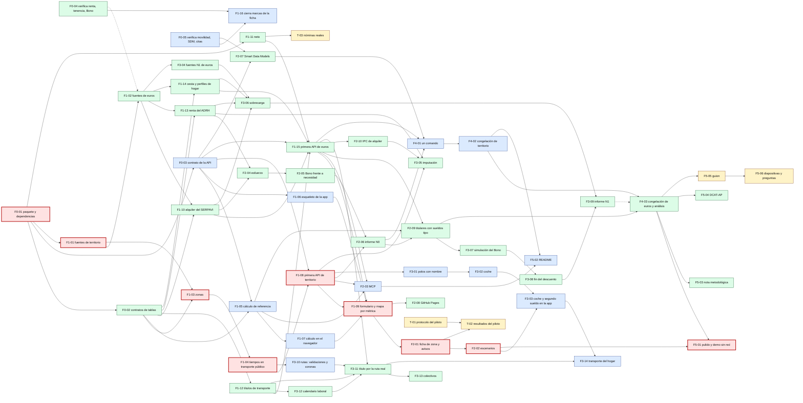

# Plan de desarrollo de «¿Me sobra?»

Plan de ejecución de la ficha [propuesta-A-unificada.md](propuesta-A-unificada.md) · escrito el 14 de noviembre de 2026 · manda `AGENTS.md`; la ficha manda en el qué y este plan en el cómo, el orden y el reparto.
Los identificadores `F1-04` son estables. Las duraciones, los tamaños y los umbrales marcados «(supuesto)» son estimaciones.

## Resumen

**Qué se enseña el 26 de noviembre.** Una web estática publicada en la que una persona escribe su sueldo, su hogar, dónde trabaja y cuántos días va, y ve en un mapa de 199 zonas a cuánto le pagan cada hora extra de viaje, cuánto le sobra al mes y cuántas horas pasa en el transporte; cambia los días de teletrabajo o quita el descuento del abono y el mapa se mueve. Un informe para la Administración con el esfuerzo de alquiler sobre renta, el Bono Alquiler Joven frente a la necesidad y los titulares con sueldos tipo. Una pregunta en directo a un asistente conectado al servidor MCP, que responde con las mismas cifras. Los datos derivados, abiertos y en esquema de Smart Data Models, y un repositorio que lo regenera todo con un comando.

**Camino crítico.** F0-01 (paquete) → F1-01 (fuentes de territorio) → F1-03 (zonas) → F1-04 (tiempos con r5py) → F1-08 (primera API de territorio) → F1-09 (formulario y mapa: esqueleto del 18) → F2-01 → F2-02 → F5-01, con la congelación del 22 (F4-02 y F4-03) como paso obligado antes de F5-01. La pieza con más riesgo es F1-04: tiene una puerta de decisión el 16 por la noche y tres planes B. La cadena de euros (F1-02 → F1-10 → F1-15) llega al mismo punto, F1-09, el 17 por la noche, sin holgura. Si H1 se va al 19, F2-01 y F2-02 se retrasan un día y F3-03 queda fuera.

**Reparto en una frase.** Izan lleva el territorio, el tiempo y la herramienta (zonas, tiempos de viaje, cálculo de referencia, web y MCP); Yeray lleva los euros y el análisis (alquiler, renta, neto, tarifas, cesta, esfuerzo, Bono, sobrecarga, informe y Smart Data Models); el piloto con usuarios y el relato van en un tercer carril sin asignar.

**Decisiones humanas pendientes** (detalle en la sección 6):

| Fecha límite | Decisión |
|---|---|
| 15 nov, 10:00 | Yeray confirma u objeta el stack, la excepción de `app/datos/` y el reparto (D1–D3), ya elegidos por Izan |
| 16 nov | Confirmar el 22 como fecha de congelación (D4); quién lleva el tercer carril (D7); escribir a la organización por las bases (D8) y por las licencias (D12) |
| 16 nov, 20:00 | Puerta de r5py: seguir, o plan B de tiempos (D6) |
| 18 nov, 20:00 | Hacer público el repositorio y activar Pages (D5); si arrancan la imputación y la sobrecarga (D9) |
| 20 nov, 20:00 | Corte de N1: qué entra en la congelación (D9) |
| 22 nov, 20:00 | Firma de la congelación (D10) |
| 23 nov, 12:00 | Titular y apertura del pitch (D11) |

## 1. Alcance priorizado contra las fechas

**Hitos.**

| Fecha | Hito | Se comprueba con |
|---|---|---|
| 15 nov (dom) | H0 · Paquete y contratos mergeados | F0-01, F0-02 y F0-03 en `main` |
| 18 nov (mié), colchón el 19 | H1 · Esqueleto de punta a punta: datos reales → cálculo → web que pinta el mapa | F1-09 mergeada con `app/datos/` real de los dos carriles |
| 20 nov (vie) | H2 · Todo N0 de la herramienta y del análisis en `main`; corte de N1 | F2-01, F2-02, F2-06 y F2-09 mergeadas; decisión D9 |
| 22 nov (dom) | H3 · Datos y cálculos congelados | F4-02 y F4-03 mergeadas y etiqueta `datos-congelados-2026-11-22` |
| 23–25 nov | H4 · Web pulida, informe, nota metodológica, pitch y dos ensayos | Lista de comprobación de la sección 8 |
| 26 nov (jue) | H5 · Presentación ante el jurado | — |

**Niveles.** N0 es lo que define la idea (los siete puntos de la ficha; la sección 15 nombra sobrante, esfuerzo y Bono). N1 la refuerza. N2 son extras. El MCP y Smart Data Models van en N0 porque el punto 7 de la ficha los nombra, pero fuera del camino crítico y con su plan B.

| Pieza (ficha) | Nivel | Issues | Si es N1 o N2: señal que la deja fuera, y qué queda |
|---|---|---|---|
| Fuentes de N0, verificaciones, zonas y renta (4, 12, 16) | N0 | F0-04, F0-05, F1-01, F1-02, F1-03, F1-13, F1-16 | — |
| Sobrante, horas, precio de la hora, esfuerzo, banda (6) | N0 | F1-05, F1-07, F1-09 | — |
| Neto desde el bruto (6.1) | N0 | F1-11 | Plan B: entrada solo de neto mensual |
| Alquiler por zona con rango; zonas «sin dato» (6.2, 6.7) | N0 | F1-10, F1-15 | — |
| Actualización del alquiler con el IPC regional (6.2) | N0 | F2-10 | Plan B: factor 1,0 y año del dato a la vista |
| Tarifas y título más barato (6.3) | N0 | F1-12 | — |
| Cesta básica y perfiles de hogar (6.4, 5) | N0 | F1-14 | — |
| Tiempo en transporte público entre zonas (6.5) | N0 | F1-04, F1-08 | Planes B1–B3 en F1-04 |
| Herramienta: formulario, mapa, ficha, diez zonas, avisos (5) | N0 | F1-06, F1-09, F2-01, F5-01 | — |
| Escenarios individuales (9) | N0 | F2-02 | — |
| Esfuerzo alquiler/renta por zona y año (7.1) | N0 | F2-04, F2-06 | — |
| Bono frente a necesidad, con correlación controlada por renta (7.3, 10.1 municipal) | N0 | F2-05, F2-06 | — |
| Titulares con sueldos tipo (8) | N0 | F2-09 | — |
| MCP local (11.3) | N0 | F2-03 | Plan B: demo grabada |
| Indicadores en Smart Data Models (11.1) | N0 | F2-07 | Plan B: contexto JSON-LD propio |
| API estática abierta, publicación, un comando, README, nota metodológica (11.2, 11.4, 13) | N0 | F0-03, F2-08, F4-01, F5-02, F5-03 | — |
| Guion, diapositivas y preguntas (18) | N0 | F5-05, F5-06 | — |
| Fuentes de las piezas N1 (12) | N1 | F3-04 | El 20 sin registrar una fuente → fuera la issue que la consume |
| Polos de empleo con nombre (6.5) | N1 | F3-01 | El 19 sin mergear → los personajes usan el distrito o municipio de su trabajo |
| Coche y segundo sueldo (6.3, 5) | N1 | F3-02, F3-03 | El 20 a las 12:00 sin `tiempos.json` real o sin F2-01 → fuera el coche; el 21 a las 12:00 sin F2-02 → fuera F3-03 |
| Imputación de zonas sin dato (6.7) | N1 | F3-05 | Solo arranca con el visto bueno de S3. El 21 a las 12:00 sin veredicto espacial o con cobertura real más de 10 puntos bajo la nominal → zonas «sin dato» |
| Sobrecarga log-normal (7.2) | N1 | F3-06 | Solo arranca con el visto bueno de S3. El 21 a las 18:00 fuera del margen de la cifra de control, o sin cifra de control → no se publica; el Bono usa el esfuerzo |
| Simulación del criterio del Bono (7.4) y fin del descuento agregado (7.5) | N1 | F3-07, F3-08 | El 21 a las 20:00 sin mergear → fuera; queda el escenario individual |
| Informe con las piezas N1 (7) | N1 | F3-09 | Se reduce a lo que haya llegado |
| Transporte con la ruta real: interzonales, operador, calendario laboral, colectivos y todo el hogar (6.3; decisión del 15/11, supuestos de #80) | N1 | F3-10, F3-11, F3-12, F3-13, F3-14 | F3-12 el 20 a las 12:00 sin mergear → 4,33 semanas. F3-10 sin puerta D6 o el 20 a las 20:00 sin mergear → heurística por la recta. F3-11 el 21 a las 12:00 sin mergear → `tarifas` v1. F3-13 el 21 a las 12:00 → solo «ordinario». F3-14 (b) el 21 a las 16:00 → solo cuenta quien trabaja. Lo que no llegue se declara en F5-03 |
| Metadatos DCAT-AP (11.2) | N1 | F5-04 | El 23 a las 14:00 sin F4-03 → el README describe los ficheros |
| Piloto con usuarios (10.3) | N1 | T-01, T-02 | El 17 sin responsable → fuera, y el impacto es el análisis del Bono; con responsable y sin web publicada el 20 → prueba de uso en local con cinco personas |
| Nóminas reales (6.1, 10.2) | N1 | T-03 | El 18 sin nóminas → auditoría y casos de control |
| Deslizador del valor del tiempo (6.5) · destino libre con rejilla (6.5) · zoom a barrios con el alquiler por código postal (4, 6.2) · polos obtenidos de la EDM2018 y del MITMA, y el indicio de la sección 8 (6.5, 8) · déficit de transporte (7.6) · rentabilidad implícita con el Notariado (7.7) · validación externa por distrito (10.1) · precio de oferta (6.2) · propuesta al catálogo y modelo nuevo de Smart Data Models (11.1, 11.2) · instancia remota del MCP (11.3) | N2 | Sin issue | Solo se abre issue si el 20 por la noche todo N0 está mergeado y la persona tiene un agente libre, en este orden: barrios con el alquiler por código postal del catálogo regional, deslizador, polos de datos. El resto no entra antes del 26 |

**Catálogo regional en N0.** El punto 4 de la ficha lo pone en el centro, así que N0 usa del catálogo: el Bono Alquiler Joven por municipio (F2-05), el IPC de alquiler (F2-10) y, si F0-04 y F0-05 lo confirman, la población por edad y los datos del Consorcio (GTFS y coronas). La tenencia entra con N1 (F3-06) y el alquiler por código postal es el primer N2. El valor catastral, los afiliados, el paro, `zt84` y el portal del Ayuntamiento no entran antes del 26: solo los usan piezas N2 o son contexto.

## 2. Contratos de datos entre carriles

**Regla de integración.** Un carril nunca lee `data/processed/` del otro: lo que cruza de carril pasa por los ficheros versionados de `app/datos/` (o, antes de que existan, por su ejemplo de `tests/fixtures/api/`). Así cada persona solo necesita las fuentes de su carril, y la web, el MCP y el análisis leen lo mismo. Cambiar un contrato es un PR propio y pequeño, avisado en la sincronización del día.

**Claves.** `zona_id` (texto): código INE de 5 dígitos para los 178 municipios (`28065`) y `28079` + distrito de 2 dígitos para los 21 distritos de Madrid (`2807913`). `seccion_id` (texto, 10 dígitos). `anio` (entero). `destino_id` (texto): un `zona_id` o `polo:<slug>`. Zonas de los fixtures: `2807901`, `2807913`, `28065`, `28092` y `28001` (esta, sin dato de alquiler).

**Tablas de `data/processed/`** (`alquiler_zona`, `renta` y `esfuerzo` llevan además la fila de Madrid entero, `28079`, que no es una de las 199 zonas y solo usa el análisis por municipio; Parquet en local; fixture CSV en `tests/fixtures/processed/<tabla>.csv`; definición en código y validación en F0-02).

| Tabla · grano · clave | Columnas (tipo, unidad) | Produce | Consume |
|---|---|---|---|
| `zonas` · zona · `zona_id` | `nombre` texto; `tipo` {municipio, distrito}; `municipio_id` texto; `corona` {A, B1, B2, B3, C1, C2}; `poblacion` entero (personas); `lon_centro`, `lat_centro` decimal (grados, EPSG:4326); geometría en EPSG:25830 | F1-03 | F1-04, F1-08, F3-01, F3-02 |
| `tiempos` · origen × destino × modo · `zona_id`, `destino_id`, `modo` | `modo` {tp, coche}; `minutos` decimal (mediana puerta a puerta, salidas de 7:30 a 8:30 de un martes; nulo sin ruta en 120 min); `km` decimal (solo coche); `estimado` booleano (verdadero si sale de la línea base por distancia) | F1-04, F3-01, F3-02 | F1-08 |
| `alquiler_zona` · zona × año · `zona_id`, `anio` | `eur_m2_p25`, `eur_m2_p50`, `eur_m2_p75` decimal (€/m² al mes, vivienda colectiva); `m2_p50` decimal (m²); `testigos` entero; `origen` {observado, estimado, sin_dato}; `ic_inf`, `ic_sup` decimal (€/m² al mes, solo estimado); `factor_ipc` decimal (1,0 sin actualizar) | F1-10, F3-05, F2-10 | F1-15, F2-04 |
| `alquiler_seccion` · sección × año · `seccion_id`, `anio` | `eur_m2_p25/p50/p75` decimal (€/m² al mes); `cuantia_p25/p50/p75` decimal (€/mes); `testigos` entero | F1-10 | F3-06 |
| `renta` · unidad × año · `unidad_id`, `nivel`, `anio` | `nivel` {zona, seccion}; `renta_hogar` decimal (€/año, media por hogar); `renta_uc` decimal (€/año por unidad de consumo); `gini` decimal (0–100); `p80p20` decimal; `poblacion` entero; `tam_hogar` decimal (personas) | F1-13 | F2-04, F3-05, F3-06 |
| `netos` · bruto × configuración · `bruto_anual`, `hijos`, `monoparental` | `bruto_anual` entero (€, cada 250 y cada 50 entre 16.500 y 21.500); `hijos` {0, 1, 2}; `monoparental` booleano; `cotizacion`, `cuota_irpf`, `neto_anual` decimal (€/año) | F1-11 | F1-15 |
| `tarifas` · escenario × edad × corona × días × viajes · las cinco | `escenario` {vigente_2026, sin_descuento}; `joven` booleano; `corona` texto; `dias` 1–5; `viajes_dia` 2 o 4; `titulo` texto; `coste_mes` decimal (€/mes) | F1-12 | F1-15, F3-08 |
| `hogares` · perfil · `perfil` | `perfil` {solo, comparte, pareja, monoparental}; `adultos`, `hijos`, `personas_comparten` entero; `alimentacion`, `suministros` decimal (€/mes); `anio` entero | F1-14 | F1-15, F3-06 |
| `esfuerzo` · zona × año · `zona_id`, `anio` | `alquiler_mes_p50`, `renta_hogar_mes` decimal (€/mes); `esfuerzo` decimal (proporción) | F2-04 | F2-05, F2-06 |
| `bono` · municipio · `municipio_id` | `solicitudes`, `aceptadas`, `rechazadas`, `poblacion_joven` entero; `necesidad` decimal; `indicador_necesidad` {esfuerzo, sobrecarga}; `grupo` texto | F2-05 | F2-06 |
| `sobrecarga` · zona × año · `zona_id`, `anio` | `pct_40_inf`, `pct_40_sup`, `pct_30_inf`, `pct_30_sup` decimal (% de hogares inquilinos); `dif_sigma` decimal | F3-06 | F3-08, F3-09 |
| `simulacion` · perfil × municipio × criterio · las tres | `perfil` texto; `municipio_id` texto; `criterio` texto; `elegible` booleano; `eur_mes` decimal (€/mes); `estimado` booleano | F3-07, F3-08 | F3-09 |

**Ficheros de la API estática, `app/datos/`** (JSON compacto en UTF-8; `null` donde falta; cada uno con un bloque `meta`: fecha de generación, año del dato, fuentes con nombre, URL y licencia; ejemplo en `tests/fixtures/api/`; validador en F0-03).

| Fichero · grano · clave | Contenido (unidad) | Produce | Consume |
|---|---|---|---|
| `zonas.geojson` · zona · `zona_id` | Polígonos simplificados en EPSG:4326; propiedades `zona_id`, `nombre`, `tipo`, `municipio_id`, `corona`, `poblacion` | F1-08, F4-02 (Izan) | Web, MCP, F2-06, F3-05, F3-08 |
| `tiempos.json` · origen × destino | `origenes` (lista de `zona_id`), `destinos` (lista con `destino_id`, `nombre`, `tipo`), `tp` (matriz de minutos enteros), y si existen `coche` (minutos), `km_coche` y parámetros de coste | F1-08, F4-02 (Izan) | Web, MCP, F2-09, F3-05, F3-07 |
| `alquiler.json` · zona · `zona_id` | Por zona: `anio`, `p25`, `p50`, `p75` (€/m² al mes), `m2`, `factor_ipc`, `origen`, `ic` | F1-15, F4-03 (Yeray) | Web, MCP, F2-07 |
| `netos.json` · bruto × configuración | `brutos` (€), `configuraciones`, matriz `neto_anual` (€/año) | F1-15, F4-03 (Yeray) | Web, MCP |
| `tarifas.json` · escenario × edad × corona × días | `orden_coronas`, `edad_max_joven`, y por escenario el `coste_mes` (€/mes) y el `titulo` | F1-15, F4-03 (Yeray) | Web, MCP |
| `hogares.json` · perfil | Valores por defecto del hogar, m² por defecto (lo añade F1-15 desde `alquiler_zona`) y cesta (€/mes) | F1-15, F4-03 (Yeray) | Web, MCP |
| `analisis.json` · zona o municipio | Bloques `esfuerzo` (zona × año), `bono` (municipio), `titulares`, y si existen `sobrecarga` y `simulacion` | F2-06, F2-09, F4-03 (Yeray) | Informe, MCP, F2-07, F5-05 |
| `sdm/` · entidad | Los indicadores en el modelo de Smart Data Models elegido | F4-03, con el código de F2-07 (Yeray) | Reutilizadores |
| `tests/fixtures/casos_referencia.json` · caso | Entradas y salidas esperadas del cálculo | F1-05 (Izan) | F1-07, F2-03 |

## 3. Issues

La issue es la fuente de verdad: allí están el texto para el agente, los criterios de hecho, los ficheros, las skills, los revisores, el riesgo y el plan B. Aquí, solo el índice. «Líneas» es una estimación.

| ID | Issue (título del PR) | Nivel | Dueño | Día | Depende de | Agente | Líneas |
|---|---|---|---|---|---|---|---|
| F0-01 | [#64](https://github.com/yeraybc/DataMad-hackaton-2026/issues/64) chore(src): paquete mesobra con dependencias fijadas y licencia MIT | N0 | Izan | 15 nov | — | sonnet · esfuerzo medio | 90 |
| F0-02 | [#65](https://github.com/yeraybc/DataMad-hackaton-2026/issues/65) feat(src): contratos de las tablas intermedias con fixtures | N0 | Yeray | 15 nov | F0-01 | sonnet · esfuerzo medio | 320 |
| F0-03 | [#66](https://github.com/yeraybc/DataMad-hackaton-2026/issues/66) feat(src): contrato de la API estática con ficheros de ejemplo | N0 | Izan | 15 nov | F0-01 | sonnet · esfuerzo medio | 330 |
| F0-04 | [#67](https://github.com/yeraybc/DataMad-hackaton-2026/issues/67) docs(verificaciones): fuentes de renta, tenencia, sobrecarga y Bono | N0 | Yeray | 15 nov | — | sonnet para orquestar | 120 |
| F0-05 | [#68](https://github.com/yeraybc/DataMad-hackaton-2026/issues/68) docs(verificaciones): movilidad, Smart Data Models y citas | N0 | Izan | 15 nov | — | sonnet para orquestar | 120 |
| F1-01 | [#69](https://github.com/yeraybc/DataMad-hackaton-2026/issues/69) data(fuentes): geometrías y población del INE, coronas del CRTM, GTFS y OpenStreetMap | N0 | Izan | 15 nov | F0-01 | sonnet · esfuerzo medio | 80 |
| F1-02 | [#70](https://github.com/yeraybc/DataMad-hackaton-2026/issues/70) data(fuentes): SERPAVI, ADRH, Bono, EPF, IPC de alquiler y población por edad | N0 | Yeray | 15 nov | F0-01, F1-01 | sonnet · esfuerzo medio | 80 |
| F1-03 | [#71](https://github.com/yeraybc/DataMad-hackaton-2026/issues/71) feat(src): zonas con centro de población y corona tarifaria | N0 | Izan | 15–16 nov | F0-02, F1-01 | opus · esfuerzo alto | 300 |
| F1-04 | [#72](https://github.com/yeraybc/DataMad-hackaton-2026/issues/72) feat(src): matriz de tiempos en transporte público con r5py | N0 | Izan | 16–17 nov | F1-01, F1-03 | opus · esfuerzo alto | 380 |
| F1-05 | [#73](https://github.com/yeraybc/DataMad-hackaton-2026/issues/73) feat(src): cálculo de referencia del sobrante, las horas y el precio de la hora | N0 | Izan | 16 nov | F0-02, F0-03 | opus · esfuerzo alto | 330 |
| F1-06 | [#74](https://github.com/yeraybc/DataMad-hackaton-2026/issues/74) feat(app): esqueleto de la herramienta con el mapa de zonas | N0 | Izan | 16 nov | F0-03 | sonnet · esfuerzo medio | 280 |
| F1-07 | [#75](https://github.com/yeraybc/DataMad-hackaton-2026/issues/75) feat(app): cálculo en el navegador contrastado con los casos de referencia | N0 | Izan | 17 nov | F1-05 | sonnet · esfuerzo medio | 300 |
| F1-08 | [#76](https://github.com/yeraybc/DataMad-hackaton-2026/issues/76) data(app): primera API estática de zonas y tiempos | N0 | Izan | 17–18 nov | F0-03, F1-03, F1-04 | sonnet · esfuerzo medio | 150 |
| F1-09 | [#77](https://github.com/yeraybc/DataMad-hackaton-2026/issues/77) feat(app): formulario validado y mapa por métrica | N0 | Izan | 17–18 nov | F1-06, F1-07, F1-08, F1-15 | sonnet · esfuerzo alto | 350 |
| F1-10 | [#78](https://github.com/yeraybc/DataMad-hackaton-2026/issues/78) feat(src): alquiler por zona y sección desde el SERPAVI | N0 | Yeray | 16 nov | F0-02, F1-02 | opus · esfuerzo alto | 330 |
| F1-11 | [#79](https://github.com/yeraybc/DataMad-hackaton-2026/issues/79) feat(src): neto desde el bruto con los parámetros de 2026 | N0 | Yeray | 15–16 nov | F0-01 | opus · esfuerzo alto | 350 |
| F1-12 | [#80](https://github.com/yeraybc/DataMad-hackaton-2026/issues/80) feat(src): títulos de transporte de 2026 y el más barato según los días | N0 | Yeray | 16 nov | F0-02 | sonnet · esfuerzo alto | 260 |
| F1-13 | [#81](https://github.com/yeraybc/DataMad-hackaton-2026/issues/81) feat(src): renta del ADRH por zona y sección | N0 | Yeray | 17 nov | F0-02, F0-04, F1-02 | sonnet · esfuerzo medio | 260 |
| F1-14 | [#82](https://github.com/yeraybc/DataMad-hackaton-2026/issues/82) feat(src): cesta básica y perfiles de hogar con la EPF | N0 | Yeray | 16 nov | F0-02, F0-04, F1-02 | sonnet · esfuerzo medio | 220 |
| F1-15 | [#83](https://github.com/yeraybc/DataMad-hackaton-2026/issues/83) data(app): primera API estática de alquiler, netos, tarifas y hogares | N0 | Yeray | 17 nov | F0-03, F1-10, F1-11, F1-12, F1-14 | sonnet · esfuerzo medio | 160 |
| F1-16 | [#84](https://github.com/yeraybc/DataMad-hackaton-2026/issues/84) docs(ideas): cierra las marcas «(verificar)» de la ficha | N0 | Izan | 17 nov | F0-04, F0-05 | haiku · esfuerzo bajo | 80 |
| F2-01 | [#85](https://github.com/yeraybc/DataMad-hackaton-2026/issues/85) feat(app): ficha de zona, diez mejores zonas y avisos del dato | N0 | Izan | 19 nov | F1-09 | sonnet · esfuerzo medio | 320 |
| F2-02 | [#86](https://github.com/yeraybc/DataMad-hackaton-2026/issues/86) feat(app): escenarios «¿y si…?» | N0 | Izan | 20 nov | F2-01 | sonnet · esfuerzo medio | 220 |
| F2-03 | [#87](https://github.com/yeraybc/DataMad-hackaton-2026/issues/87) feat(src): servidor MCP local sobre la API estática | N0 | Izan | 19–20 nov | F1-05, F1-08, F1-15 | sonnet · esfuerzo alto | 300 |
| F2-04 | [#88](https://github.com/yeraybc/DataMad-hackaton-2026/issues/88) feat(src): esfuerzo de alquiler sobre renta por zona y año | N0 | Yeray | 17 nov | F1-10, F1-13 | sonnet · esfuerzo medio | 200 |
| F2-05 | [#89](https://github.com/yeraybc/DataMad-hackaton-2026/issues/89) feat(src): Bono Alquiler Joven frente a la necesidad por municipio | N0 | Yeray | 18 nov | F0-04, F1-02, F2-04 | opus · esfuerzo alto | 280 |
| F2-06 | [#90](https://github.com/yeraybc/DataMad-hackaton-2026/issues/90) feat(app): informe de análisis con el esfuerzo y el Bono | N0 | Yeray | 19 nov | F0-03, F2-04, F2-05, F1-08 | opus · esfuerzo alto | 350 |
| F2-07 | [#91](https://github.com/yeraybc/DataMad-hackaton-2026/issues/91) feat(src): indicadores por zona en esquema de Smart Data Models | N0 | Yeray | 18 nov | F0-03, F0-05 | sonnet · esfuerzo alto | 250 |
| F2-08 | [#92](https://github.com/yeraybc/DataMad-hackaton-2026/issues/92) chore(github): publica app/ en GitHub Pages | N0 | Yeray | 19 nov | F1-09 | sonnet · esfuerzo medio | 80 |
| F2-09 | [#93](https://github.com/yeraybc/DataMad-hackaton-2026/issues/93) feat(src): titulares con sueldos de referencia en todas las zonas | N0 | Yeray | 20 nov | F1-05, F1-08, F1-15, F2-06 | opus · esfuerzo alto | 300 |
| F2-10 | [#94](https://github.com/yeraybc/DataMad-hackaton-2026/issues/94) feat(src): actualización del alquiler con el IPC regional | N0 | Yeray | 18 nov | F0-04, F1-02, F1-10, F1-15 | sonnet · esfuerzo medio | 150 |
| F3-01 | [#95](https://github.com/yeraybc/DataMad-hackaton-2026/issues/95) feat(src): polos de empleo con nombre como destinos | N1 | Izan | 19 nov | F1-04, F1-08 | sonnet · esfuerzo medio | 200 |
| F3-02 | [#96](https://github.com/yeraybc/DataMad-hackaton-2026/issues/96) feat(src): tiempos y coste en coche | N1 | Izan | 20 nov | F1-04, F3-01 | sonnet · esfuerzo alto | 280 |
| F3-03 | [#97](https://github.com/yeraybc/DataMad-hackaton-2026/issues/97) feat(app): modo coche y segundo sueldo con su lugar de trabajo | N1 | Izan | 21 nov | F2-02, F3-02 | sonnet · esfuerzo medio | 250 |
| F3-04 | [#98](https://github.com/yeraybc/DataMad-hackaton-2026/issues/98) data(fuentes): tenencia, sobrecarga de la ECV y salarios del INE | N1 | Yeray | 19 nov | F0-04, F1-02 | sonnet · esfuerzo medio | 70 |
| F3-05 | [#99](https://github.com/yeraybc/DataMad-hackaton-2026/issues/99) feat(src): imputación del alquiler en zonas sin dato con validación espacial | N1 | Yeray | 20–21 nov | F1-10, F1-13, F1-15, F1-08, F2-10 | opus · esfuerzo alto | 380 |
| F3-06 | [#100](https://github.com/yeraybc/DataMad-hackaton-2026/issues/100) feat(src): hogares en sobrecarga por sección con distribución log-normal | N1 | Yeray | 20–21 nov | F1-10, F1-13, F1-14, F3-04 | opus · esfuerzo alto | 380 |
| F3-07 | [#101](https://github.com/yeraybc/DataMad-hackaton-2026/issues/101) feat(src): simulación del criterio del Bono con transporte en casos tipo | N1 | Yeray | 21 nov | F2-09 | opus · esfuerzo alto | 330 |
| F3-08 | [#102](https://github.com/yeraybc/DataMad-hackaton-2026/issues/102) feat(src): efecto del fin del descuento del abono por municipio | N1 | Yeray | 21 nov | F1-12, F1-08, F3-07 | sonnet · esfuerzo medio | 180 |
| F3-09 | [#103](https://github.com/yeraybc/DataMad-hackaton-2026/issues/103) feat(app): informe con sobrecarga, simulaciones y titulares | N1 | Yeray | 22 nov | F2-06, F2-09, F3-06, F3-07, F3-08 | opus · esfuerzo alto | 320 |
| F3-10 | [#161](https://github.com/yeraybc/DataMad-hackaton-2026/issues/161) feat(src): validaciones, sistemas tarifarios y rango de coronas de cada ruta | N1 | Izan | 19–20 nov | F1-04, D6 | opus · esfuerzo alto | 300 |
| F3-11 | [#162](https://github.com/yeraybc/DataMad-hackaton-2026/issues/162) feat(src): título más barato por la ruta real (interzonales, operador y viajes no laborables) | N1 | Yeray | 20 nov | F1-12, F1-15, F3-10, F3-12 | opus · esfuerzo alto | 380 |
| F3-12 | [#160](https://github.com/yeraybc/DataMad-hackaton-2026/issues/160) feat(src): calendario laboral de 2026 en el coste de transporte (vacaciones y festivos) | N1 | Yeray | 19 nov | F1-12 | sonnet · esfuerzo medio | 120 |
| F3-13 | [#163](https://github.com/yeraybc/DataMad-hackaton-2026/issues/163) feat(src): descuentos de familia numerosa, monoparental y discapacidad en el transporte | N1 | Yeray | 21 nov | F3-11 | sonnet · esfuerzo medio | 150 |
| F3-14 | [#164](https://github.com/yeraybc/DataMad-hackaton-2026/issues/164) feat(app): coste de transporte de todo el hogar con tarifas v2 | N1 | Izan | 21 nov | F3-11, F3-03 | sonnet · esfuerzo medio | 250 |
| F4-01 | [#104](https://github.com/yeraybc/DataMad-hackaton-2026/issues/104) chore(src): un comando regenera y comprueba toda la API estática | N0 | Izan | 21 nov | F1-08, F1-15, F2-06, F2-07 | sonnet · esfuerzo bajo | 90 |
| F4-02 | [#105](https://github.com/yeraybc/DataMad-hackaton-2026/issues/105) data(app): API estática congelada de zonas y tiempos | N0 | Izan | 22 nov | F4-01, F1-08 | sonnet · esfuerzo medio | 40 |
| F4-03 | [#106](https://github.com/yeraybc/DataMad-hackaton-2026/issues/106) data(app): API estática congelada de euros y análisis | N0 | Yeray | 22 nov | F4-01, F4-02, F1-15, F2-07, F2-09 | sonnet · esfuerzo medio | 40 |
| F5-01 | [#107](https://github.com/yeraybc/DataMad-hackaton-2026/issues/107) feat(app): accesibilidad, textos finales y demo sin red | N0 | Izan | 23 nov | F2-02, F4-02, F4-03 | sonnet · esfuerzo medio | 280 |
| F5-02 | [#108](https://github.com/yeraybc/DataMad-hackaton-2026/issues/108) docs(readme): reproducir, instalar el MCP y citar las fuentes | N0 | Izan | 23–24 nov | F2-03, F4-01, F4-02 | sonnet · esfuerzo bajo | 120 |
| F5-03 | [#109](https://github.com/yeraybc/DataMad-hackaton-2026/issues/109) docs(app): nota metodológica con supuestos, límites y validación | N0 | Yeray | 23 nov | F4-02, F4-03 | opus · esfuerzo alto | 250 |
| F5-04 | [#110](https://github.com/yeraybc/DataMad-hackaton-2026/issues/110) docs(app): metadatos DCAT-AP y licencia del conjunto de datos | N1 | Yeray | 23 nov | F4-03, F2-07 | sonnet · esfuerzo medio | 150 |
| F5-05 | [#111](https://github.com/yeraybc/DataMad-hackaton-2026/issues/111) docs(pitch): guion de cinco minutos con cifras trazadas | N0 | Sin asignar | 23–24 nov | F4-02, F4-03, F2-09 | opus · esfuerzo alto | 150 |
| F5-06 | [#112](https://github.com/yeraybc/DataMad-hackaton-2026/issues/112) docs(pitch): diapositivas y respuestas preparadas para el jurado | N0 | Sin asignar | 24 nov | F5-05 | opus · esfuerzo alto | 180 |
| T-01 | [#113](https://github.com/yeraybc/DataMad-hackaton-2026/issues/113) docs(pitch): protocolo del piloto con usuarios | N1 | Sin asignar | 17–18 nov | — | opus · esfuerzo alto | 120 |
| T-02 | [#114](https://github.com/yeraybc/DataMad-hackaton-2026/issues/114) docs(pitch): resultados del piloto con usuarios | N1 | Sin asignar | 24 nov | T-01, F2-01 | sonnet · esfuerzo medio | 100 |
| T-03 | [#115](https://github.com/yeraybc/DataMad-hackaton-2026/issues/115) test(src): nóminas reales anónimas para contrastar el neto | N1 | Sin asignar | 17–18 nov | F1-11 | sonnet · esfuerzo medio | 100 |

52 issues: 22 de Izan, 25 de Yeray y 5 sin asignar (tercer carril).

## 4. Grafo y calendario

Camino crítico en rojo. Solo se dibujan las dependencias directas.



Azul: Izan. Verde: Yeray. Amarillo: tercer carril. Rojo: camino crítico (todo él es de Izan).

**Calendario.** Entre paréntesis, agentes en paralelo de esa persona. «→» es secuencia; «‖» es paralelo. Las descargas y ejecuciones largas no cuentan como agente.

| Día | Izan | Yeray | Tercer carril y sincronización |
|---|---|---|---|
| 15 dom | F0-01 solo (1: todo depende de él). Después F0-03 ‖ F0-05 ‖ F1-01 (3: ficheros distintos, nada depende entre sí) → F1-03 al mergear F1-01 | Tras F0-01: F0-02 ‖ F0-04 ‖ F1-11 (3: contratos, verificación y neto no comparten nada) → F1-02 cuando F1-01 esté mergeada (turno de `data/README.md`; el SERPAVI y el Bono no esperan a F0-04) | **S1, por la mañana:** descargas manuales (A1) y turno de `data/README.md`. H0 al final del día |
| 16 lun | F1-03 ‖ F1-05 ‖ F1-06 (3: `zonas.py`, `calculo.py` y `app/` son independientes y usan fixtures); F1-04, pasos 0 y A, en cuanto quede un agente libre | F1-10 ‖ F1-12 ‖ F1-14 (3: un módulo cada uno); F1-11 termina con el auditor | **S2, 20:00:** puerta de r5py (D6). D4, D7, D8 y D12 |
| 17 mar | F1-04 paso B ‖ F1-07 → F1-09 con los ejemplos ‖ F1-16 (3: la matriz es tiempo de máquina; F1-16 es mecánica) → F1-08 | F1-15 por la mañana ‖ F1-13 → F2-04 (2) | T-01 ‖ T-03 si hay responsable |
| 18 mié | F1-08 → F1-09 con los datos reales (1: es la integración, no se paraleliza) | F2-05 ‖ F2-07 ‖ F2-10 (3: `bono.py`, `sdm.py` y `alquiler.py`) | T-01 y T-03 terminan. **S3, 19:00:** H1 juntos, mapa con datos reales; se decide si arrancan F3-05 y F3-06. D5 |
| 19 jue | F2-01 ‖ F2-03 ‖ F3-01 (3: `app/`, el MCP y los polos no comparten ficheros); por la mañana, cronometrar F3-10 con 200 pares | F2-06 ‖ F2-08 ‖ F3-04 (3: informe, workflow y fuentes); F3-12 si hay hueco (pequeña) | Web publicada; empieza el piloto |
| 20 vie | F2-02 ‖ F3-02 ‖ F3-10 (3); F2-03 termina | F2-09 ‖ F3-05 ‖ F3-06 (3: `titulares.py`, `imputacion.py` y `sobrecarga.py`); F3-11 entra al liberarse uno (`transporte.py`) | **S4, 20:00:** H2 y corte de N1 (D9) |
| 21 sáb | F3-03 → F3-14 (b) ‖ F4-01 ‖ F3-14 (a) (3: `app/` en secuencia; el cálculo, aparte) | F3-07 → F3-08 (1: comparten fichero) ‖ F3-11 → F3-13 (`transporte.py`); F3-05 y F3-06 terminan | Por la noche, ensayo de congelación: `python -m mesobra` completo, sin PR |
| 22 dom | F4-02 (1: ejecución completa, una vez) | F3-09 → F4-03 (1: mismos ficheros, en secuencia, y F4-03 espera a F4-02) | **S5, 20:00:** firma de la congelación (D10) y etiqueta |
| 23 lun | F5-01 ‖ F5-02 (2) | F5-03 ‖ F5-04 (2) | F5-05. D11 a las 12:00 |
| 24 mar | F5-02 termina; correcciones del ensayo | Correcciones del ensayo | F5-05 termina → F5-06 ‖ T-02. **Ensayo 1** a las 17:00 |
| 25 mié | Solo arreglos; nada se mergea en `app/` después de las 18:00 | Igual | **Ensayo 2** a las 12:00; vídeo de respaldo de la demo |
| 26 jue | Presentación | Presentación | — |

**Dónde no se paraleliza y por qué.**
- **`app/index.html`, `app/app.js` y `app/vista.js`:** F1-06 → F1-09 → F2-01 → F2-02 → F3-03 → F5-01 van en secuencia, un agente cada vez. Partir la interfaz en ficheros para paralelizar costaría más en rebases que lo que ahorra, y nadie del equipo domina JS para arbitrar conflictos.
- **`data/README.md`:** es el único fichero que comparten los dos carriles. Un rebase caduca el veredicto de `dm-verificador-fuentes`, así que las PR de fuentes se revisan y mergean de una en una (F1-01, después F1-02; F3-04 el 18).
- **Pipelines:** cada fichero `pipeline_*.py` lo edita una sola issue por día. Por eso las piezas N1 del análisis no tocan `pipeline_analisis.py`: las engancha F3-09 de una vez.
- **Congelación:** F4-02 y F4-03 son una ejecución completa cada una, sin agentes en paralelo.
- **Límite real:** la plantilla del PR pide que una persona lea cada diff entero. Con las estimaciones de este plan, Izan tiene 22 PR y unas 4900 líneas estimadas, con un pico de 4 PR el día 15; Yeray tiene 25 PR y unas 5800 líneas estimadas, con un pico de 4 PR el día 16. Son más de las tres PR diarias que una persona lee con calma: el primer día casi todo son PR cortas de datos y verificación, pero el margen de lectura es justo. Más agentes no acortan nada, porque la cola es la lectura; por eso las dos piezas N1 más caras (F3-05 y F3-06) solo arrancan si el 18 la lectura va al día.

## 5. Roles

| Rol | Qué vigila | Fases | Agente o skill que lo cubre | Hueco |
|---|---|---|---|---|
| Product owner, con la mirada del jurado | Que cada pieza sirva a los cuatro criterios de la ficha §17 y que N0 llegue entero | Todas; S3, S4 y los ensayos | `dm-abogado-del-diablo` (plan, corte de N1, guion) | La decisión es humana: Izan y Yeray en S3 y S4 |
| Ingeniería de datos | Descargas reproducibles, SHA-256, contratos, `data/raw` intacto | F0, F1, F4 | `dm-nueva-fuente`, `dm-diccionario-datos`, `dm-verificador-fuentes`, hooks de `data/raw`, `tests/test_api_estatica.py` | Las descargas con 403 son manuales |
| Ciencia de datos y estadística | Imputación sin fuga, cobertura de intervalos, ajuste log-normal, correlación parcial | F2, F3 | `dm-modelado-espacial`, `dm-revisor-espacial`, `dm-revisor-codigo` | La sobrecarga no es espacial y la CI no le exige revisor estadístico: F3-06 pide una pasada de `dm-abogado-del-diablo` sobre el método |
| Análisis espacial | CRS, uniones, centros de población, mapas | F1, F2, F3 | `dm-cartografia`, `dm-tablas-de-paso`, `dm-eda-espacial`, `dm-revisor-espacial` | Ninguno |
| Economía y política pública | Lectura del esfuerzo, del Bono y de las simulaciones; que no se afirme causalidad | F2, F3, F5 | `dm-calculos-normativos` (interpretar resultados), `dm-abogado-del-diablo` | Ninguno que se amortice antes del 26 |
| Cálculo normativo | Neto, tarifas, reglas del Bono, parámetros citados | F1, F3 | `dm-calculos-normativos`, `dm-auditor-calculos-normativos` | Faltan casos oficiales de nómina completa: los cubre T-03 |
| Frontend y UX | Que la web funcione, se entienda sola y sea accesible | F1, F2, F5 | `dm-cartografia` (mapas); pruebas de `node --test` | No hay revisor de JS ni de accesibilidad. No se crea un agente: la lógica va en funciones puras (`calculo.js`, `vista.js`) probadas con Node y contrastadas con Python (`tests/test_paridad.py`), y lo visual lo comprueba una persona en S2, S3 y los ensayos |
| Seguridad y privacidad | Entradas, HTML, peticiones a terceros, MCP, datos del piloto | F1-06 en adelante, F2-03, F2-08, T-01 | `dm-revisor-seguridad`, gitleaks en la CI | La CI no lo exige: cada issue de `app/`, del MCP y del piloto lo pide en su texto |
| QA | Que cada cifra visible sea la del dato y que nada esté roto | Todas; F4 y los ensayos | `dm-trazador-cifras`, `cifras_con_fuente.py`, `pytest`, `npm test`, `python -m mesobra` | Ninguno |
| Comunicación y pitch | Guion, diapositivas, preguntas, tono | F5 | `dm-humanizar`, `dm-abogado-del-diablo`, `dm-trazador-cifras` | Falta la persona (D7) |

No se propone ninguna skill ni agente nuevo: ningún hueco se amortiza antes del 26.

## 6. Intervención humana

**Decisiones** (lista cerrada).

| # | Qué se decide | Quién | Fecha límite | Qué se bloquea si no se decide | Recomendación |
|---|---|---|---|---|---|
| D1 | Stack: pandas y geopandas, r5py, LightGBM, web estática con MapLibre y JS sin compilación, informe en HTML con figuras PNG, MCP con el SDK de Python; sin DuckDB ni Quarto | Elegido por Izan el 14; Yeray puede objetar | 15 nov, 10:00 | F0-01 y todo lo demás | Confirmar |
| D2 | Versionar en `app/datos/` los ficheros pequeños de la API estática | Igual | 15 nov, 10:00 | F0-03, F1-08, F1-15 | Confirmar |
| D3 | Reparto de la sección «Resumen» | Igual | 15 nov, 10:00 | La asignación de las issues | Confirmar |
| D4 | El 22 de noviembre como fecha de congelación | Los dos | 16 nov | Las señales de corte y F4 | Confirmar el 22 a las 20:00 |
| D5 | Hacer público el repositorio y activar Pages (carpetas a la vista, `ideas/` incluida) | Yeray, dueño del repo | 18 nov, 20:00 | F2-08, el piloto y la instalación del MCP desde el repo | Sí, tras H1 |
| D6 | Puerta de r5py: seguir, OpenTripPlanner, tiempos de la EDM2018 o aproximación por distancia | Izan, con Yeray | 16 nov, 20:00 | F1-04 y con ella H1 | Seguir si los cinco pares pasan; si no, B1 |
| D7 | Quién lleva el tercer carril (piloto, nóminas, guion, diapositivas) | Los tres | 16 nov | T-01, T-02, T-03; F5-05 y F5-06 pasan a Yeray e Izan | Asignarlo a la tercera persona y darle acceso al repo |
| D8 | Bases: pesos de los criterios, formato de entrega, duración, criba de 100 palabras | Quien escriba a la organización | Enviar el 15; hace falta el 21 | El formato de F5-05 y F5-06 | Sin respuesta: cinco minutos con demo |
| D9 | Corte de N1 con las señales de la sección 1. Antes, en S3 (18 nov), si arrancan la imputación (F3-05) y la sobrecarga (F3-06): solo si H1 está cumplido y no hay PR sin leer | Los dos | 18 y 20 nov, 20:00 | F3-09 y F4-03 | Aplicar las señales sin excepciones |
| D10 | Firma de la congelación y etiqueta `datos-congelados-2026-11-22` | Los dos | 22 nov, 20:00 | F5 entero | — |
| D11 | Titular y apertura del pitch, con los datos congelados | Los tres | 23 nov, 12:00 | F5-05 | Lo que diga el bloque `titulares`; plan B del titular de la ficha §8 |
| D12 | Pedir por escrito la licencia del CRTM (si F0-05 no la confirma) y la del Notariado | Quien escriba | Enviar el 16; hace falta el 21 | Publicar tiempos derivados; el Notariado ya es N2 | Sin respuesta del CRTM: publicar solo tiempos agregados por zona, citando la fuente, y declararlo |
| D13 | Etiqueta `pr-grande` si F4-02 o F4-03 pasan de 800 líneas | Quien revise | 22 nov | El merge de la congelación | Concederla: son datos generados |

**Acciones que solo puede hacer una persona** (no son decisiones): A1, descargar a mano lo que el proxy bloquee (SERPAVI, CKAN) y dejarlo en `data/raw/` con el nombre que diga la PR; A2, instalar JDK 21 y Node 22; A3, leer entero el diff de cada PR antes de marcar la casilla; A4, tras cada PR de fuentes, descargar lo nuevo y pasar `--comprobar`; A5, abrir la web y mirarla en S2, S3 y los ensayos: ningún agente ve la página.

**Ritual diario** (15 minutos como máximo, cada persona, a primera hora):

```bash
git fetch origin && git log --oneline -15 origin/main        # qué entró ayer
gh pr list --state open                                      # PR abiertas: ¿alguna en rojo o parada?
gh pr checks <número>                                        # la que esté en rojo
gh issue list --assignee @me --state open                    # lo mío de hoy, según el calendario
python .github/scripts/revisiones.py --resumen               # en cada worktree con PR abierta
python .claude/skills/dm-nueva-fuente/scripts/descargar.py --comprobar
pytest -q tests/test_api_estatica.py && npm test             # cuando existan
git worktree list && git worktree prune                      # borrar los worktrees ya mergeados
```

Después, mirar las señales de corte del día en la sección 1 y lanzar los agentes del calendario. Si una PR lleva más de medio día parada, se decide en el momento: arreglar, recortar o cortar.

## 7. Arranque estándar del agente ejecutor

Se pega al abrir cada sesión de implementación, cambiando el número:

```text
Implementa la issue #N de este repo. Léela con `gh issue view N` y sigue AGENTS.md: worktree y rama propios, la skill del área, commit, revisores obligatorios, PR draft con «Closes #N» y auto-merge.

1. Termina la issue entera. Los obstáculos normales (un error, un test que falla, una descarga que no responde, un rebase con conflicto) se diagnostican y se superan; no pares ni preguntes por ellos.
2. Para solo ante un bloqueo deliberado (un hook que lo impide, un permiso denegado), una descarga que exige a una persona, o una decisión humana real de las que nombra la issue. En ese caso di qué encontraste y qué necesitas, en un comentario de la issue.
3. Da una línea de estado cada pocas llamadas a herramientas.
4. Cierra con un informe que se entienda sin haber visto la sesión: qué encontraste, qué hiciste, qué verificaste (con la cifra o el test) y qué queda.

No toques ficheros fuera de los que lista la issue. Si un criterio de «Cuándo está hecho» no se puede cumplir, no lo des por bueno: dilo.
```

## 8. Riesgos y entregables

| Riesgo (ficha §16) | Issue que lo mitiga | Plan B |
|---|---|---|
| El mapa en euros se parece al de alquiler | F1-05 y F1-09: la métrica por defecto es el precio de la hora; F2-09 lo mide | Plan B del titular de la ficha §8 (D11) |
| Sobrecarga mal calculada o validada en círculo | F3-06, con la cifra de control de F0-04 | No se publica; el Bono usa el esfuerzo |
| Descarga del SERPAVI bloqueada | F1-02, con la acción A1 | Descarga manual desde otra red |
| El dato de contratos va por debajo del precio actual | F2-01 (aviso de suelo), F5-03 | Banda con precio de oferta solo si aparece una fuente legal (N2) |
| Huecos en municipios pequeños | F1-10 («sin dato»), F3-05 | Zonas «sin dato» |
| Error en el bruto a neto | F1-11 con el auditor, T-03 | Entrada solo de neto mensual |
| Sobrecarga infravalorada por incluir a todos los hogares | F3-06 (corrección por inquilinos) | Limitación declarada en F2-04 y F5-03 |
| Licencias del Notariado y del CRTM | F0-05, F1-01, D12 | Notariado fuera (N2); del CRTM solo tiempos derivados |
| Tiempo en coche sin tráfico | F3-02 | Limitación declarada, o coche fuera |
| Fallo en la demo | F5-01 (demo sin red), F2-08, ensayos | Servidor local en el portátil y vídeo grabado |
| Equipo sin frontend ni relato | F1-05 y F1-07 (lógica en Python, JS contrastado), D7 | Leaflet si MapLibre falla; guion a cargo de Yeray |
| Datos personales en el piloto | T-01, con `dm-revisor-seguridad` | Piloto fuera |
| **Añadidos por este plan:** r5py no funciona con el Python del repo | F0-01 (señal temprana), F1-04, D6 | La línea base por distancia va dentro de F1-04 y la herramienta nunca se queda sin tiempos; después, OpenTripPlanner o la EDM2018 si D6 lo decide |
| La ejecución completa falla el día 22 | F4-01 y el ensayo de congelación del 21 | Se congela la versión de H1 |
| El repositorio no se hace público a tiempo | D5 | Demo local; publicación el 22 |

**Entregables del 26:** web publicada (herramienta, informe y nota metodológica), repositorio público que se regenera con `python -m mesobra`, conjunto de datos de `app/datos/` con su licencia (y DCAT-AP si llega), servidor MCP instalable, guion, diapositivas, hoja de preguntas y vídeo de respaldo de la demo.

**Lista de comprobación de cada ensayo** (24 a las 17:00 y 25 a las 12:00):
- [ ] `dm-trazador-cifras` sobre `app/` y `docs/pitch/`: cada cifra dicha o mostrada coincide con `app/datos/`.
- [ ] `dm-humanizar` sobre el guion y los textos de la web.
- [ ] Demo sin red: wifi apagado, `python -m http.server`, los cuatro enlaces de personaje y un escenario.
- [ ] Demo con red: la URL de Pages desde el equipo y el navegador con los que se presenta.
- [ ] MCP: la pregunta del guion devuelve las cifras de la web; el vídeo de respaldo está en el equipo.
- [ ] `python -m mesobra` desde un clon limpio (una vez, en el ensayo 1).
- [ ] Cronómetro: el guion cabe en el tiempo; cada persona sabe su parte y quién responde qué pregunta.
- [ ] `git status` limpio y `main` en la etiqueta de congelación más los arreglos de F5.

## 9. Trazabilidad con la ficha

| Sección de la ficha | Destino |
|---|---|
| Cómo leer: los siete puntos | 1: F1-05; 2: F1-09 y F2-06; 3: F2-04; 4: F1-01, F1-02; 5: F2-01, F5-03; 6: F2-05, F2-09, F3-07, T-01; 7: F2-03, F2-07, F2-08, F5-02 |
| 1 · La idea · 2 · El problema | F5-05 (relato); el 22 % del Bono, F0-04 |
| 3 · Para quién; personajes | F5-01 (enlaces de personaje), F2-09, F3-01; precedente H+T, F0-05 |
| 4 · Unidad territorial | F1-03; barrios, fuera por ahora (N2) |
| 5 · Cómo funciona para el usuario | F1-09, F2-01, F2-02, F3-03; punto libre en el mapa, fuera por ahora (N2) |
| 6 · Cálculo · 6.1 · 6.2 · 6.3 · 6.4 | F1-05, F1-07 · F1-11, T-03 · F1-10, F2-10 · F1-12, F3-02 · F1-14 |
| 6.5 · Tiempo de viaje | F1-04, F3-01; rejilla, polos de datos y deslizador, fuera por ahora (N2) |
| 6.6 · Asequibilidad · 6.7 · Zonas sin dato | F2-01, F3-06 · F1-10, F3-05 |
| 7.1 · 7.2 · 7.3 · 7.4 · 7.5 | F2-04 (con F1-13) · F3-06 · F2-05 · F3-07 · F3-08; todo se presenta en F2-06 y F3-09 |
| 7.6 · 7.7 | Fuera por ahora (N2): dependen del coche y de la licencia del Notariado |
| 8 · Qué esperamos encontrar | F2-09; el indicio del MITMA, fuera por ahora (N2) |
| 9 · Escenarios | F2-02 (individual), F3-07 y F3-08 (agregado) |
| 10.1 · 10.2 · 10.3 | F2-05 (municipal; por distrito, N2) · F3-05, F3-06, F1-11, T-03 · F3-07, T-01, T-02 |
| 11.1 · 11.2 · 11.3 · 11.4 | F2-07 · F0-03, F5-04 · F2-03 · F4-01, F5-02, F5-03 |
| 12 · Datos | F1-01, F1-02, F3-04. Fuera por ahora, porque solo las usan piezas N2 o son contexto: del catálogo regional, `1934258`, valor catastral de referencia, afiliados, paro, `1916304`, `zt84` y la EDM2018; el portal del Ayuntamiento entero; MITMA, Notariado y Agencia Tributaria |
| 13 · Arquitectura | F0-01, F0-02, F0-03, F1-06, F1-07, F2-08; pipelines y API estática: F1-08, F1-15, F4-02, F4-03 |
| 14 · Lo que queda fuera | Fuera, por los motivos de la ficha |
| 15 · Equipo, bloques y calendario | Este plan |
| 16 · Riesgos y verificaciones | Sección 8; F0-04, F0-05, F1-04, F1-10, F1-16; bases de la organización, D8 |
| 17 · Encaje con los criterios | F5-06 (hoja de preguntas) |
| 18 · Guion | F5-05, F5-06 |
| Anexo A | Sin trabajo: es el registro de cómo se unificó la ficha |

## 10. Supuestos

1. (supuesto) El INE publica población por sección censal del año de la cartografía y la EPF desagrega por tipo de hogar en la Comunidad; lo comprueban F1-01 y F0-04.
2. (supuesto) Todas las dependencias instalan en el Python de `.python-version`; lo comprueba F0-01 el primer día.
3. (supuesto) Los ficheros de `app/datos/` caben holgadamente en 5 MB cada uno y en 1 MB los dos de territorio.
4. (supuesto) Hay Node 22 y JDK 21 en los equipos de las dos personas (acción A2).
5. (supuesto) El destino de un viaje es el centro de población de la zona de trabajo o un polo con nombre; el punto libre queda en N2. El tiempo dentro de una zona es la mediana desde sus secciones hasta su centro.
6. (supuesto) Umbrales de plausibilidad y de corte: menos del 5 % de pares sin ruta, intervalo de imputación más estrecho que la mitad del valor, cobertura real a menos de 10 puntos de la nominal, esfuerzo entre 0,05 y 1,5, factor del IPC entre 1,00 y 1,25. Se ajustan al ver los datos, dejándolo escrito en la PR.
7. (supuesto) Tres agentes en paralelo por persona es el máximo que una persona supervisa leyendo cada diff.
8. (supuesto) GitHub Pages exige que el repositorio sea público con el plan actual de la cuenta; no se ha comprobado el plan.
9. (supuesto) Si nadie asume el tercer carril, Yeray hace el guion e Izan las diapositivas, y el piloto y las nóminas quedan fuera.
10. Ya verificado en `.claude/skills/dm-calculos-normativos/referencia/` (leído al planificar): tarifas de 2026, edad y precio del Abono Joven, descuentos del abono, reglas del Bono, definición de sobrecarga y valor del tiempo. Por eso no tienen issue de verificación propia: las usan F1-12, F3-07 y F1-16.

## 11. Revisión de `dm-abogado-del-diablo`

Una pasada sobre el borrador (commit `73f7df0`). Veredicto: **NO APTO**, con un hallazgo crítico y seis importantes. Los identificadores son los de ahora: al pasar el IPC a N0, su issue es F2-10 y las de F3 posteriores bajaron un número.

**Aplicado.**
1. *Crítico: el catálogo regional casi no aparecía en N0.* El IPC de alquiler regional pasa a N0 (F2-10) y su fuente a F1-02; F0-04 busca la población por edad en el catálogo; F0-05 comprueba si los datos del Consorcio están en él; la sección 1 dice qué usa N0 del catálogo y la trazabilidad nombra lo que queda fuera.
2. *La cadena de euros no tenía holgura.* F1-15 cierra el 17, F1-09 arranca el 17 con los ejemplos y el 18 solo cambia a los datos reales; el resumen ya no habla de holgura y dice qué se pierde si H1 se va al 19.
3. *Riesgos de r5py sin declarar.* r5py no se importa en la CI ni al principio del módulo; la línea base por distancia va dentro de F1-04 como paso 0, así que F1-08 no se bloquea; OpenTripPlanner queda como decisión con dos días.
4. *Dependencias y ficheros.* F1-02 depende de F0-04 y registra la población por edad; `alquiler_zona`, `renta` y `esfuerzo` llevan la fila de Madrid entero para el cruce con el Bono; F4-03 ya no depende de la issue N1 del informe (solo va detrás si llega); los polos (F3-01) pasan al 19.
5. *Supervisión humana.* La sección 4 da la carga estimada por persona y su pico; la imputación y la sobrecarga solo arrancan con el visto bueno del 18 (D9).
6. *El tiempo dentro de la zona valía cero.* Se calcula desde las secciones al centro de la zona, con su control (F1-04, F1-05).
7. *Criterios de la app que ninguna máquina comprobaba.* La lógica de la interfaz va en funciones puras (`app/vista.js`) con pruebas de Node, hay un test de paridad entre JS y Python sobre los datos reales (F1-09), y lo visual queda como comprobación humana declarada (A5).
8. *Preguntas del jurado.* Mantenimiento, frecuencia y coste: apartado con evidencia en la nota metodológica (F5-03) y respuesta en F5-06. Smart Data Models: el modelo se fija el 15 (F0-05) y F2-07 se adelanta al 18 con los ejemplos. Impacto: si no hay web publicada, prueba de uso en local con cinco personas (T-01).
9. *Controles sin origen firme.* El IPREM de 2026 y el criterio vigente del Bono los confirma el auditor normativo antes de fijar el test (F3-07).

**Descartado, con su motivo.**
- *Pasar a N0 el alquiler por código postal (`1934258`) como contraste por distrito.* Exige una tabla de paso de código postal a distrito y no se ha leído en el repo una geometría abierta de códigos postales; no es una figura barata. Queda como el primer N2.
- *Usar Smart Data Models para normalizar los cruces, no solo para exportar.* Los cruces del plan son por código INE y r5py lee los GTFS tal cual; convertir las paradas a los modelos GTFS no alimentaría ningún cálculo antes del 26. Queda la exportación (F2-07) y la respuesta preparada en F5-06.
- *Reducir la carga del primer día.* No se quita ninguna PR: las del 15 son cortas y de ellas depende todo lo demás. Se declara el pico y se pone la puerta del 18.

**Segunda pasada, incremental** (commit `ec1c9b7`). Veredicto: **APTO CON RESERVAS**, sin nada crítico. Dio por buenos los tres descartes y señaló cinco puntos, todos aplicados: F1-14 ya no depende de las superficies del SERPAVI (el m² por defecto lo pone F1-15); la línea base por distancia tampoco da cero dentro de la zona; `python -m mesobra` incluye `sdm` (F4-01); el SERPAVI y el Bono no esperan a F0-04 (F1-02); y la señal de corte del piloto es una sola (T-01, T-02). Reserva que queda, y se dice en la hoja de preguntas (F5-06): el uso del catálogo regional en N0 es defendible pero justo.
